# Logsift

[](https://github.com/bdarwin/logsift/releases/latest)
[](https://github.com/bdarwin/logsift/actions/workflows/snapshot.yml)
[](LICENSE)


**Find out what happened, even in gigabytes of logs.** Logsift opens huge log files instantly, tails them live and points out errors, bursts and restarts. Filters, Find All, a timeline and parsed columns narrow it down. For Java, it explains thread dumps and profiles running JVMs, on your computer or on a server. Windows, macOS and Linux.

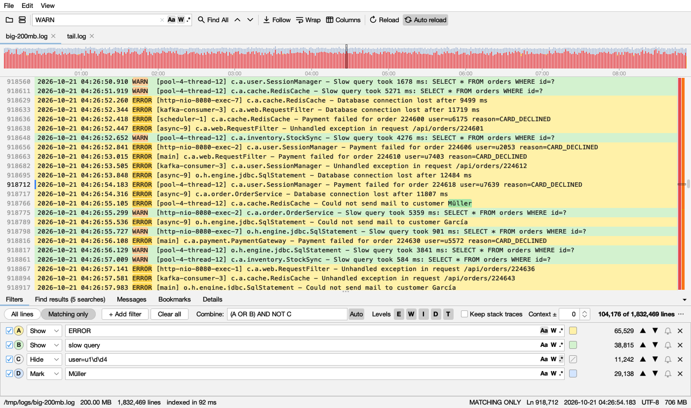

## Features

- **Huge files, instantly.** A 1 GB log shows its first lines in 0.12 s and is fully indexed in 0.26 s. Scrolling and jumping to any line stay smooth at any size.
- **Live tail.** Follow a growing log, including through rotation and truncation. You choose whether changes load automatically or only when you click Reload.
- **Find All.** Run several searches at once (text, whole word, regex, any case), each in its own color, and search within the results.
- **Filters.** Show, hide or mark lines and combine filters with AND, OR and NOT. Filter by log level and time range, keep stack traces with their line, and add context lines.
- **Timeline and highlight bar.** See error bursts at a glance and drag over a time range to zoom in.
- **Columns.** Time, level, thread, logger and message are parsed automatically. JSON logs and CSV files work too, with a pretty-printed details view.
- **Your own log formats.** Drop a log file and Logsift works out its layout, or paste your log4j, logback, java.util.logging or Python logging setup (even a whole `logback.xml` or `log4j2.xml`: each layout in it becomes a format). A live preview shows how lines split into columns.
- **Follow a request.** Right-click a line with a trace or request ID (or select any text) → **Follow**: the request's lines in order, across threads, open logs or a whole folder (zips too), with the time between them and the longest wait marked.
- **Tree of loggers.** Loggers (or threads, components, hosts) as a package tree beside the log, with line counts. Uncheck a branch to hide its lines, double-click one to see only it.
- **Zips, .gz files and the web.** Drop a `.zip` and it opens as a tab with its folders and files (zips inside it too); open any of them as a log, with everything a log has, merge them by time, or search them all. A `.gz` opens directly. Open logs from web addresses, or download several and search them together.
- **Folder search.** Search a whole folder in parallel, including inside `.gz` and `.zip` files, and zips inside zips.
- **Remote logs over SSH/SFTP.** Browse the server, pick a file, and it stays up to date as the remote log grows.
- **Analyze.** See the top messages by count, compare a bad run with a good one, and merge several logs by time.
- **Java threads.** Open thread dumps (jstack, jcmd, or `kill -3` output inside a log), or attach to a running JVM on your computer, on a server over SSH, or through its JMX port. Logsift points out deadlocks, threads queueing for a lock, stuck and busy threads and full thread pools, and shows each thread over time.
- **A log knows its JVM.** Open a log and Logsift names the JVM writing it, with its threads, profile and heap a click away. Right-click a line to see its thread's stack; from a thread, show only its lines.
- **Profiling and memory.** Flame graphs of a JVM's CPU, wall-clock time, allocations, live objects (memory leaks), locks, native memory and native leaks, calls of a method and slow calls, or hardware events, with async-profiler or the JVM's own Flight Recorder. Compare runs, see who calls a method, and find which classes fill the heap and keep growing.
- **Also:** bookmarks, alerts on new matching lines, export, sessions and recent files, many text encodings (UTF-8, UTF-16, Windows code pages, Shift_JIS, GB18030 and more), and light and dark mode.

## Download

Get the latest version from the **[Releases page](https://github.com/bdarwin/logsift/releases/latest)**:

| System | File |
|---|---|
| Windows (x64, ARM64) | `Logsift-<version>-windows-x64.msi` / `-windows-arm64.msi`: installer, no admin rights needed. Or the `.zip`: unzip, run `Logsift\Logsift.exe` |
| macOS (Apple Silicon, Intel) | `Logsift-<version>-macos-arm64.dmg` / `-macos-x64.dmg` |
| Debian / Ubuntu | `Logsift-<version>-linux-x64.deb` |
| Other Linux (x64, ARM64) | `Logsift-<version>-linux-x64.tar.gz` / `-linux-arm64.tar.gz`: unpack, run `Logsift/bin/Logsift` |
| Any OS with Java 21+ | `Logsift-<version>-any-java21.zip`: run `bin/logsift` |

The native downloads include their own Java runtime, so nothing else needs to be installed. They are not code-signed yet:
- **macOS:** if it says the app is damaged or can't be opened, run `xattr -dr com.apple.quarantine /Applications/Logsift.app`.
- **Windows:** if SmartScreen warns, choose **More info → Run anyway**.

Builds of the latest code are on the [snapshot release](https://github.com/bdarwin/logsift/releases/tag/snapshot). What changed in each version is in the [CHANGELOG](CHANGELOG.md).

## Opening logs

- **Files:** File → Open, or drag files onto the window. On Windows, right-click a file or folder → **Open with Logsift** (a folder opens a search in it); Logsift is also in the **Open with** list of `.log`, `.txt` and `.out` files, without taking over what double-click does. On macOS, use Open With or drop files on the Dock icon. If Logsift is already running, files open in the same window.
- **Zip and .gz files:** a `.zip` (File → Open, drag and drop, Recent files) opens as a tab showing its folders and files as a tree, also the files of zips inside it, with their sizes and a filter. Double-click a file (or select several and press **Open**) to open it as a log; **Merge by Time** merges the selected logs; **Search in All Files…** searches every file in it. A zip with one file opens that file right away, and a `.gz` file opens directly. A file from a zip is named by its place in it (`bundle.zip/logs/app.log`) and behaves like any log: its bookmarks, filters and format are remembered, and it is in Recent files and the last session. It is unpacked to a temporary copy once, when first opened.
- **Web addresses:** File → Open URL… (Ctrl+Shift+U) takes one or more `http`/`https` addresses, one per line, with an optional user and password or token (sent as a Bearer token). One address opens in a tab; several are downloaded into one temporary folder and searched together. A `.zip` or `.gz` download is unpacked as above. The file is a copy: it doesn't follow the server's file as it grows.
- **WSL (Windows):** File → Open from WSL… opens your Linux home folder. Windows reaches WSL files directly (`\\wsl.localhost\Ubuntu\…`), so they open and follow like any other file, without SSH.
- **Command line:** `logsift app.log other.log`. `logsift --version` prints the version.
- **Another program's output, live:** pipe it in with `-`:

  ```bash
  kubectl logs -f my-pod | logsift -
  docker logs -f my-app 2>&1 | logsift -
  journalctl -f | logsift -
  ```

  The output is saved to `~/.logsift/stdin/` as it arrives and followed like a growing log. Captures older than a week are removed. On macOS the command is `/Applications/Logsift.app/Contents/MacOS/Logsift`, and on Linux `/opt/logsift/bin/Logsift` (`.deb`) or `Logsift/bin/Logsift` (`.tar.gz`); add an alias for convenience.

## Help, updates and privacy

- **Help → Keyboard Shortcuts** (Ctrl+/ or ⌘/) lists every shortcut. **Help → Report a Bug** opens a GitHub issue with your version and system filled in.
- **Updates:** once a day Logsift asks GitHub for the latest release number, and a button appears in the toolbar when a newer version is out. That request carries nothing about you or your logs; turn it off with **Help → Check for Updates Automatically**.
- **Errors:** if something unexpected happens, a window shows the details with **Copy Details** and **Report on GitHub**. Errors are also written to `~/.logsift/errors.log` (Help → Open Error Log).
- Logsift never sends your logs anywhere. Its only other network connections are to servers you choose: SSH servers, JMX ports, and web addresses you open.

## Screenshots

| | |
|---|---|
| 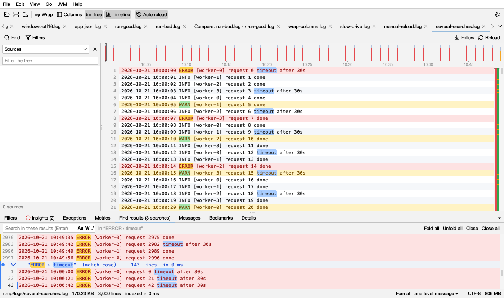 **Several searches at once**, with a search inside another's results | 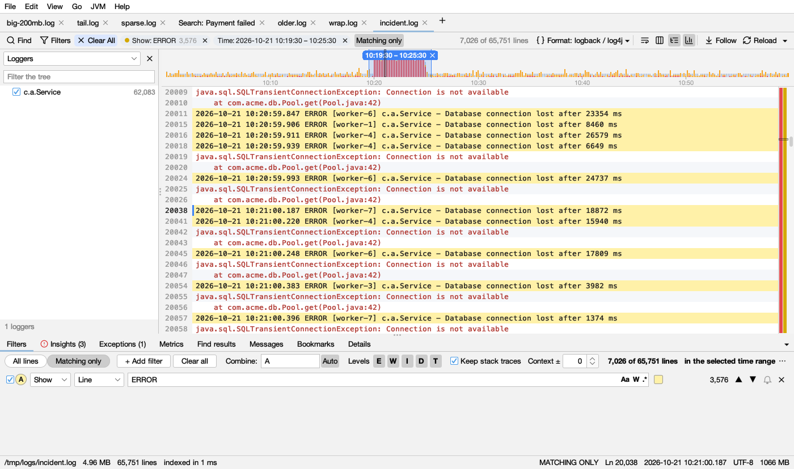 **Timeline**: select a time range, keep stack traces |
| 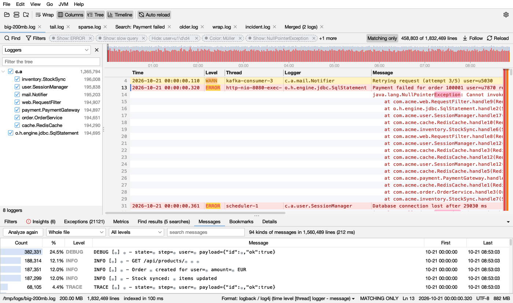 **Columns** and **top messages** | 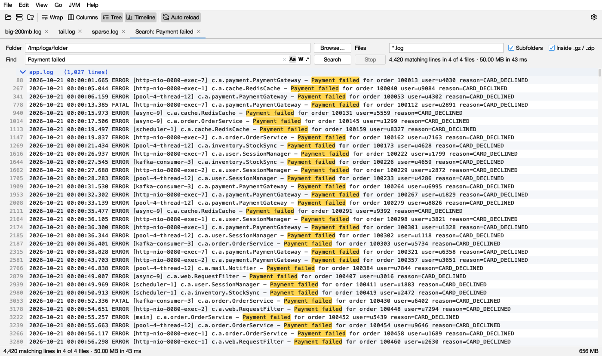 **Folder search**, including inside .gz and .zip |
| 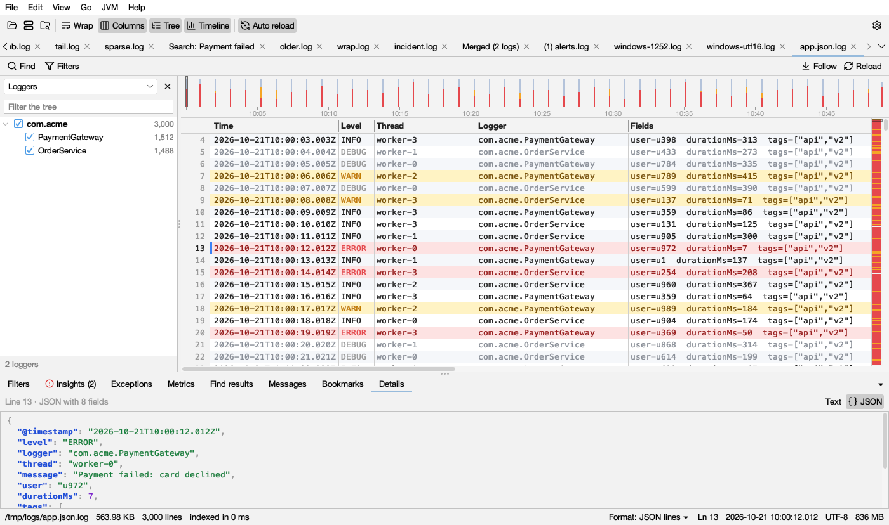 **JSON logs** with a details panel | 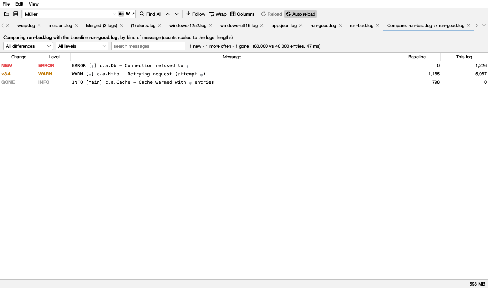 **Compare** a bad run with a good one |
| 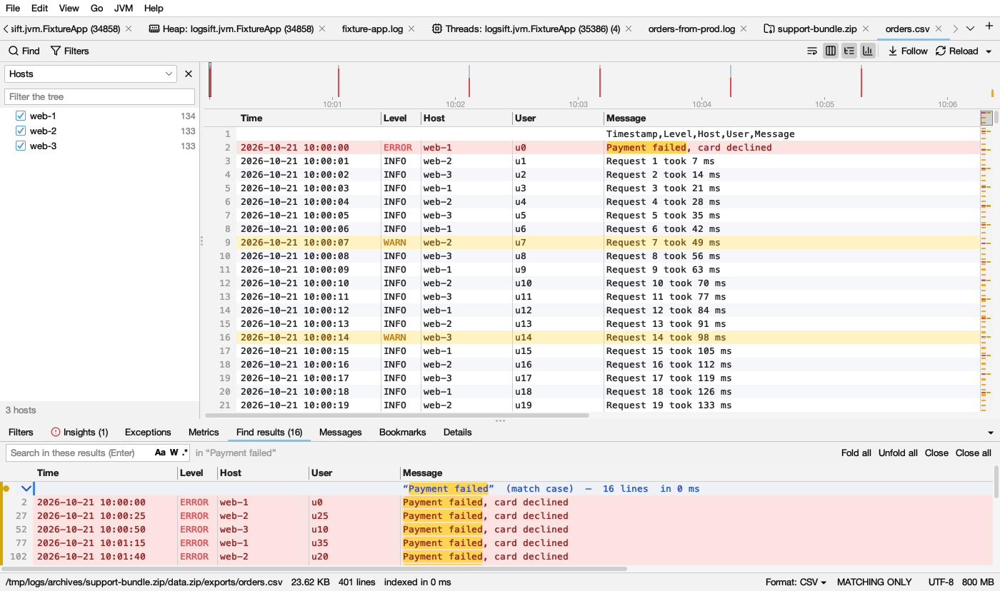 **CSV files** as columns, here from a zip inside a zip | 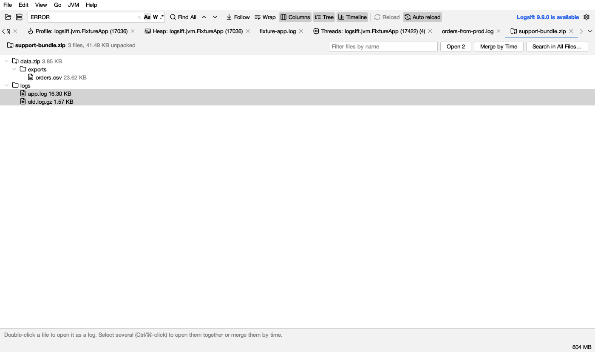 **Zips** open as a tab: open files as logs, merge or search them |
| 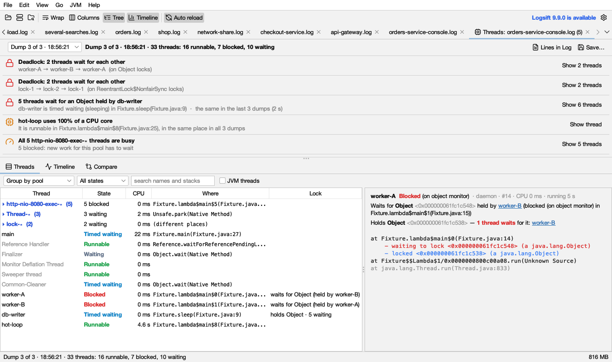 **Thread dumps**, explained | 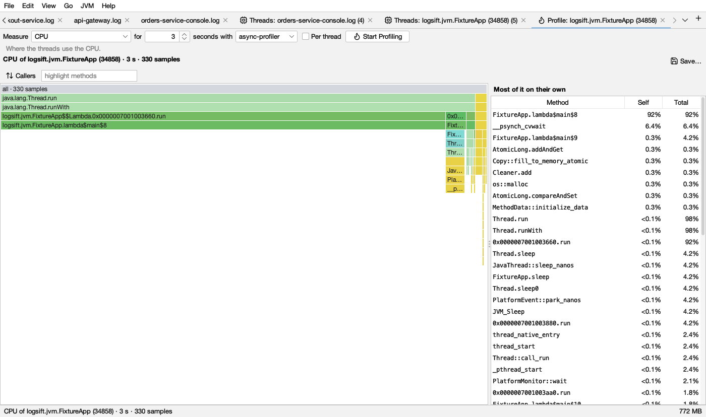 **Profiling** with a flame graph |
| 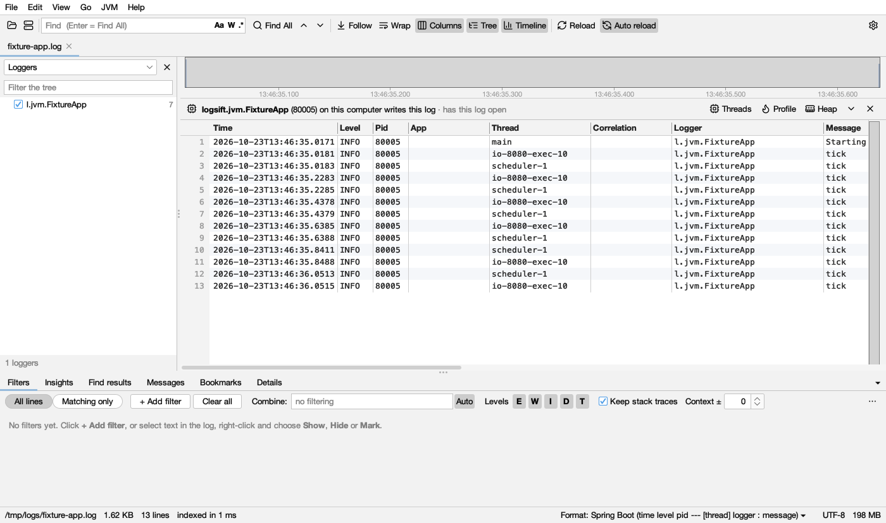 **A log knows its JVM** | 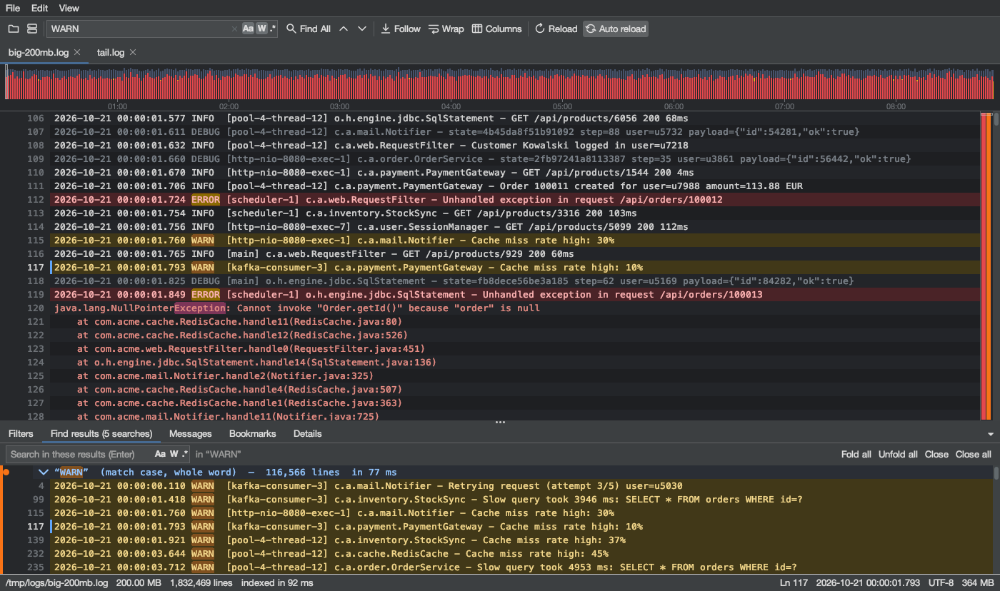 **Dark mode** |

## Run from source

```bash
./gradlew run --args="/path/to/app.log"     # or open files via File → Open / drag and drop
./gradlew installDist                       # launcher in build/install/logsift/bin/logsift
```

Make a test log:

```bash
./gradlew genLog -Pout=/tmp/sample.log -PsizeMb=500             # 500 MB realistic log
./gradlew genLog -Pout=/tmp/live.log -PsizeMb=5 -Pfollow=2000   # keeps appending 2000 lines/s
```

## Using it

| Action | Shortcut (macOS uses ⌘ in place of Ctrl) |
|---|---|
| Open files (or drag files onto the window) | Ctrl+O |
| Find All (results panel opens below) | type in the Find box, Enter |
| Match case / whole word / regex | `Aa` `W` `.*` buttons inside the Find box |
| Next / previous hit | F3 / Shift+F3 (also ⌘G / ⇧⌘G on macOS), or ▲ ▼ |
| Stop a running search | Esc in the Find box |
| Close results | Shift+Esc |
| Jump from a result to the line | click it, or move with the arrow keys in the results |
| Wrap long lines | Alt+Z (⌥Z on macOS), or the Wrap button (works in the Columns view too) |
| Next / previous error | F8 / Shift+F8 |
| Follow the current line's request (or the selected text) | Ctrl+Shift+R |
| Bookmark the current line | Ctrl+F2 (⌘F2 on macOS) |
| Next / previous bookmark | F2 / Shift+F2 |
| Search in a folder | Ctrl+Shift+F (⇧⌘F on macOS) |
| Merge logs by time | Ctrl+Shift+M |
| Open a remote log (SFTP) | Ctrl+Shift+O |
| Compare with another log | Ctrl+Shift+D |
| Columns view | Ctrl+Shift+K |
| Export lines shown by filters | Ctrl+Shift+E |
| Go to line | Ctrl+L |
| Go to time | Ctrl+Shift+L |
| Matching lines only / all lines | Ctrl+Shift+H (⇧⌘H on macOS) |
| Fold / open the bottom panel | Ctrl+J, the ▾ button, or double-click a tab |
| Follow the end of the file (tail -f) | Ctrl+T, the Follow button, or End |
| Load changes to the file | F5 or Reload (it lights up when the file changed); **Auto reload** loads them as they happen |
| Select text | drag; double-click = word, triple-click or click the line number = whole line; Shift+click extends |
| Copy | Ctrl+C (with nothing selected, copies the current line) · Select all: Ctrl+A |
| Search for the selected text | Ctrl+F (fills the Find box with the selected text) |
| Font size | Ctrl+= / Ctrl+- |
| Dark mode | View → Toggle Dark Mode |
| Tree of loggers | Ctrl+Shift+B |
| Settings | Ctrl+, (⌘, on macOS) |

## Folder search

**File → Search in Folder…** (Ctrl+Shift+F, ⇧⌘F on macOS), or drop a folder on the window, opens a search tab:

- Pick a folder, file name patterns (`*.log;*.txt`), and whether to include subfolders and archives.
- Rotated logs count as the log they came from: `*.log` also finds `app.log.1`, `app.log.2026-10-21`, `app.log.2.gz`, and `.log` files inside any `.zip`, also inside zips and `.gz` files within a zip (up to 5 levels deep).
- All files are searched in parallel with the same fast search as Find All. Binary files are skipped. Results are grouped by file and appear while the search runs.
- Double-click a line to open the file at that line, with Find All already run there. Files from `.gz` or `.zip` are unpacked to a temporary file first. Double-click a file name to fold it.

## Timeline

When a log has timestamps, a timeline above it shows how much was logged over time, with **errors in red and warnings in amber**, so incidents stand out at a glance. The box shows which part of the file you are looking at.

- **Click** the timeline to jump to that time. **Go → Go to Time…** (Ctrl+Shift+L) takes `10:05`, `10:05:30.250` or `2026-10-21 10:05`.
- **Drag** across it to show only that time range. The range works with the filters: drag over an incident, add an ERROR filter, and you see just the errors of the incident. Click ✕ on the range to show all times again.
- The status bar shows the time of the current line.
- Recognized formats: `2026-10-21 10:02:13`, ISO with `T`, `2026/10/21`, `21-10-2026`, `21.10.2026`, `21-Oct-2026`, syslog `Oct 21 10:02:13`, Apache `[21/Oct/2026:10:02:13 +0000]`, timestamps inside JSON lines, time only, and epoch seconds or milliseconds. Times are shown as written in the log (time zones are not converted).

## Bookmarks

**Ctrl+F2** (⌘F2 on macOS) bookmarks the current line (or right-click → *Bookmark This Line*); **F2 / Shift+F2** jump to the next / previous bookmark. Bookmarks show as blue dots by the line number and on the highlight bar. The **Bookmarks** tab lists them with their time and text; type a note in the Note column, double-click to go there, Delete to remove. Bookmarks are remembered per file, and dropped if the file was truncated (the lines would have moved).

## Text encodings

Logsift detects how a log's text is encoded: UTF-8 (with or without a byte order mark), **UTF-16** (as written by some Windows tools; with or without a byte order mark), and **Windows-1252** (Western European, used by older Windows programs). The status bar shows the encoding; **View → Encoding** reopens the log in another one (Latin-1, Cyrillic, Shift_JIS, GB18030 and more). UTF-16 logs are read through a UTF-8 copy that is kept up to date, so following a growing UTF-16 log works too. Folder search detects the encoding of each file.

## Recent files and sessions

**File → Open Recent** lists the last 15 files. When Logsift starts without a file to open, it reopens the logs that were open last time (**File → Reopen Last Session** does it any time). Every file remembers its filters, formula, level chips, *Matching only* and position, so reopening a log puts you back where you were; if the file got smaller in the meantime (truncated or rotated), it starts fresh.

## Export

**File → Export** saves lines to a new file: the **lines shown by filters** (Ctrl+Shift+E), the **Find results**, the **selected lines**, or **everything in the view**. The original bytes are copied (line endings and encoding unchanged), in runs of consecutive lines, so even large exports take seconds.

## Columns and levels

The **Columns** button (or View → Columns, Ctrl+Shift+K) shows lines as columns: **Time, Level, Thread, Logger, Message**, with the level colored and stack traces under the message. Logsift recognizes common layouts by itself: logback and log4j patterns, Spring Boot's default layout (with its process id), Python logging, syslog (host, process, pid), web server access logs (client, user, request, status, size), "time level message", and merged logs (a Source column). Drag a header edge to resize a column.

- **Count values:** right-click a column header (Thread, Logger, Host, Status…) → *Count Values* lists every value with its number of lines. Double-click one to show only its lines, or *Hide* it.
- **Hide columns:** right-click a column header → *Hide … Column*, or tick columns on and off in the same menu. The header shows **N columns hidden**; click it to see which, and **Show All Columns** brings them back. Hidden columns are remembered for each format.
- **Select text** in cells and messages as in the plain view: drag, double-click a word, Shift+click to extend.
- **Level chips** in the Filters bar (**E W I D T**) show only some levels, together with your other filters: turn off I, D and T to see just errors and warnings, stack traces included.

## Log formats

When Logsift doesn't know a log's layout, the Columns view says so and offers **Define Its Format…**. Formats are also under **View → Log Format → New Format from This Log** and in **Settings → Log Formats**. There are three ways to make one:

1. **Drop a log file** (or open one). Logsift guesses the layout from its lines (time, level, `[thread]`, logger, separators like `-` `:` `|`) and how its times are written, for example `dd.MM.yy HH:mm:ss.SSS`.
2. **Paste how your program logs:** a log4j, Log4j 2 or logback pattern such as `%d{HH:mm:ss.SSS} [%thread] %-5level %logger{36} - %msg%n`, a whole `logback.xml`, `log4j2.xml` or `log4j.properties`, a `log4j2.properties`, `.yaml` or `.json`, Spring Boot's layout, a Log4j 1.x XML config, a java.util.logging `logging.properties` (`SimpleFormatter.format`), or Python logging: a format such as `%(asctime)s %(levelname)s %(name)s: %(message)s`, a `logging.conf` or dictConfig (with `datefmt`), or `basicConfig(…)` in code. Dropping the config file works too. Properties the pattern uses (`${LOG_PATTERN}`, `${sys:PID}`, `${env:X:-default}`) are filled in from the same file. When the config has several appenders or formatters with different layouts, each becomes a format, named after its appender, and each log uses the one its lines fit.
3. **Write the pattern** yourself: `{time} {level} [{thread}] {logger} - {message}`. Columns go in braces and everything else is matched as written. `{time}` takes a timestamp and `{level}` a level word (also `E`, `ERR`, `warning`…). `{*}` skips a part, and other columns take everything up to the next character. A regex with named groups like `(?<level>…)` works too.

A preview shows sample lines split into columns, with the times as they are read. Lines that don't fit continue the entry above (stack traces). A format is used when most of a log's lines fit it, or always for the file names you give (`app*.log; *.trace`). The status bar shows the format each log is read with (**Format: …**). If Logsift picked the wrong one, click it (or use **View → Log Format**) to choose another for that file, which is remembered, or to show it as plain text. Levels in your format's level column drive the colors, the error marks and the **E W I D T** chips. Formats are saved in `~/.logsift/formats.properties`, so you can copy them to another computer.

## Insights

The **Insights** tab (next to Filters) tells you at a glance what is going on in the log. It fills in by itself once a file is read (for files up to 2 GB; bigger ones when you open the tab), and its title shows how many problems it found, so you can see them without clicking.

- A summary: the time the log covers, how many lines, errors and warnings.
- **Error bursts:** times when errors came much faster than usual, such as *10:42:00 – 10:44:58: 90 errors, 45× the usual rate*. **Show these minutes** shows just that time.
- **New errors:** errors that only began partway through, with when they started (and stopped), then the most frequent errors.
- **Silences:** stretches with no lines at all, when the program was stuck, stopped or not running.
- **Restarts:** the program started more than once.
- **Noise:** one message that fills a big part of the log; **Hide** it to see the rest.

Each finding has buttons to **Go to** its line, **Find all** of that message, **Show only** it or **Hide** it. **Refresh** looks again after the log grew.

## Following a request

Right-click a line → **Follow traceId 4bf92f…** (or press **Ctrl+Shift+R**), and the **Request** tab shows every line of that request in order: when it happened, the time since the line before (**After**), its thread, level and message. The top line sums it up: *6 lines · 2 threads · 10:02:19.097 → 10:02:27.337 (8.24 s) · 1 error · longest wait 8.20 s*, and the longest wait is marked, which is usually where the time went. Click a line to go there.

- **IDs it recognizes:** `traceId=…`, `request_id: …`, `X-Request-Id`, `"correlationId":"…"` and any other `…Id` / `…_id` key, the `[app,traceId,spanId]` and `[traceId-spanId]` that tracing libraries add, a W3C `traceparent`, and UUIDs. Process and thread ids (`pid`, `tid`) and span ids are left out. With several IDs on a line, traces come first, then requests. To follow anything else (an order number, a user), select it first.
- **Lines of its threads in between:** logs often name the ID on only some lines of a request. This adds the lines its threads wrote between its first and last line, until the thread names another request's ID (then it has moved on). These lines are dimmed.
- **Across files:** **In: This log / All open logs / Folder** picks where to look. With a folder (the log's own, or any folder or `.zip` you choose), every file in it is searched, also inside zips, zips in zips and `.gz` files unless **Inside zips and .gz** is off. Lines from all files are put in one order by time, with a **File** column; double-click a line of another file to open it there. Merged logs work too.
- **Find All** and **Show Only These Lines** run the same search in the log.

## Tree of loggers

Logs with a logger column (or class, component, thread, host…) get a tree on the left: `com.acme.db.Pool` sits under **com.acme › db**, with line counts. Uncheck a branch to hide its lines and their stack traces. Double-click a name, or right-click → *Show Only*, to see just that one; **Show all** brings everything back. The list at the top picks the column. Counts keep up while the log grows, and what you hid is remembered for the file. Close the tree with ✕, and bring it back with the **Tree** button or **View → Tree of Loggers** (Ctrl+Shift+B).

## Thread dumps and running JVMs

**JVM → Open Thread Dump…** reads `jstack` and `jcmd Thread.print` output, the plain and JSON files of `jcmd Thread.dump_to_file` (with virtual threads), and dumps saved by Logsift. A log with `kill -3` dumps in it (a console log, `catalina.out`, even `docker logs --timestamps` output) shows a bar offering **Analyze Threads**; **JVM → Analyze Thread Dumps in This Log** does the same for any open log. Several dumps in one file, taken some seconds apart, are read as a series.

The **Threads** tab starts with what stands out, worst first. Each finding has a **Show threads** button:

- **Deadlocks:** threads that wait for each other's locks (monitors and `ReentrantLock`s), as a chain.
- **Lock queues:** several threads waiting for one lock, who holds it and what that thread is doing.
- **Stuck threads:** in the same place in every dump (needs two or more dumps).
- **Busy threads:** the share of a CPU core each one used between dumps.
- **Full pools:** every thread of a pool (`http-nio-8080-exec-∗`) busy, so new work waits.
- **Growing thread count** across the dumps.

Below that:

- **Threads:** the threads of one dump, grouped by pool or by identical stack, filtered by state or by text in their names and stacks. Click one to see its stack: its own code in full color and the JDK's dimmed. It also shows the lock it waits for and who holds it, and the threads waiting for the locks it holds, each a link to that thread.
- **Timeline:** one row per thread and one cell per dump, colored by state. A stuck thread shows as one solid bar.
- **Compare:** which threads are new, gone, or doing something else between two dumps.

**JVM → Attach to a Running JVM…** (Ctrl+Shift+J) lists the Java programs running as you on this computer, or on a server over SSH (with the same login as remote logs). Pick one and its Threads tab can **Take Dump** or **Record…** several dumps some seconds apart. A dump pauses the JVM for a moment (usually milliseconds), and Logsift only reads: it changes nothing in the JVM.

- **On this computer** Logsift attaches the way the JDK's own tools do. If that isn't possible, it uses `jcmd` from a JDK folder you give.
- **On a server** it uses `jcmd`: from the JDK folder you give, the PATH, or the JDK the program itself runs on. Servers with only a Java runtime and no JDK tools work too: Logsift copies async-profiler to the server's `/tmp` and uses that. JVMs running as another user (`tomcat`, `app`) are reached with `sudo`. Logsift asks for the sudo password if it needs one and keeps it only while it runs. JVMs in containers are listed too.
- **Through a JMX port** (a JVM started with `-Dcom.sun.management.jmxremote.port=9010`), from anywhere, with no SSH: give the host and port, and the user and password if the port has them. Over JMX, Logsift takes thread dumps and heap histograms, and profiles with Flight Recorder, the recording sent back over the same port. Heap dumps and async-profiler need SSH or this computer.

### A log and its JVM

A log tab shows which JVM writes the log, in a bar above it, with **Threads**, **Profile** and **Heap** buttons. Logsift finds it by itself:

- **On this computer**, and on the server of a log opened over SSH: the JVM that has the log open (Linux and macOS; on Windows, by the process id the log names), the one it was linked to before, or the one the log names.
- **A log on a shared drive, or copied from a server:** Logsift reads what the log says about itself (Spring Boot's startup line names the program, its host and its process id) and which server the drive is on, and offers **Find Its JVM…** with those filled in.
- **Any log:** **JVM → Link This Log to a JVM…** picks the JVM by hand: on this computer, over SSH, or through a JMX port.

The link is remembered for the log and for the other logs in its folder, by program (`orders.jar`, `com.acme.App`), not by process id, so it finds the JVM again after a restart or a new version of the jar. The bar's menu links another JVM, or forgets the link.

Thread names connect the two:

- **Right-click a line → Show Thread in Threads** shows that thread's stack in a dump of the JVM, taking one if needed. A name the log cut short (Spring Boot keeps the last 15 characters, `nio-8080-exec-1`) still finds `http-nio-8080-exec-1`.
- **Lines in Log** in the Threads tab (or right-click a thread) shows only the lines that thread wrote. This works for dumps found in a log too.

**Save…** writes the dumps as a text file that opens again here, or in any other tool.

## Profiling

**Profile…** in the Threads tab of a running JVM shows where it spends its time, memory or lock waits. Choose what to measure, for how long, and **Start Profiling**. The JVM keeps running as usual.

| Measure | Shows |
|---|---|
| **CPU** | where the threads use the CPU |
| **Wall clock** | where they spend their time, running or waiting |
| **Allocations** | where memory is allocated, and for which classes |
| **Live objects (memory leaks)** | objects allocated during the run and still alive at its end: what makes the heap grow |
| **Locks** | where threads wait to get locks |
| **Native memory** / **Native memory leaks** | native allocations (malloc, direct buffers), or only those never freed |
| **Native locks** | waits for native (pthread) locks |
| **Calls of a method** | every call of a method you name (`com.acme.Api.handle`, `java.io.FileInputStream.read*`), and where it comes from |
| **Slow calls of a method** | calls slower than a time you give, with their total time |
| **Hardware event** (Linux) | cache misses, page faults, context switches, CPU cycles… |
| **Everything at once** | CPU, wall clock, allocations, live objects, locks and native memory from one run |

**Per thread** gives each thread its own flame graph.

The result is a **flame graph**: the outermost calls on top, what they call below, each as wide as its share. Green is Java code (paler for the JDK's own), yellow native code, orange the kernel, and teal the class an allocation was for. To look closer:

- **Click** a frame to zoom into it.
- **Right-click** a frame for **Callers of** it (who calls it, all the way up), **Only Stacks Through** it or **Hide Stacks Through** it.
- **Callers** turns the whole graph upside down: where the time is first, then who called it.
- **highlight methods** colors the frames that match the text and shows their share.
- **Most of it on their own** lists the methods with the most; click one to highlight it.

Every run stays in the tab. **Compare with** an earlier run colors each frame by how its share changed: red grew, blue shrank. The method list then gets a **Change** column.

Two engines:

- **async-profiler** (built in, for JVMs on Linux and macOS) offers every mode above, and also sees native code and the kernel. On Linux, CPU profiling uses perf events when the kernel allows them, and a timer otherwise (Logsift says so).
- **Flight Recorder**, built into the JVM, works on any JVM with JFR, Windows included. It measures CPU, wall clock, allocations and locks, all from one recording.

**Save…** writes collapsed stacks. They open again with **JVM → Open Profile…**, along with `.jfr` recordings (each kind of event in them becomes a view).

## The heap

**Heap…** in the Threads tab of a running JVM shows what fills its heap, by class: how many objects, their size, and their share.

- **Take Histogram** now, and again a little later. The **Size change** and **Objects change** columns show what grew; the classes that keep growing are where memory leaks.
- **Only live objects** runs a full garbage collection first, so only objects still in use are counted. That pauses the JVM, longer for big heaps. Turn it off to count without the pause, garbage included. Compare histograms of the same kind.
- **Save Heap Dump…** writes every object to a `.hprof` file for a heap analyzer. It pauses the JVM while it is written, and the file is about as big as the heap. From a server, it is copied over SSH.

## Settings

**Settings** (Ctrl+, or Logsift → Settings on macOS) has the font and its size, tab width, line stripes, the timeline, dark mode, the encoding for text that isn't UTF-8 (for example Shift_JIS or GB18030), how often files are checked for changes, whether the last session reopens at start, update checks, and your log formats.

## CSV files

A `.csv` or `.tsv` file is read as a table: its header row names the columns and each row is split into them, by comma, semicolon, tab or `|` (whichever the file uses), with quoted fields (`"a, b"`, `""` for a quote) handled. Columns named like a time, level, thread, logger or message (`timestamp`, `severity`, `msg`, …) are used as such: the timeline uses the time column, and levels color the rows. Other columns keep their names and appear in the tree beside the log, where unchecking a value hides its rows. Files with other names are read as CSV when they clearly are one (a header of names, then rows with the same number of fields), or choose **CSV** in the status bar's format menu. A quoted field over several lines is shown as continuing its row.

## JSON logs

Logs with one JSON object per line are recognized. With **Columns** on, the usual fields become columns (`@timestamp`/`ts`/`time` → Time, `level`/`severity` → Level, `thread`, `logger`, `message`/`msg`) and the rest are shown together in a Fields column. The timeline uses ISO times or epoch milliseconds in the JSON. The **Details** tab (next to Filters) shows the current entry in full (a line with its stack trace), or just the text you selected (several lines, or part of one). Its **Text | JSON** switch pretty-prints the JSON in it with colors, also JSON in the middle of a message, and opens up JSON written inside strings. A JSON line or selection is shown pretty-printed by itself; click **Text** to see it as written.

## Remote logs (SSH / SFTP)

**File → Open Remote (SFTP)…** (Ctrl+Shift+O, or the server button in the toolbar): enter the host, user, and a password or private key (`~/.ssh/id_ed25519` or `id_rsa` is suggested), then **Connect**. Pick the log in the file browser: type a folder in the address bar (`/var/log`, `~/logs`, or a name relative to the folder shown) and press Enter, or double-click folders (`..` goes up, Backspace too); double-click a file or press **Open**. Load the whole file or just the last N MB. LogSift keeps a local copy up to date while the remote log grows (new bytes are fetched every second), starts over when it is truncated or rotated, and reconnects by itself if the connection drops (the status bar says so). Host keys are checked against `~/.ssh/known_hosts`; for a new server you are asked first. It remembers the server, user, key and last folder per server, never passwords. Every feature works on remote logs.

## Merge logs by time

**File → Merge Files by Time…** (Ctrl+Shift+M) merges several logs (say, the same app on two nodes, or an app log and its server log) into one view in timestamp order. Each line starts with a label like `<node2-app>` and a colored stripe, so you can see where it came from; right-click → **Show Only Lines from <node2-app>** filters to one source. Stack traces stay with their log line. The merged view is an ordinary log, so filters, the timeline, messages and search all work on it, and it keeps updating while the source logs grow.

## Top messages

The **Messages** tab (next to Filters) groups the log's lines into kinds of messages and counts them, most frequent first. Variable parts (numbers, IDs, hosts, durations, user names) are shown as ∗, so `ERROR [worker-7] Database connection lost after 26579 ms` and `ERROR [worker-2] Database connection lost after 812 ms` count as one message. Stack traces count with their log line.

- Use it to answer "what is actually going wrong?" in seconds: pick **Errors** in the level list.
- **Double-click** a message to find all its lines (and jump to the first one).
- **Right-click → Hide these lines** to remove noisy messages, or **Show only these lines**. Select several messages to hide them all at once.
- **Lines shown by filters** counts only the lines your filters and time range show.
- It is fast: 1.56 million entries are grouped in about 0.25 s.

## Compare two logs

**File → Compare With…** (Ctrl+Shift+D) compares the current log with a baseline, for example the log of a run that went well. Comparing line by line is useless for logs (every timestamp differs), so Logsift compares **kinds of messages** (as in the Messages tab): what is **new** in this log, what is **gone**, and what happens much **more** or **less** often, with counts scaled to the logs' lengths. New errors come first. Double-click a row to find all its lines in the log that has them.

## Highlight bar

A narrow bar beside the scrollbar shows the whole file at a glance. It has red marks for errors (ERROR, FATAL, SEVERE, CRITICAL), amber for warnings, a second lane for Find All hits and colored filters, and a box showing where you are. Click a mark to jump to that line; hover to see it. F8 / Shift+F8 jump to the next or previous error. The marks stay up to date while the file grows.

## Filters

The **Filters** panel below the log holds any number of filters (up to 26). Each one has:

- a letter (A, B, C, …) for use in the formula
- an action: **Show** keeps matching lines, **Hide** removes them, **Mark** only colors them
- the text to match, with the same `Aa` / `W` / `.*` options as Find
- a line color, a live count of matching lines, and ▲ ▼ to step through its matches

**Combine** says how filters work together. In **Auto** mode it is "any Show filter, and no Hide filter", for example `(A OR B) AND NOT C`. Type your own to get anything else: `A AND B`, `(A OR B) AND NOT (C OR D)`, `NOT C`. `AND OR NOT ( )` work, and so do `& | ! -`.

**All lines / Matching only** (Ctrl+Shift+H, ⇧⌘H on macOS) switches between every line, with filtered-out lines grayed, and only the lines that pass. Your place in the file is kept when you switch, so you can filter down, click a line, switch back and see everything around it.

**Keep stack traces** (on by default) treats a log line and the lines under it (stack traces, wrapped messages) as one entry: if any line of the entry matches, the whole entry is shown, and Hide filters hide whole entries. Logsift detects how entries start from the first lines of the file (a date, a time, a syslog date, a level word, or `{` for JSON lines); the checkbox tooltip shows what it found. **Context ±N** adds N grayed lines before and after each match, with a dashed line where lines were skipped, like `grep -C`.

**Alerts:** click the bell on a filter to be told when new lines matching it are written (while the file grows). Logsift shows a desktop notification and a popup you can click to jump to the line, beeps, and puts a count on the tab. Bursts are combined (at most one alert per filter every 3 seconds). Lines that were already in the file don't alert.

**Clear all** (next to + Add filter) removes every filter, turns all levels back on and clears the time range. In Find results, **Close** removes the selected search, **Close all** removes every one, and the ✕ in the Find box closes the selected search.

Quick ways to add filters: select text in the log, right-click, then choose **Show / Hide / Mark lines with "…"**. Filter sets can be saved and loaded (the ⋯ menu), and filters keep working while the file grows.

**Several searches at once:** each Find All is added to the top of the Find results window and opens there, while earlier searches fold to a header line (“ERROR” — 1,234 lines) and stay available. Click a header (or its chevron) to fold or open it; with the keyboard, Enter, Left and Right do the same. **Fold all** / **Unfold all** do every search. Every search has its own color in the log and on the highlight bar. Running a search you already have moves it back to the top. F3 / Shift+F3 step through the selected search's hits.

**Search within results:** select a search (or any of its lines), type in **Search in these results** and press Enter. A nested search like “ERROR › timeout” appears under it, showing only the lines that match both. You can keep narrowing it further, and closing a search also closes the searches nested in it.

Find All keeps running on a growing file. New matching lines show up in the results as they are written, including nested searches.

## Measured speed

These numbers come from `./gradlew visualTest` on an Apple Silicon Mac (10 cores, 32 GB RAM). The file had just been generated, so it was already in the OS file cache. With a cold cache, the disk speed sets the limit.

| | 1 GB, 9.4M lines | 3 GB, 28.1M lines |
|---|---|---|
| First lines on screen | 0.12 s | 0.22 s |
| Full line index built | 0.26 s | 1.1 s |
| Jump to any line + repaint | ~10 ms | ~6 ms |
| Find All `ERROR` (literal, 335k / 1M hits) | 0.17 s | 0.58 s |
| Find All `WARN` (whole word) | 0.15 s | 0.38 s |
| Find All `müller` (ignore case, non-ASCII) | 0.19 s | 0.45 s |
| Find All regex `Payment failed .* user=u12\d4 ` | 0.12 s | 0.37 s |

Filters on a 200 MB log (1.8M lines): four filters with formula `(A OR B) AND NOT C` take 0.2 s. Changing only the formula takes about 2 ms, because the filters' results are kept and only merged again.

Heap use stays at a few hundred MB for these sizes. The index costs about 12 MB per 100M lines.

**Stress test** (`./gradlew stress -PstressGb=10`, same Mac, 2 GB heap as in the installed app):

| | Time |
|---|---|
| 10 GB log (93.6M lines): first lines / full index | 0.01 s / 2.6 s |
| Jump to the end, or 20 random jumps | under 10 ms |
| Find All: 0.9M / 3.4M / 5.1M (regex) hits | 1.7 s / 1.9 s / 3.0 s |
| Filter `ERROR AND NOT timeout` | 3.5 s |
| Timeline / tree of loggers | 1.9 s / 10 s (in the background) |
| One 200 MB line: open / search it | 0.02 s / 0.17 s |
| 300 million short lines (3 GB): full index | 0.4 s |

The heap stayed under 500 MB through all of it.

## Tests

```bash
./gradlew test                       # fast unit tests (index, tail, search vs simple reference code)
./gradlew visualTest                 # opens a generated 1 GB log in the real UI
./gradlew visualTest -PsizeMb=3072   # same with 3 GB
```

`visualTest` generates `build/visual/big-<N>mb.log` (and reuses it on later runs). It then drives the real window and checks the following against independent, plain-Java reference code:

- the line count
- 25 random lines read straight from the file
- hit counts for literal, whole-word, Unicode and regex searches
- F3 and Shift+F3 navigation
- live search while 10k lines are being appended
- log rotation

It saves screenshots and a timing summary to `build/screenshots/`. Delete `build/visual` when you need the disk space back.

## How it works

For the full, educational explanation (sparse index, SWAR byte search, the regex pre-filter, filter merging, tail and rotation, and lessons learned), see **[docs/how-it-works.md](docs/how-it-works.md)**. Short version:

```
logsift.core   (no UI code; could later back a VS Code extension or a CLI)
  FileSource      positional reads (pread), safe from many threads
  LineIndex       sparse index: chunks of 4 MB; offset of every 64th line
  LogDocument     open file + index + tail polling (growth, truncation, rotation)
  ByteScan        newline/byte search 8 bytes at a time (SWAR)
  LineMatcher     literal byte search, regex, or literal pre-filter + regex
  RequiredLiteral finds text every regex match must contain (ripgrep's trick)
  SearchSession   parallel Find All, hits published in line order, follows growth
  Formula         AND / OR / NOT of filter letters (parser and auto formula)
  FilterEngine    one live search per filter; merges their sorted hits by the formula
  FilterResult    the passing lines: a sorted list, or "all lines except a list"
  FolderSearch    parallel search of a folder's files, streaming; .gz and .zip inside
  Archives        a zip's files (zips inside too), unpacking one; UrlFetch downloads over HTTP(S)
  EntryFormat     how entries start (date, time, level...), to keep stack traces together
  TimeFormat      timestamp formats parsed from bytes; TimeIndex: a time every ~64 lines
  MessageStats    groups lines into message templates; LogCompare compares two logs
  LogFormat       columns (regex with named groups, JSON fields, or CSV); ColumnStats counts values
  LogMerger       merges logs by time; Encoding / Utf16Mirror; RemoteMirror (SFTP)
  LineExporter    copies chosen lines' original bytes to a file
logsift.jvm     (thread dumps and running JVMs)
  DumpParser      jstack / jcmd / kill -3 text (also inside logs), dump_to_file plain and JSON
  ThreadAnalysis  deadlocks (cycles of lock waits), lock queues, stuck and busy threads, pools
  LocalJvms       attach + JMX (the JVM's own diagnostic commands), or jcmd
  SshJvms         ps, jcmd or async-profiler over SSH, sudo for other users' JVMs
  JmxJvms         a JMX port: diagnostic commands, Flight Recorder streamed back
  LogOrigin       which JVM writes a log: who has it open, what it says, its file server
  JvmLink         a log's JVM, remembered by program
  Profiler        async-profiler (every mode) or Flight Recorder → Profiles (trees of stacks)
  HeapHistogram   GC.class_histogram, and what grew between two
logsift.ui
  LogView         virtual view: paints only visible rows; scrollbar counts rows
  LogTab          log view + Filters and Find results panels for one file
  FilterPanel     the filter rows, formula field and All lines / Matching only switch
  OverviewBar     highlight bar beside the scrollbar (errors, warnings, filters, hits)
  FolderSearchTab folder search form and results grouped by file
  TimelineBar, MessagesPanel, BookmarksPanel, DetailsPanel, CompareTab, ColumnLayout ...
  ThreadsTab, ThreadTimeline, ProfileTab, FlameGraph, HeapTab, JvmDialog, JvmBar
  MainFrame       window, toolbar, menus, status bar, drag & drop
logsift.tools
  LogGenerator    realistic reproducible logs (levels, threads, stack traces, Unicode)
```

Design choices:

- **No memory mapping.** On Windows, a memory-mapped file can't be renamed or deleted, which breaks log rotation for the app that writes it. Mappings are also limited to 2 GB each. Positional reads through the OS cache are nearly as fast.
- **Sparse index.** It stores the position of every 64th line per 4 MB chunk. Chunks are scanned in parallel and published in order, so the top of the file shows up immediately. When following a growing file, a short last chunk is re-scanned together with the new data.
- **Custom view instead of JList/JTable.** Swing's own lists measure in pixels and overflow at around 100M rows. LogView's scrollbar counts rows, which supports up to about 2.1 billion lines.
- **Search never decodes lines unless it must.** Plain text is matched on raw UTF-8 bytes. A regex runs only on lines that contain its required text, when there is one.
- **Tail detection works on every platform.** It polls the file every 500 ms. It detects rotation by a changed file ID (inode), and on Windows by a smaller file appearing at the same path. It detects truncation by a smaller size or changed first 256 bytes. The view and the running search restart automatically.

## Known limits

- **Highlight rules are built in** (ERROR/FATAL, WARN, stack traces, DEBUG/TRACE). Filters with colors cover most needs; there is no rule editor yet.
- **Very long lines:**
  - Lines over 64 KB are cut for display. Search still sees the whole line.
  - A single line over 256 MB is only searched in its first 256 MB.
- **Logs from zips and the web** are copies made when opened; they don't follow the original.
- **Merged logs and remote logs** are local copies: they keep up while the sources grow, but entries that arrive late in a merge are appended, not inserted in time order.
- **Time zones** are not converted: times are shown as written in each log.
- **Thread dumps** of HotSpot JVMs (OpenJDK, Oracle, Temurin, Zulu, Corretto and the like) are read. OpenJ9 `javacore` files are not.
- **async-profiler** runs on Linux (x64, ARM64) and macOS JVMs; for JVMs on Windows, use Flight Recorder.
- **Tested** on Windows, macOS and Linux by CI (unit and visual tests, including log rotation by logback on Windows). The downloads are not code-signed yet.

## Roadmap

Ideas for next versions: continuous profiling of a running JVM, editable highlight rules and signed installers. Suggestions and bug reports are welcome in [Issues](https://github.com/bdarwin/logsift/issues).

## Contributing

Bug reports, ideas and pull requests are welcome: see [CONTRIBUTING.md](CONTRIBUTING.md).

## License

[MIT](LICENSE) © 2026 bdarwin

Logsift includes [async-profiler](https://github.com/async-profiler/async-profiler) (Apache License 2.0) for profiling and for thread dumps on servers without JDK tools.
