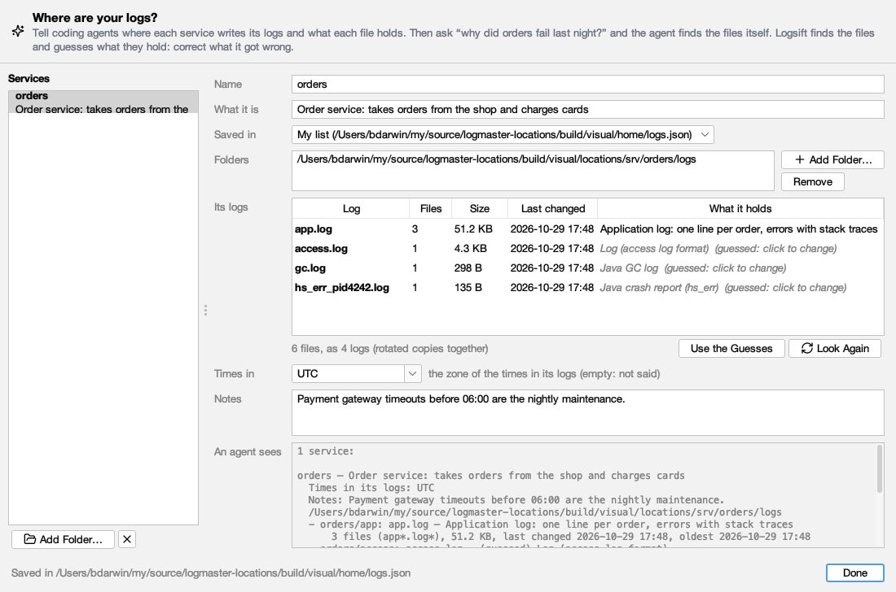

# Coding agents

A coding agent such as GitHub Copilot can ask Logsift about your logs. You ask in the agent's chat, for example *"why is orders.log full of timeouts?"*. The agent calls Logsift, and Logsift reads the file on your computer and answers with short summaries and line numbers, never whole files. The agent can then search and read the lines around what it found.

It works with GitHub Copilot in VS Code, Visual Studio and JetBrains IDEs, with Copilot CLI, and with any other agent that supports MCP (the Model Context Protocol).

## Setting it up

1. Open **Settings → Agents**.
2. Choose your agent in the **Agent** list. Under it, Logsift says where the setup goes and shows it, with the path of `logsift-mcp` on this computer filled in.
3. Click **Copy** and paste it into the agent's MCP settings. Merge it with what is already there.
4. VS Code: choose **Agent** mode in Copilot Chat. Logsift's tools are under the tools button. Copilot CLI: start `copilot` again.

`logsift-mcp` comes with Logsift:

| System | Where |
|---|---|
| Windows | next to `Logsift.exe` |
| macOS | `Logsift.app/Contents/MacOS/logsift-mcp` |
| Linux | `bin/logsift-mcp` |
| The zip for any Java | `bin/logsift-mcp` |

A Logsift run from a source build has no `logsift-mcp`, so the tab says so and **Copy** is off.

Other agents: add a local (stdio) MCP server called `logsift` that runs `logsift-mcp`, with no arguments.

## GitHub Copilot CLI

1. Add Logsift with one command in a terminal, giving the path of `logsift-mcp` after `--` (see the table above; **Settings → Agents** shows it):

   ```sh
   # macOS
   copilot mcp add logsift -- /Applications/Logsift.app/Contents/MacOS/logsift-mcp
   # Linux (.deb; from the .tar.gz it is Logsift/bin/logsift-mcp where you unpacked it)
   copilot mcp add logsift -- /opt/logsift/bin/logsift-mcp
   # Windows (PowerShell; the installer puts Logsift in your own AppData folder)
   copilot mcp add logsift -- "$env:LOCALAPPDATA\Logsift\logsift-mcp.exe"
   ```

   Or, by hand: open **Settings → Agents**, choose **GitHub Copilot CLI**, click **Copy**, and paste it into `~/.copilot/mcp-config.json` (on Windows `%USERPROFILE%\.copilot\mcp-config.json`). If the file already lists other servers, add `"logsift": {…}` next to them inside `"mcpServers"`. In this file, a Windows path has each `\` written twice (`"C:\\Users\\you\\…"`). **Copy** does that for you.

   ```json
   {
     "mcpServers": {
       "logsift": {
         "type": "local",
         "command": "/Applications/Logsift.app/Contents/MacOS/logsift-mcp",
         "args": [],
         "tools": ["*"]
       }
     }
   }
   ```
2. Check it: `copilot mcp list` lists **logsift**, and `copilot mcp get logsift` shows its command.
3. Start `copilot` (start it again if it was running).
4. Ask in plain words, naming the file:
   - *What went wrong in ~/logs/orders.log last night?*
   - *Why did orders fail last night?* (with [your log locations](#where-your-logs-are) described)
   - *Group the exceptions in /var/log/app/app.log and tell me which started after 10:00.*
   - *Is the GC in ~/gc.log healthy?*

The first time it uses a Logsift tool, Copilot CLI asks whether to allow it; choose to allow it for the session (or always). Logsift's tools only read. To skip the question, start it with `copilot --allow-tool=logsift`.

To remove it: `copilot mcp remove logsift`.

If logsift isn't listed, or its tools fail:
- The path in `command` is wrong. Run it in a terminal: `logsift-mcp --version` should print the version.
- The file isn't valid JSON. A missing comma between two servers is the usual cause.
- **What Agents Asked…** (below) stays empty until the agent calls a tool. Each call is listed there.

## Where your logs are

Without help, an agent needs a path in every question. Tell Logsift where each service writes its logs, and ask *"why did orders fail last night?"*: the agent calls `list_logs`, sees that `orders` writes `app.log` (the application log, with 14 rotated copies) and `gc.log` in `/var/log/orders`, and opens the right file itself.



Open **File → Log Locations for Agents…** (it starts from the log you are looking at), **Describe for Agents…** in a folder's tab, or **Log Locations…** under Settings → Agents:

1. **Add Folder…** and choose the folder a service writes its logs to. Logsift names the service after the folder (the one above a `logs` folder: `/srv/orders/logs` is *orders*).
2. **What it is**: one line, such as *Order service: takes orders from the shop and charges cards*.
3. **Its logs**: Logsift finds the files in the folder (and its subfolders, three deep), puts each log together with its rotated copies (`app.log`, `app.log.1`, `app.2026-10-27.log.gz` are one log), and guesses what each holds (*Java GC log*, *CSV: order_id, placed_at, amount*, *Log (logback format)*, *Java crash report*). The guesses are gray. Click one to say it better, for example *Application log: one line per order, errors with stack traces*, or **Use the Guesses** to keep them.
4. **Times in**: the time zone of the times in its logs, if it isn't this computer's.
5. **Notes**: anything an agent should know, such as *payment timeouts before 06:00 are the nightly maintenance*.
6. **An agent sees** shows exactly what `list_logs` will answer.

Agents read only the folders allowed under **Folders agents may read** (your home folder unless you chose others). If a service's folder is outside them, a bar says so, and **Let Agents Read Them** adds it.

**Saved in** chooses where the service is kept:

- **My list**: `~/.logsift/logs.json`, for you.
- **A project's folder…**: `.logsift/logs.json` in that project. Commit it, and your team's agents know the logs too. Its folders may be relative to the project (`build/logs`). When an agent is started in that project (or below it), it reads this list as well. A service in the project's list wins over one of the same name in yours.

### Sharing with your team

The lists are written to work on other computers:

- A folder inside the project is saved relative to it (`build/logs`).
- A folder in your home folder is saved as `~/…`.
- A folder can name environment variables, each computer filling in its own: `${LOG_DIR}/orders`, or `${ORDERS_LOGS:-/var/log/orders}` with a default. A folder whose variable isn't set on a computer is skipped there.

Three ways to share:

- **Commit the project's list**: choose **Saved in → A project's folder…** and commit `.logsift/logs.json`. Everyone who starts an agent in that project gets it.
- **Share → Copy as Text** (or **Copy All as Text**) and send it in a chat or an email. The one who gets it chooses **Share → Paste Services**.
- **Share → Export to a File…** and **Import a File…**: a `logs.json` to put on a wiki or a shared drive. Importing a service with the same name as one you have replaces yours.

`logsift-mcp --logs FILE` reads one more list, for example one on a shared drive. The lists are read again on each call, so changes count at once.

The file is plain JSON, if you prefer to write it by hand:

```json
{
  "services": [
    {
      "name": "orders",
      "description": "Order service: takes orders from the shop and charges cards",
      "folders": ["/var/log/orders"],
      "files": [
        { "pattern": "app*.log*", "description": "Application log: one line per order, errors with stack traces" },
        { "pattern": "gc*.log", "description": "GC log (G1)" }
      ],
      "timeZone": "UTC",
      "notes": "Payment timeouts before 06:00 are the nightly maintenance."
    }
  ]
}
```

## What the agent can ask

| Tool | What it does |
|---|---|
| **list_logs** | Your services and where their logs are (see [Where your logs are](#where-your-logs-are)): each kind of log with what it holds, rotated copies counted together, sizes and when they last changed |
| **open_log** | Opens a log (also a `.gz` file, or a file inside a zip), by its path or by a name from `list_logs` (`orders/app` opens the newest `app.log`), and gives back a short name for it (`log:1`), its format, size, line count and time range |
| **list_open** | The logs open so far |
| **insights** | What happened in the log, most important first (error bursts, new errors, restarts, known problems) |
| **exceptions** | Exceptions grouped by root cause, with counts and where they first and last appear |
| **search** | Lines that match a text or regex, in a range of lines if asked |
| **read_lines** | Lines from a line number on |
| **top_messages** | The most frequent messages, with numbers replaced by placeholders |
| **metrics** | How long things took, and numbers in messages |
| **search_folder** | Every file in a folder that contains a text, inside zips and `.gz` files too; give a service's name to search all its folders |
| **analyze_gc** | Explains a GC log: pauses, time stopped, heap after collections, and what to tune |
| **analyze_threads** | Explains thread dumps: deadlocks, lock queues, stuck and busy threads |
| **analyze_crash** | Explains a crash file: a Windows dump (`.dmp`, `.mdmp`) or a Java `hs_err_pid` file. What happened, the code to blame, the crashed thread's stack, what other threads and libraries may have caused it, and what to try |
| **crash_threads** | The threads of a crash file with their stacks, threads with the same stack together; filter by name, state or function |
| **crash_modules** | The DLLs or shared libraries loaded in the crashed process, with versions and paths |

Line numbers in answers start at 1, like in the log view. Times are the log's own times.

From a crash file the agent gets only the explanation: stacks, modules and facts. It never gets the process's memory that a dump holds.

Long answers are cut, and say where. Slow work, such as a first look at a multi-GB log, goes on in the background. The agent is told to ask again in a few seconds.

## What it can't do

- Change, move or delete any file.
- Run commands, connect to servers, or touch a running JVM.
- Read outside your home folder, or outside the folders listed under **Folders agents may read**. The current folder also counts when it is outside your home folder.
- Read files that hold keys or passwords, even through a link:
  - `~/.ssh`, `~/.aws`, `~/.gnupg`, `~/.kube`, `~/.docker`;
  - `.env` files, `credentials`, `id_rsa`;
  - `*.pem`, `*.key`, `*.p12` and other key stores.

## What is masked

Everything Logsift answers goes to the agent's AI provider, under your agreement with them. Before an answer leaves Logsift, it replaces what you chose to mask with `‹masked:…›`, for example `token=‹masked:secret›`, and says how many values it masked.

| Setting | Default | What it masks |
|---|---|---|
| **Secrets** | on | Passwords and secrets in `key=value` pairs, bearer tokens, JWTs, API keys (AWS, GitHub, Slack, Google, OpenAI, Anthropic and similar), passwords in web addresses, private keys, card numbers |
| **Email addresses** | off | `name@example.com` |
| **IP addresses** | off | IPv4 and IPv6 addresses |
| **Your own patterns** | none | One regular expression per line, for example customer numbers or host names. A pattern with a mistake is shown in red under the list and isn't used |

Changes apply the next time the agent starts Logsift. Agents usually start it when you open a new chat or restart the agent.

Text from logs is passed on as data. Logsift tells the agent never to follow instructions found in a log.

## What agents asked

**What Agents Asked…** opens `~/.logsift/agent.log`. Each line is one call, with:
- the time;
- the agent;
- the tool and its arguments, masked;
- how long the answer was;
- the outcome: *ok*, *still working*, *refused*, *cancelled* or *failed*.

The answers themselves are never kept.

## From a terminal

`logsift-mcp --help` lists the options. The command line wins over Settings → Agents.

| Option | What it does |
|---|---|
| `--root FOLDER` | Allow reading under this folder (can be given several times) |
| `--mask-emails`, `--mask-ips` | Also mask email addresses or IP addresses |
| `--mask REGEX` | Also mask your own pattern |
| `--no-mask` | Don't mask secrets |
| `--max-chars N` | The longest answer, in characters |
| `--version` | Print the version |

*GitHub Copilot is a trademark of GitHub, Inc. Logsift is not affiliated with or endorsed by GitHub.*
