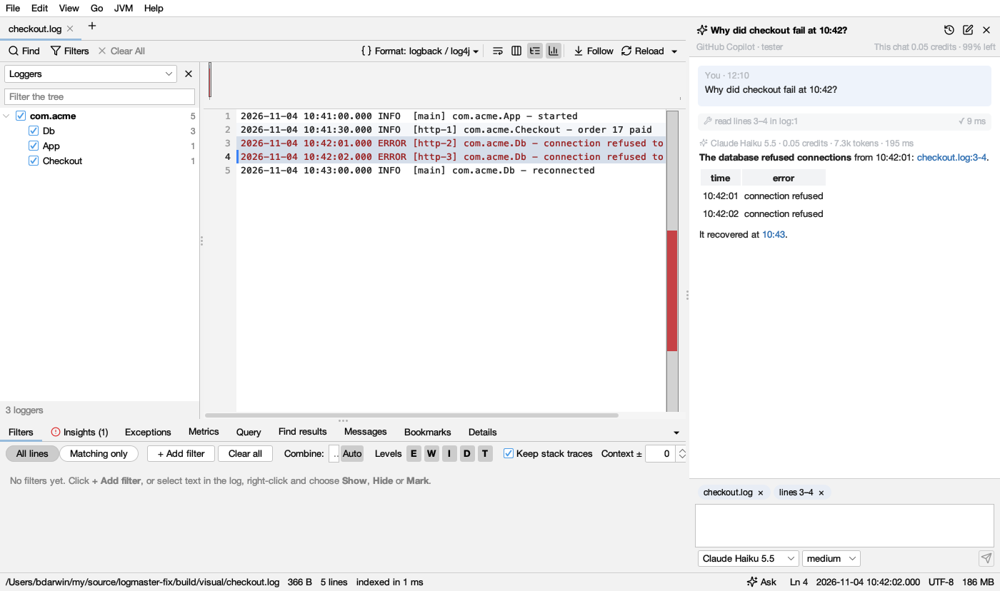
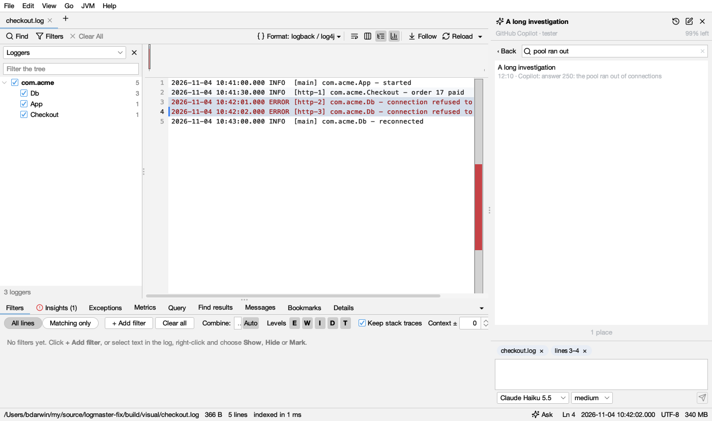

# Assistant

**View → Assistant** (Ctrl+I, ⌘I on macOS), or **Ask** in the status bar, opens a chat beside the logs. Ask anything about what's open: *why did checkout fail at 10:42?*, *errors by hour and what changed*, *compare this log with yesterday's*. GitHub Copilot answers with Logsift's own tools, the ones [coding agents](agents.md) use, on the logs the window has open, so nothing is read twice and line numbers are the ones you see.

## What you need

- **GitHub Copilot**, installed and signed in: `npm install -g @github/copilot`, then run `copilot` once in a terminal and type `/login`. Your Copilot subscription pays for the answers. Logsift finds the program where npm, Homebrew, nvm or WinGet put it; elsewhere, choose it with **Choose Copilot Program…**.
- Nothing else. The assistant starts the first time you open it, never before.

## Asking

- **Enter** asks; **Shift+Enter** starts a new line. While it answers, the button stops it.
- What you're looking at goes with the question: the log shown, the other logs open, and the lines you selected. The chips above the box say what; **×** leaves one out of the next question.
- With nothing asked yet, the chat offers questions that fit what's open: what went wrong, errors by hour, root causes, the selected lines, a table's columns.

## The answer

- **Lines are links.** The assistant cites each line it relies on, like *checkout.log:1201-1209*; a click selects those lines in the log (showing all lines if filters hide them).
- **Each tool it calls is shown** (*read lines 3–4 in log:1 ✓ 9 ms*). A click shows what Logsift answered, with **Show these lines**, **Find in the log** (for a search) or **Open in Query** (for SQL, run in the Query tab), and **Copy**.
- **What it cost** is above each answer: the model, the AI credits Copilot reported for it, the tokens, and how long it took.

## Models and credits

The list at the bottom has the models your Copilot account offers, each with its price in AI credits per million tokens read · written. A model your organization turned off is greyed. Models that can think harder have a second list (*low*, *medium*, *high*…): harder is slower and costs more. Your choice is kept for new chats; changing it mid-chat applies from the next question.

The header shows what this chat cost and how much of your premium requests is left. Click it for the details: premium requests used and when they start again, this chat, today, and this month by model.

## Every chat is kept

Chats are kept on your computer, in a DuckDB file in Logsift's folder (`~/.logsift/chat/chats.duckdb`), with each question, answer, tool call and its result, and what it cost. A long chat opens at its end and scrolls back a page at a time, as far as it goes.

**Chats** (the clock button) lists them, newest first, with what each cost. **Search every chat** finds words in any question, answer or tool result and opens the chat at that very entry. Right-click a chat to delete it. Double-click a chat's name to rename it. **New chat** (the pen) starts another.

## What it can and can't do

The assistant has **only Logsift's tools**: it reads logs, tables, dumps and profiles, within the [folders agents may read](agents.md#what-it-cant-do), and Logsift masks secrets in what it sees, as set in **Settings → Agents**. It can't run commands, change files or browse the web. Each tool call is written to the agents' audit log (`~/.logsift/agent.log`). Copilot's own sessions for these chats are kept apart from yours, in `~/.logsift/chat/copilot`.

*GitHub Copilot is a trademark of GitHub, Inc. Logsift is not affiliated with or endorsed by GitHub.*
