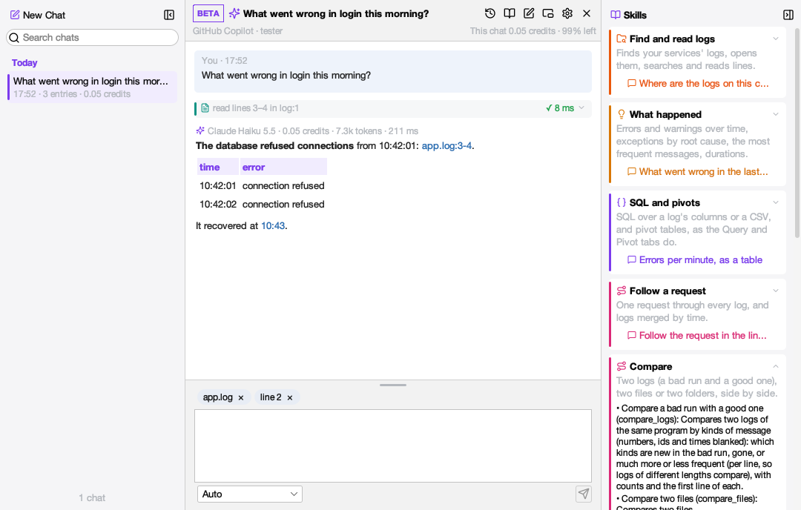
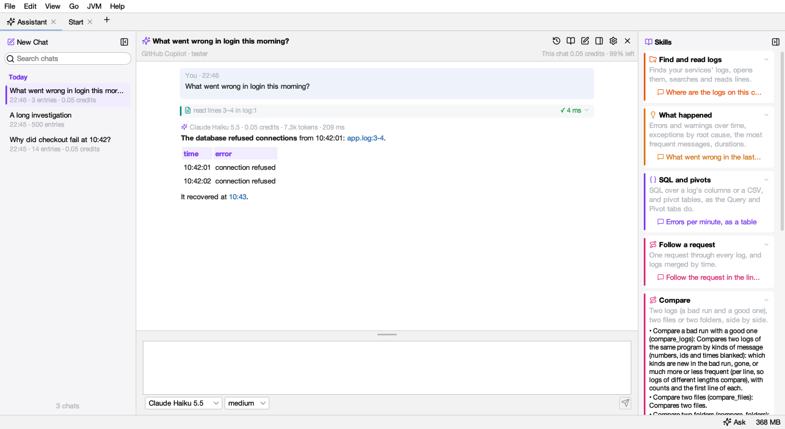
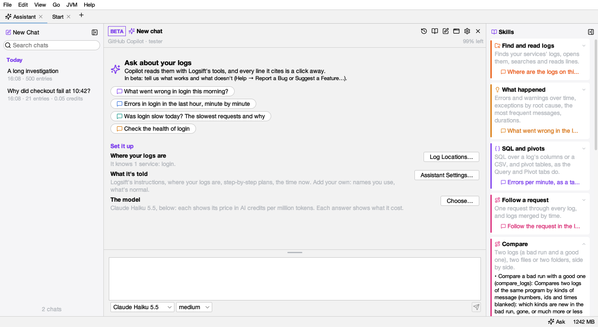
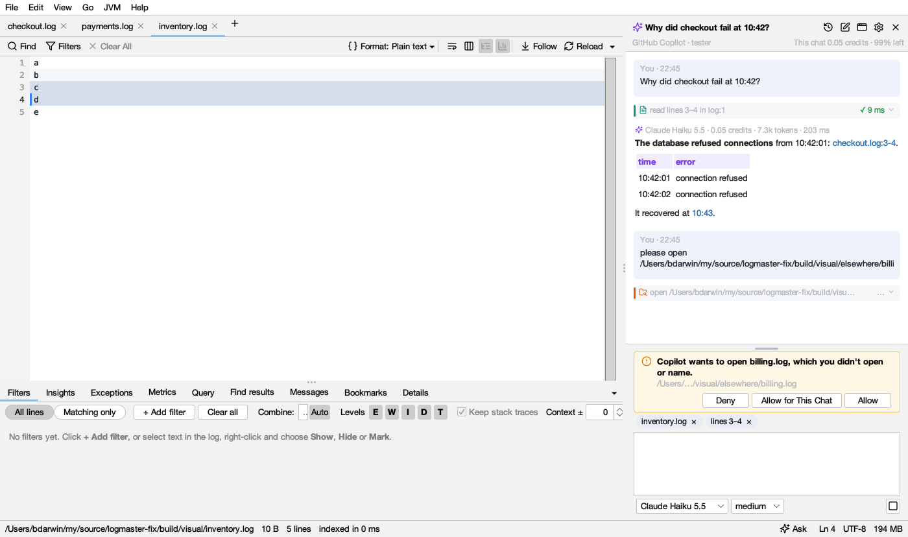
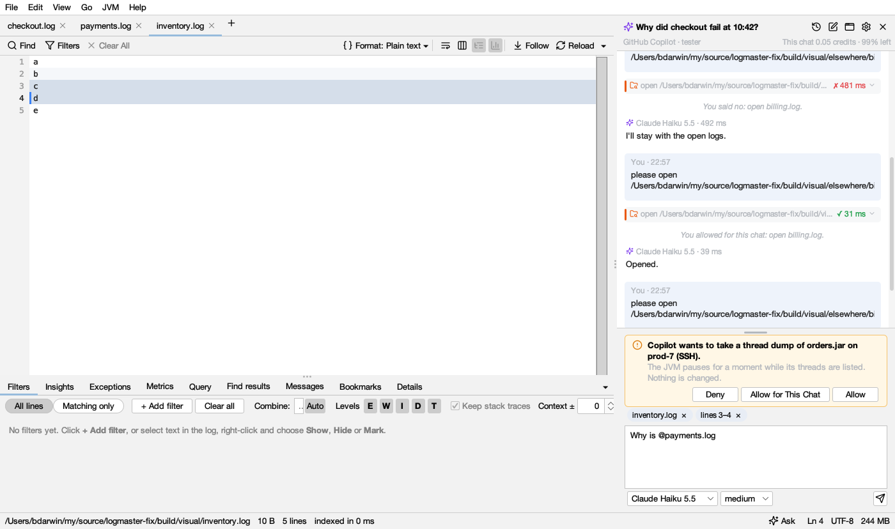
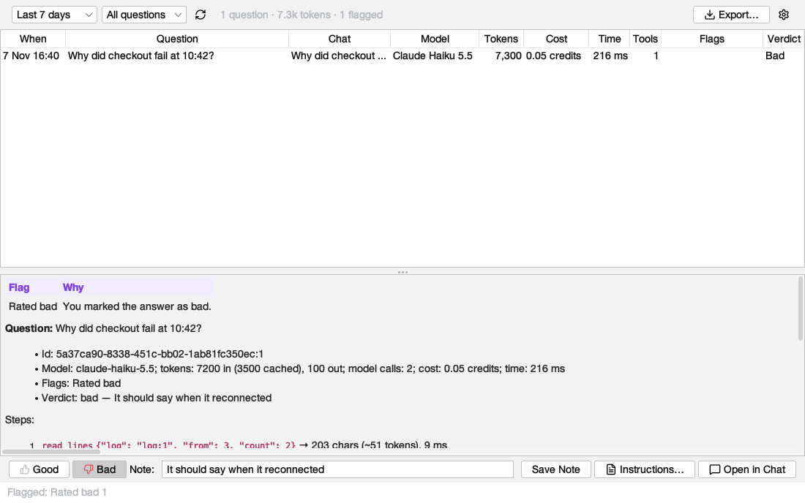
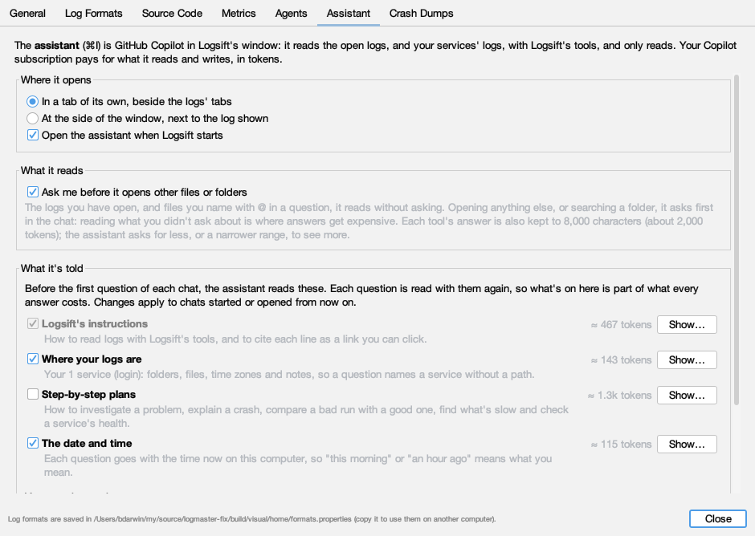

# Assistant

**The assistant is in beta**, marked **BETA** beside the chat's name: it's new, and what works and what doesn't helps shape it. Tell us with **Help → Report a Bug or Suggest a Feature…**.

Logsift opens the assistant when it starts, in a tab of its own. **View → Assistant (Beta)** (Ctrl+I, ⌘I on macOS), or **Ask** in the status bar, brings it to the front; pressing it again goes back to the log. Ask anything about what's open, or about your services' logs: *why did checkout fail at 10:42?*, *errors by hour and what changed*, *compare this log with yesterday's*. GitHub Copilot or Claude Code answers with Logsift's own tools, the ones [coding agents](agents.md) use, on the logs the window has open, so nothing is read twice and line numbers are the ones you see.

## What you need

One of these, chosen in **Settings → Assistant → Who answers** (GitHub Copilot unless you choose Claude Code):

- **GitHub Copilot**, installed: `npm install -g @github/copilot`. Your Copilot subscription pays for the answers. Not signed in yet, the assistant shows **Sign In to GitHub…**: GitHub's page opens in your browser, you sign in and authorize GitHub Copilot there, and the assistant is ready as soon as you're done (**Copy Link** if you'd rather use another browser; **Cancel** stops it). Copilot keeps the sign-in where `copilot`'s own `/login` does, so signing in once in a terminal works too. Logsift finds the program where npm, Homebrew, nvm or WinGet put it; elsewhere, choose it with **Choose Copilot Program…**.
- **Claude Code**, installed and signed in: install it from [claude.com/claude-code](https://claude.com/claude-code), then run `claude auth login` once in a terminal. Your Claude subscription (or Anthropic Console account) pays for the answers. Logsift finds `claude` where its installer, npm or Homebrew put it; elsewhere, choose it with **Choose Claude Program…**. It gets Logsift's tools and nothing else: no files, shell or web of its own, none of your Claude Code settings, MCP servers, skills or commands. Logsift's tools reach it from inside the window, on this computer only, so they read what the window has open and ask you first as they do for Copilot.
- Nothing else. The assistant starts the first time you look at it, never before: a tab in the background costs nothing.

Switching from one to the other keeps your chats: a chat started with one goes on with the other, told what was said.

## Where it opens

In a tab of its own, beside the logs' tabs; at the side of the window next to the log shown; or in a window of its own, to put beside Logsift or on another screen. The button beside the gear in the chat's header lists the three and moves it, and Logsift remembers where. In its tab or its window, it asks about the log you looked at last, so **Ask the Assistant About This Line** and the chips work as they do beside it, and a line link takes you to the log.

**In its own window:** a line link, **Show these lines**, **Find in the log** and **Open in Query** bring Logsift's window forward at the log. **⌘I** (Ctrl+I) goes from either window to the other. Closing the assistant's window hides the assistant, as closing its tab does; ⌘I opens it again where you left it. If that screen isn't there any more (a laptop away from its monitor), it opens beside Logsift's window instead.

When the tab or the window is narrow, the chats at the left and the skills at the right fold away and the conversation has the room; **Chats** (the clock button) lists the chats then.

**Text size:** the assistant's text has a size of its own, apart from the logs' font: 14 points at first, a step above Logsift's menus. **⌘+** and **⌘-** (Ctrl+= and Ctrl+-) while you're in the assistant (typing a question, or after a click in the conversation) make it bigger or smaller, in its tab, at the side or in its window; in a log they change the log's font as before. It's kept, and also in **Settings → Assistant**.

In its tab there's room for more: your **chats** at the left, as in other chat apps (*Today*, *Yesterday*, *Previous 7 days*…, the one open marked, with **New Chat** and a search at the top), and its **skills** at the right. The conversation takes the room between them. Each folds to a narrow strip with the button at its top (and opens again from the strip, or the clock and book buttons in the header). The question box takes the whole width; drag the handle on its top edge to make it taller or shorter, and Logsift keeps that height.

It opens when Logsift starts, in front only when nothing else was reopened (with the **Start** page beside it). Turn that off in **Settings → Assistant**.

With nothing asked yet, it offers questions to start with, for what's open and for your services (*What went wrong in login this morning?*), and what you can set up: **Log Locations…** (where each service's logs are), **Assistant Settings…** (what it's told) and the model.

## Skills

The **Skills** panel says what the assistant can do, by what it's for: find and read logs; what happened (errors over time, exceptions, frequent messages, durations); SQL and pivots; follow a request; compare two logs, files or folders; JVMs (thread dumps, GC logs, profiles); crashes. A click on one shows its tools and what each does, and its question (*What's different between today's run and yesterday's?*) puts that in the box for you to change or send. Below are the step-by-step plans it follows for the usual jobs. None of this is sent to Copilot: the panel costs nothing.

## Asking

- **Enter** asks; **Shift+Enter** starts a new line. While it answers, the button stops it.
- What you're looking at goes with the question: the log shown, the other logs open, and the lines you selected. The chips above the box say what; **×** leaves one out of the next question.
- **Name a file with @.** Type `@` and pick from the logs open in the window, then the files you opened lately (`@payments.log`). The assistant is told which file that is, in one line, and reads it without asking.
- **Right-click a line** (or selected lines) and choose **Ask the Assistant About This Line**: the question waits in the box, with the lines chosen, for you to change or send.
- Each question also goes with the date, time and time zone now, so *this morning* or *an hour ago* means what you mean, read in each service's own time zone.

## It asks before reading anything else

The logs you have open, and files you name with `@`, it reads freely. To open another file, or search a folder, it first asks above the box, naming the file: **Allow**, **Allow for This Chat** (that file's folder too, for the rest of the chat) or **Deny**. Your answer is written in the chat; after a no it works with what's open, or says what it would need and why. Reading what you didn't ask about is where answers get expensive, so this is on by default; turn it off in **Settings → Assistant → What it reads**.

A **thread dump** or a **heap histogram** of a running JVM is always asked for, whatever that setting, with what it does to the program (*the JVM pauses for a moment while its threads are listed*). Tell Logsift where each service's JVM runs with **JVM → JVM Connections (SSH, JMX)…** (in [Log Locations](agents.md#where-your-logs-are), **Its JVMs**: this computer, SSH or a JMX port; **Add JVM** for one with no folder of logs), and ask *why is orders slow right now?*: the assistant takes a dump, shows the busy and blocked threads, and keeps the whole dump as a log to read. Over SSH it uses your key and a server you already trust; for a password, a new server's key or a JMX password, Logsift asks you. Never a heap dump.

Each tool's answer is also kept to 8,000 characters (about 2,000 tokens; coding agents get up to 24,000). When there is more, the assistant is told how much was cut and asks for a narrower range.

## The answer

- **Lines are links.** The assistant cites each line it relies on, like *checkout.log:1201-1209*; a click selects those lines in the log (showing all lines if filters hide them). A log it opened by itself opens in a tab of its own at those lines, and a file it names by its path (*/var/log/app.log:120*) opens in Logsift too.
- **Each tool it calls is shown** (*read lines 3–4 in log:1 ✓ 9 ms*). A click anywhere on the row (the arrow at its end says which way) shows what Logsift answered, with **Show these lines**, **Find in the log** (for a search) or **Open in Query** (for SQL, run in the Query tab), and **Copy**.
- **Tables** come as tables: several items with the same fields (errors by host, slow requests) are a table, with numbers lined up at the right. Headings and the assistant's own marks are in its violet; each tool has its own color and icon (search blue, read teal, SQL violet, insights amber, exceptions red), so a long answer reads at a glance.
- **What it cost** is above each answer: the model, the AI credits Copilot reported for it, the tokens, and how long it took.

## Charts

The assistant doesn't draw charts in text. When it explains a GC log (**analyze_gc**), Logsift draws the heap chart under that step itself: memory in use before and after each collection, the heap's size, and full GCs. A click on a point shows its line in the log; **Show GC Charts** opens heap, pauses, allocation and time in GC in a tab beside the log, as **Analyze GC** does. It finds the log however the assistant named it: a log open in Logsift, a path (`~/logs/gc.log` too), or a service's log from [Log Locations](agents.md#where-your-logs-are) (`orders/gc.log`). The chart costs no tokens: Logsift reads it from the log, not from the answer. For anything else, the answer gives a table.

## Models and credits

The list at the bottom has the models your Copilot account offers, each with its price in AI credits per million tokens read · written. A model your organization turned off is greyed. Models that can think harder have a second list (*low*, *medium*, *high*…): harder is slower and costs more. Your choice is kept for new chats; changing it mid-chat applies from the next question.

The header shows what this chat cost and how much of your premium requests is left. Click it for the details: premium requests used and when they start again, this chat, today, and this month by model.

With **Claude Code**, the list has Claude Haiku, Sonnet and Opus (each the latest), and the thinking levels *low* to *max*. What each answer cost is shown in dollars at API prices, as Claude Code reports it: on a Claude subscription you aren't charged that, but it says how much was read and written, and it counts toward your plan's usage limits. Totals keep AI credits and dollars apart.

## Every chat is kept

Chats are kept on your computer, in a DuckDB file in Logsift's folder (`~/.logsift/chat/chats.duckdb`), with each question, answer, tool call and its result, and what it cost. A long chat opens at its end and scrolls back a page at a time, as far as it goes.

In its tab the chats are at the left. Beside the logs, **Chats** (the clock button) lists them, newest first, with what each cost. **Search every chat** finds words in any question, answer or tool result and opens the chat at that very entry. Right-click a chat to delete it. Double-click a chat's name to rename it. **New chat** (the pen) starts another.

## The audit: what goes wrong, and what's wasted

Under each answer, 👍 and 👎 say whether it was good. 👎 asks what went wrong; what you write is kept with the question.

**View → Assistant Audit** (or the clipboard button in the assistant's header) lists every question you asked, newest first, a page at a time. For each one it shows:

- the model;
- the tokens read and written;
- what it cost;
- how long it took;
- how many tools it called;
- what was flagged;
- your verdict.

Choose a question to see what answering it took:

- what went with it (the time, and the log and lines you were looking at);
- each model call;
- each tool, with its arguments, the size of its answer and how long it took, and the start of that answer;
- the answer itself.

**Instructions…** shows what the assistant was told before the question. **Open in Chat** opens the question in its chat. **Good**, **Bad** and **Note** set your verdict there too.

A question is flagged when:

| Flag | What it means |
|---|---|
| **Error** | The answer stopped with an error. |
| **No answer** | The model was called but wrote nothing. |
| **Tool failed** | A tool refused or failed, often because of a wrong argument the model guessed. |
| **Same call again** | A tool was called twice with the same arguments, so its answer was read twice. |
| **Big tool answer** | A tool answered with more than the size set (20 KB at first). The model read all of it. |
| **Many tools** | More tool calls than the number set (12). |
| **Many tokens** | More tokens than the number set (100,000). |
| **Slow** | It took longer than the time set (2 minutes). |
| **Broken line link** | The answer cites a line its link can't open. |
| **Rated bad** | You marked the answer 👎. |

The list can show all questions, flagged ones, those rated bad or good, or those not rated, from today back to all time.

**Export…** saves the questions listed as a Markdown report. **Report with Details** also adds:

- the start of each tool's answer;
- what went with each question;
- the instructions.

You can read the report yourself, or give it to a coding agent to find what to change. A coding agent connected to Logsift over MCP can read the audit itself, with **assistant_audit** and **assistant_audit_question** (see [What the agent can ask](agents.md#what-the-agent-can-ask)).

The audit reads the chats as they are kept, so it costs no tokens. **Settings → Assistant → Audit** sets the limits above. It also sets whether what went with each question and the instructions are kept. Each set of instructions is kept once, however many questions used it.

## What it's told

Before the first question of each chat, the assistant reads Logsift's instructions, and what you choose in **Settings → Assistant**:

| Part | What it gives the assistant | On by default |
|---|---|---|
| **Logsift's instructions** | How to read logs with Logsift's tools, and to cite lines as links. Always on. | yes |
| **Where your logs are** | Each service you described in [Log Locations for Agents](agents.md): its folders, what its files hold, its logs' time zone and your notes. *The login service* then needs no path. | yes |
| **Step-by-step plans** | How to investigate a problem, explain a crash, compare a bad run with a good one, find what's slow, check a service's health: the plans agents get as prompts. | yes |
| **The date and time** | The time now with each question, and how to turn *this morning* into the log's own times. | yes |
| **Your own instructions** | Anything else: names you use (*“login” is the auth service*), what's normal, how to answer. | when written |

Each part shows about how many tokens it is, and **Show…** shows its words; **Show Everything It's Told…** shows them together. Each question is read with them again, so what's on is part of what every answer costs; all of it is about 2,000 tokens, a small part of what Copilot reads for its tools. Changes apply to chats started or opened from then on.

## What it can and can't do

The assistant has **only Logsift's tools**: it reads logs, tables, dumps and profiles, within the [folders agents may read](agents.md#what-it-cant-do), and Logsift masks secrets in what it sees, as set in **Settings → Agents**. It can't run commands, change files or browse the web. Each tool call is written to the agents' audit log (`~/.logsift/agent.log`). Copilot runs as you, from its own folder (`~/.copilot`) where your sign-in is, so its sessions for these chats are kept there too, beside your terminal ones.

*GitHub Copilot is a trademark of GitHub, Inc. Claude and Claude Code are trademarks of Anthropic, PBC. Logsift is not affiliated with or endorsed by GitHub or Anthropic.*
