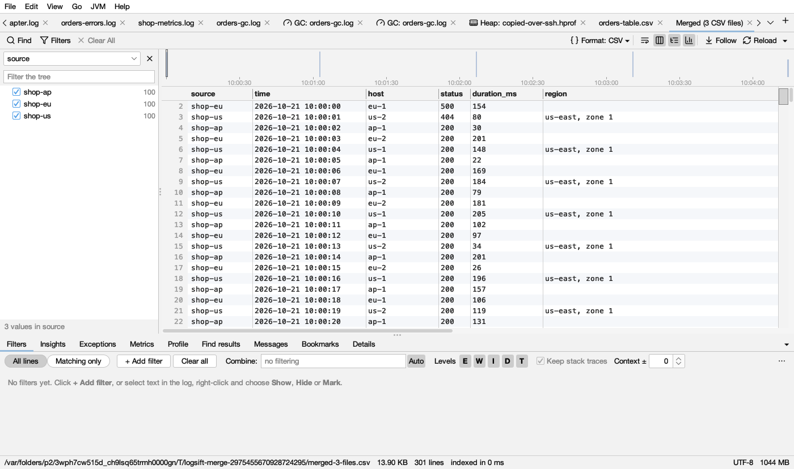

# Compare and merge

## Compare two logs

**File → Compare Logs by Message…** (Ctrl+Shift+D, ⇧⌘D on macOS) compares the current log with a **baseline**: another open log, for example of a run that went well. Open both logs first. (To compare two CSV files row by row, see [Compare files](diff.md).)

Comparing line by line is useless for logs (every timestamp differs), so Logsift compares **kinds of messages**, as in the [Messages](insights.md#messages-top-messages) tab. Counts are scaled to the logs' lengths, so a log twice as long doesn't look twice as bad.

| Change | Colour | Means |
|---|---|---|
| **NEW** |  red | Only in this log. New errors come first: usually the place to start |
| **×4.2** |  dark amber | At least twice as often as in the baseline (scaled) |
| **GONE** |  gray | Only in the baseline. Something that used to happen no longer does, such as a *connected* message |
| **÷3.0** |  blue ( in dark mode) | Half as often or less |
| **same** | gray | About as often (shown only with *Everything*) |

Columns: **Change**, **Level**, **Message**, **Baseline** (count there), **This log** (count here).

- The first list picks what to show: *All differences*, *New in this log*, *More often*, *Gone from this log*, *Less often*, *Everything*. The second picks levels.
- **search messages** filters the rows.
- Double-click a row to find all its lines in the log that has them.

## Merge logs by time

**File → Merge Files by Time…** (Ctrl+Shift+M) merges several logs (say, the same app on two nodes, or an app log and its server's log) into one view in time order. Tick the open logs, or **Add Files…**.

- Each line starts with a label such as `<node2-app>` (the file name, with its folder when names clash) and has a stripe at the left in its source's colour. Hover the tab for the legend.
- The colours, in order:  yellow,  green,  blue,  purple,  orange,  pink,  teal,  red, then again.
- Right-click → **Show Only Lines from `<node2-app>`** shows one source.
- Stack traces stay with their line. The merged view is an ordinary log: filters, the timeline, messages and search all work on it. It keeps up while the sources grow, but lines that arrive late are added at the end, not put in time order.

A log with no timestamps can't be merged: *no timestamps found to merge by*.

## Merge CSV files

When every file you tick is a CSV (or TSV) file, the merge makes one CSV file instead, and the dialog says so before you start:

- **One header.** Columns are matched by name, whatever their case or the spaces around them (*Host* in one file is *host* in another). The first file's columns come first, in its order, then any column only other files have. A row from a file without a column leaves it empty.
- **A source column**, first, holds each row's file (its name, with its folder when names clash). It is a column like any other: the tree beside the log shows the sources (uncheck one to hide its rows), and the [Profile](profile.md) and [filters on a column](filters.md#filters-on-a-column) work with it.
- **Commas** separate the fields, whatever each file used (`;`, a tab, `|`). Fields with a comma, a quote, a line break or spaces at an end are quoted, so they read back the same.
- **The order:** when every file has times, rows go in time order. When one has none (a table), the files go one after the other, in the order they are listed; the dialog names the files without times.
- The result opens as an ordinary CSV tab, **Merged (3 CSV files)**: columns, filters, metrics and the Profile all work. It keeps up while the files grow: new rows are added at the end, in the merged columns.
- CSV files and logs ticked together are merged as logs (each line labelled), so the CSV files don't show as columns; the dialog says so. Merge the CSV files on their own to get one CSV.
