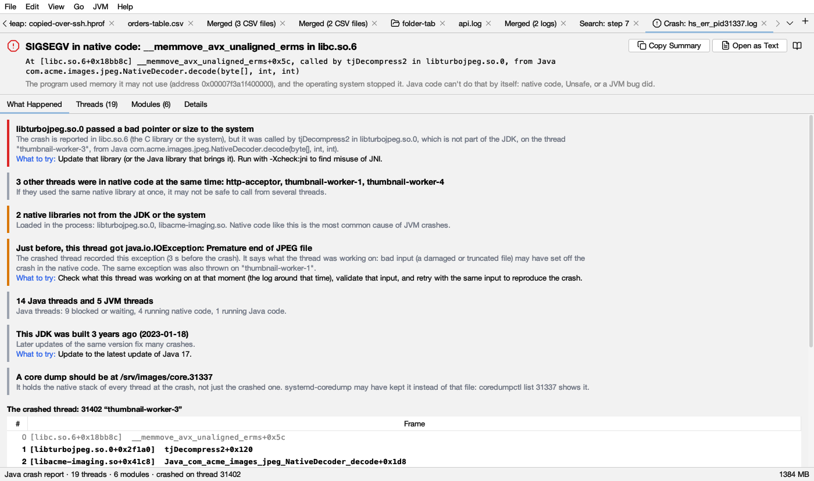
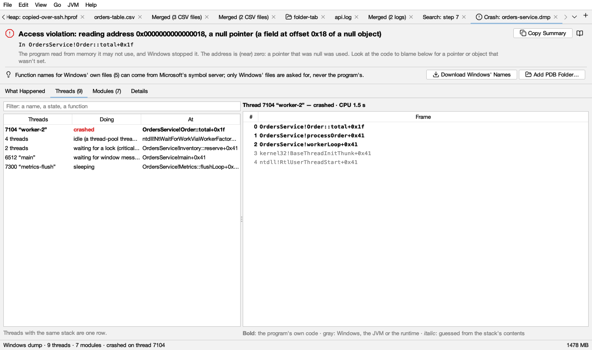

# Crash dumps

Logsift explains two kinds of crash files:

- **Windows dumps** (`.dmp`, `.mdmp`) of any program, full or mini. Windows Error Reporting, Task Manager, debuggers and crash reporters write them.
- **Java crash reports** (`hs_err_pid1234.log`). A HotSpot JVM (Java 6 to 25, on Windows, Linux and macOS) writes one when it crashes.

Open one with **File → Open Crash Dump…**, **JVM → Open Java Crash Report (hs_err)…**, or by dropping it on the window. Files with those names open in a crash tab. A crash report that has another name opens as a log, with a bar that offers **Explain the Crash**.

## The top

- **The title** says what happened, in words: *Access violation: reading address 0x18, a null pointer (a field at offset 0x18 of a null object)*, or *SIGSEGV in native code: memmove in libc.so.6*. The  red mark means a crash. The  blue mark means the dump was written while the program ran, with no crash: for example from Task Manager, or a debugger that stopped it.
- **The line under it** says where: the first frame that is the program's own code, and what it called. Windows, the C runtime and the JVM are rarely to blame, so Logsift looks past them. For a Java crash it also names the Java method that called into native code.
- **The gray text** says what it means.
- **Copy Summary** copies all of it as text: the findings, the crashed thread's stack and the facts. That's handy for a ticket.
- **Open as Text** (Java crash reports) opens the file itself as a log.
- A link opens the file that goes with this one, when it is there: the `.mdmp` the JVM wrote next to its report, or the `hs_err_pid` file next to a Windows dump of a Java program.

## What Happened

The findings, most important first. Each has a coloured bar:  red for the cause,  amber for things that may have caused it,  gray for information. **What to try** says what to do. Below the findings is the stack of the crashed thread.

### Windows dumps

- **The exception, explained.**
  - **Access violation:** says whether the program read, wrote or ran code at the address, and what the address is: a null pointer, a field of a null object, a DLL that had been unloaded, freed memory, or a guard page.
  - **Stack overflow:** names the recursion.
  - **Fast fail (0xC0000409):** says which check stopped the program, for example a stack buffer overrun or `abort()`.
  - **Heap corruption:** explains that the damage happened earlier.
  - **Unhandled C++ exception:** gives its type and, for `std::exception`, its message, read from the dump.
  - **.NET exception:** says the managed details need a .NET debugger.
  - A dozen more codes are named.
- **The code to look at**: the first frame of the program's own code.
- **Not a crash**: a debugger, or a dump tool, stopped the program.
- **Dumps of a program that hung** (no exception): what the first thread is doing, and how many threads wait for a lock (two threads taking two locks in opposite order is a deadlock).
- **Threads waiting for a lock**, a **Java program** (and where its `hs_err_pid` file is), a **.NET program**, a **32-bit program in a 64-bit dump** (and how to write a better one), **DLLs unloaded** before the dump, **many threads** or **many handles** (a leak), a **32-bit address space nearly full**, and **a minidump** (what's missing from it).

### Java crash reports

How the JVM crashed, from where the problem was and which thread it was on:

| Crash | What it means |
|---|---|
| In a native library (not the JDK's) | That library crashed. It is named, with the Java method that called it. Update it; run with `-Xcheck:jni` |
| In the system's code (`libc`, `memmove`), called by a native library | That library passed a bad pointer or size. It is named |
| Through `Unsafe` | Code read or wrote memory at a bad address (often a freed off-heap buffer) |
| In the garbage collector | The heap was damaged earlier, usually by native code or `Unsafe`, sometimes a JVM bug. The thread that did the damage isn't the one that crashed |
| In the JIT compiler | A JVM bug, set off by one method: Logsift gives the `-XX:CompileCommand=exclude,…` that works around it |
| In JIT-compiled Java code | A compiler bug, or data damaged by native code: excluding the method tells which |
| In the JVM itself | A JVM bug or damaged data. A JNI call means native code passed a bad reference |
| A mapped file or a jar (`SIGBUS`) | The file got shorter or was replaced while the program had it open |
| Out of native memory | Why: the machine's free memory and swap, the container's limit next to the heap's, too many threads |
| An internal error (`guarantee`, `assert`) | A check in the JVM failed: search the JDK's bug tracker for the message |

Then the clues to which other threads may have caused it:

- **Other threads in native code at the same time.** If they used the same library at once, it may not be safe to call from several threads.
- **What the crashed thread got just before.** An exception such as *IOException: Premature end of JPEG file* points to bad input. A recent `OutOfMemoryError` or `StackOverflowError` also counts.
- **Locks the JVM held**, and which thread held them. For a crash during garbage collection, the thread that asked for it.
- **The JVM's state**: at a safepoint, and doing what.
- **Native libraries** that aren't the JDK's or the system's, and one **loaded just before the crash**.
- **Agents** (`-javaagent`, `-agentpath`) and **redefined classes**: monitoring tools and profilers run code inside the JVM.
- **The setting**:
  - a full heap
  - a heap as big as the container
  - an old JDK build
  - a crash while starting
  - a core dump written, or not (and how to get one)

## Threads

On the left, every thread. Threads with the same state and stack are one row (*4 threads … idle*), and the crashed thread comes first, in  red. **Doing** says what each was doing:

| Doing | Seen in the stack |
|---|---|
| crashed | The thread of the exception |
| waiting for a lock (critical section, SRW lock) | `RtlEnterCriticalSection`, `AcquireSRWLock…` |
| waiting on a condition variable, on an address | `SleepConditionVariable…`, `WaitOnAddress` |
| idle (a thread-pool thread waiting for work) | `NtWaitForWorkViaWorkerFactory` |
| waiting for window messages (idle) | `GetMessage`, `MsgWaitForMultipleObjects` |
| sleeping | `Sleep`, `NtDelayExecution` |
| waiting for another process (RPC or COM) | `NtAlpcSendWaitReceivePort` |
| waiting for the network or a device; reading or writing a file or pipe | `NtDeviceIoControlFile`; `NtReadFile`, `NtWriteFile` |
| waiting for an event or handle; for several | `WaitForSingleObject`; `WaitForMultipleObjects` |
| running | None of these |

A Java crash report gives the state of each Java thread: running Java code, running native code, in the JVM, blocked or waiting. It also names the JVM's own threads (garbage collector, JIT compiler, VM Thread). Only the crashed thread has a stack in that file.

**At** is the first frame of the program's own code. Type in the filter to keep the threads whose name, state or frames contain it.

On the right, the stack of the selected thread, top first:

- **Bold**: the program's own code (for Java: your classes, and native libraries that aren't the JDK's).
- **Gray**: Windows, the C runtime, the JVM, the JDK.
-  **Purple italic**: code generated while running, with no module. In a Java or .NET program this is its JIT-compiled code.
- **Italic gray**: guessed. The walk lost track and found this return address by scanning the stack. It is likely, not certain.
- **Source**: the file and line, when a PDB with lines was found.

## How stacks and names are found (Windows)

Logsift rebuilds each stack from the dump alone:

- On x64 it follows the unwind tables of the loaded programs, as Windows does. A full dump holds those programs, so no other files are needed.
- On x86 and ARM64 it follows frame pointers.
- When a walk loses track, it scans the stack for return addresses (the guessed frames).
- A minidump doesn't hold the programs, so it reads them from disk when they are there (the same build). Otherwise more frames are guessed.

Function names come from:

1. **PDB files** (names, source files and lines). Logsift looks:
   - next to the dump
   - where the build put them
   - in the folders under **Settings → Crash Dumps**
   - in the symbol caches named by `_NT_SYMBOL_PATH`
   - in `~/.logsift/symbols`
2. **Names the program exports.** Logsift uses one only when it starts the very function the address is in.
3. Otherwise `module+0x1a2b`.

When Windows' own files have no names, a bar offers **Download Windows' Names**: Logsift asks Microsoft's symbol server for the PDBs of Windows' files in this dump, once. It asks only for files under `\Windows`, by name and build id, never for your program's. **Add PDB Folder…** adds a folder with your program's PDBs. Both are also under **Settings → Crash Dumps**, where downloading can be turned on for every dump.

## Modules

Every DLL or shared library: version, a note (*the crash is here*, *the program*, *unloaded*, *not the JDK's or the system's*), which names Logsift has for it (*PDB: …*, *exported names only*), and its path. Filter by name or path.

## Details

The facts:

- **Windows dumps:** the program and its version, command line and working folder (full dumps), process id, when it started and how long it ran, CPU time, Windows version, processor, the dump's kind and size, threads, modules, handles by type, and memory (committed, private, program files, mapped files, reserved).
- **Java crash reports:** Java and JVM versions, garbage collector, program and options, the crashed thread, the signal, heap and metaspace, host, system, memory, limits, container limit, VM state and core dump.

Then the extra sections: the registers of the crashed thread, how the JVM was started, its event logs (compilations, GC, deoptimizations, classes, internal exceptions, libraries loaded) and environment variables.

## Getting a good dump

- **Windows, a program that crashes:** turn on Windows Error Reporting's local dumps with `DumpType` 2 (full) under `HKLM\SOFTWARE\Microsoft\Windows\Windows Error Reporting\LocalDumps`. Full dumps tell much more than minidumps.
- **Windows, a program that hangs:** Task Manager → Details → right-click the program → **Create dump file** writes a full dump. For a 32-bit program, use the 32-bit Task Manager (`C:\Windows\SysWOW64\taskmgr.exe`).
- **Java:** the `hs_err_pid` file is written in the program's working folder (or where `-XX:ErrorFile` says). On Linux and macOS, `ulimit -c unlimited` before starting Java also gives a core dump. On Windows the JVM writes a minidump (`.mdmp`) by default, and Logsift opens it.

## What it doesn't do

- **.NET:** managed exceptions, managed stacks and the .NET heap need a .NET-aware debugger (Visual Studio).
- **Java frames in a Windows dump:** these show as code compiled while running. The `hs_err_pid` file has them.
- **Linux core files and macOS crash reports:** not yet.
- **The process's memory:** Logsift never shows it, and agents never get it.

## Asking a coding agent

A [coding agent](agents.md) can ask Logsift about a crash file with **analyze_crash**, **crash_threads** and **crash_modules**. It gets the same explanation, with secrets masked.
