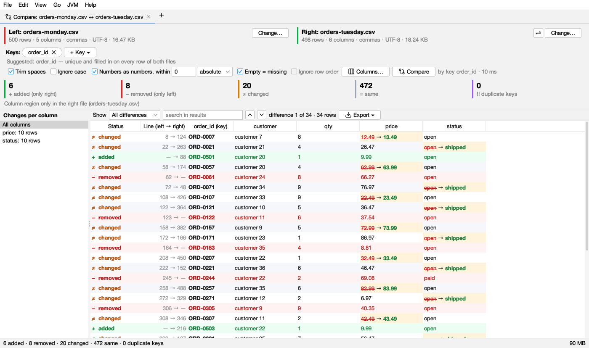

# Compare files

**File → Compare Files…** (or **Compare Files…** on the start page) opens a **Compare** tab to compare two files. CSV and TSV files are compared as **tables**: rows are matched by a **key** (an ID column, or a few columns together), wherever they are in each file, so two exports of the same data in a different order compare cleanly. Other files get a note for now: comparing text and logs line by line is coming next. To compare two logs by kinds of message, use [Compare Logs by Message](compare.md).

## Starting a comparison

The **Compare** tab has a **file browser on each side**: **Left (older)** and **Right (newer)**. They start at your home folder and the disks, and open at the folder you used last.

- **Choose a file on each side**, then click **Compare** (or double-click the second file). Folders open as you expand them. **Zips open like folders**, and so do zips inside zips (*bundle.zip › old › exports.zip › data › stock.csv*): files in a zip, and `.gz` files, are unpacked first.
- **Type or paste a path** above a side's tree and press Enter to go there, even into a zip (*…/bundle.zip/old/exports.zip/data/stock.csv*) or a hidden folder. `~` is your home folder.
- **Drop a file** on a side to choose it there; drop two files at once to fill both sides.
- **⇄ Swap** swaps the two sides.

When the comparison opens, the browsers fold away to make room. **▸ Files** (at the end of the files' row) shows them again above the results, to choose other files; **Change…** next to a file name does the same. Choosing other files makes **Compare** stand out in the accent colour until you click it.

Other ways in:

- **A CSV tab:** the compare button in the log's bar (the two arrows next to *Format: CSV*) opens a Compare tab with that file on the left, the right side open at the same folder.
- **A folder's or a zip's tab:** select two files (Ctrl-click, ⌘-click on macOS) and click **Compare**.
- **Drag and drop on a comparison:** drop a file on the left or right half of the results to compare another file on that side; an outline shows where it will land. Drop two files at once to replace both. Files dropped anywhere else on the window open as logs, as always.

If a file can't be compared (it isn't CSV or TSV), the tab says why next to **Compare**.

The files may use different separators (commas in one, semicolons or tabs in the other), different encodings (UTF-8, UTF-16, Windows-1252), a byte order mark, Windows line ends and quoted fields over several lines.

## Keys

A key is what makes a row the same row in both files: an order number, a user ID, or a few columns together (*region* + *sku*). Rows with the same key are compared value by value; the order of rows doesn't matter.

- **No key at first:** a comparison starts without a key, with rows lined up in file order (see *No key* below), so nothing is chosen for you.
- **Suggested key:** Logsift looks for a column, or two or three together, whose values are filled in and different on every row of both files (the first 20,000 rows of big files), and prefers names like *id*, *key*, *…_id* and *code*. **Use order_id as Key**, next to the keys, uses it in one click; hover it for why (*Suggested: order_id — unique and filled in on every row of both files*). Once in use, *✓ suggested* follows the key.
- **Change it:** ✕ on a key removes it. **Choose ▾** next to the keys opens a list of the columns right below it: tick the key columns (several make a key together), type in **filter columns** to find one in a wide file (Enter ticks the first match), **Clear** unticks them all. When the list closes (click outside or press Escape), it compares again, once. The keys you chose stay when you drop or swap files, if the new files have those columns.
- **No key:** rows are lined up in file order, as a text diff lines up lines: equal rows match, a row changed in place shows as changed, and rows added or removed in between show as such. **Ignore row order** instead matches equal rows wherever they are (only whole rows: nothing is "changed").
- **Key repeats:** a key value on more than one row of a file (*ORD-7* twice) can't be paired one to one, so all its rows, in both files, are listed as **‼ key repeats** and not compared, never paired at random. Usually it means the key isn't unique: tick another key column too, to tell the rows apart. Or a file has a row twice (exported twice). Hover the tile for an example from your files. Without a key, nothing can repeat and the tile isn't shown.

## Columns

Columns are matched **by name**, whatever their case or the spaces around them (*Price* and *price *). A column only one file has is said once above the table (*Column region only in the right file*), not as a change on every row.

- **Leave a column out:** on the keys' row, under the right file, **Not compared:** lists the columns left out of the comparison. **Choose ▾** next to it opens the same kind of list, with a filter: tick the columns to leave out, for example a *last updated* column that always differs. ✕ on one compares it again. It compares again when the list closes. A column left out doesn't make a row changed; it is still shown at the end of the table, in gray, as *(not compared)*.
- **Columns ▾** (above the table) only changes what the table **shows**: untick a column to hide it (it is still compared), **Show All Columns** to bring them back. **Pair Columns by Hand…** compares a column with one of another name (*cost* in the left file with *price* in the right).

## Options

| Option | What it does |
|---|---|
| **Trim spaces** | Spaces at the start or end of a value don't count (on by default) |
| **Ignore case** | *Paid* = *paid*, in keys too |
| **Numbers as numbers, within** | Values that are both numbers are compared as numbers, so *1.50* = *1.5* (on by default). **Within** allows a difference: an **absolute** amount (*0.01*), or a **%** of the larger number |
| **Empty = missing** | An empty value equals one that isn't there, as in a row with fewer fields than the header (on by default) |
| **Ignore row order** | Without a key: match equal rows wherever they are |

After changing options, **Compare** in the options' row stands out in the accent colour (*Changed: press Compare*): click it to compare again. Keys and columns left out compare again at once.

## What it shows

**Tiles** count the rows. They work as buttons: a tile is filled in its colour while its rows are in the table, and plain while they aren't. Click one to show only those rows (its border gets thicker); click it again to go back to all differences.

| Tile | Colour | Means |
|---|---|---|
| **+ added (only right)** |  green | A key only in the right file |
| **− removed (only left)** |  red | A key only in the left file |
| **≠ changed** |  amber | The same key with different values |
| **= same** |  gray | The same key, the same values: unchanged rows |
| **‼ key repeats** |  purple | Key values on more than one row of a file (and how many rows have them): not paired, not compared. Shown only with a key |

**Changes per column**, on the left, says how many rows changed in each column (*price: 1,204 rows*), most first. Click one to show only those rows; **All columns** shows them all again.

**Unified | Side by Side** (above the table) picks the view; Logsift remembers it.

- **Unified:** one table, as below.
- **Side by Side:** the left file's rows on the left and the right file's on the right, a key's two rows on one line, scrolled and selected together. It shows **every row** (Show: *Everything*): unchanged rows too, so you see the changes where they are in the files. A row only one file has is empty (gray) on the other side; a changed row is tinted amber, its changed values on a stronger amber, red on the left and green on the right. Double-click a side to open the row's line in that file. Choose another **Show** for side by side and Logsift remembers it; the unified table keeps its own (all differences at first).

Next to the scroll bar, a **strip of marks** shows where the differences are among the rows shown: green added, red removed, amber changed, purple key repeats, with a box for the part on screen. Click or drag on it to go to the difference there. Switching views or **Show** keeps the selected row when it is still shown.

**The table** (unified) has a row per key: its **Status** (the symbol and the word, in the tile's colour), **Line (left → right)** in each file, the key columns (*(key)* after their name) and the compared columns.

- A **changed value** shows as <s>old</s> → **new**: the old value struck through in red, the new one in bold green, on a light amber cell (in dark mode lighter red , green  and a dark amber cell). Hover a value for both in full. A line break in a value shows as ⏎.
- **Added** rows are on a light green background with green values, **removed** rows on a light red one with red values, **key repeats** rows on a light purple one.
- **Show** picks the rows: *All differences* (the default: everything but the same rows), *Changed*, *Added*, *Removed*, *Key repeats*, *Same* (only the unchanged rows), *Everything* (all rows, the same ones too). **search in results** keeps the rows with that text in a value (any case).
- **▲ ▼** (Shift+F7 / F7) go to the previous and next difference; it says *difference 3 of 120*.
- **Double-click** a row to open its line in the right file (the left one for a removed row). Right-click for either file.

## Export

**Export ▾**:

- **Differences as CSV…**: every row that differs, with its status, its line in each file, the key, and each compared column's left and right value (for a changed row, only the values that changed have a right value).
- **Rows Shown as CSV…**: the rows the table shows now (after Show, the column and the search).
- **Copy Summary** and **Save Summary…**: a few lines saying what was compared and the counts, and the changes per column.

## Limits

- Big files are fine: only each row's place in the file and a few hashes are kept in memory, and rows are read again when shown. Two files of a million rows each compare in a few seconds, with about 50 MB of memory kept.
- The key suggestion looks at the first 20,000 rows of each file. A key that repeats later shows up under key repeats.
- Values are compared as text unless both are numbers; dates are text (*2026-01-02* and *02/01/2026* differ).
- Without a key, rows changed in place are paired in order within a run of changes; if many rows moved, choose a key.
- Changing a file while it is compared isn't noticed: compare again.

## Coming next

- Text and log files side by side, with changes within a line, and options to ignore spaces or mask timestamps and IDs so two runs of a job line up.
- Comparing folders, with the same two browsers.
- Three-way merge, and use from the command line and git.
