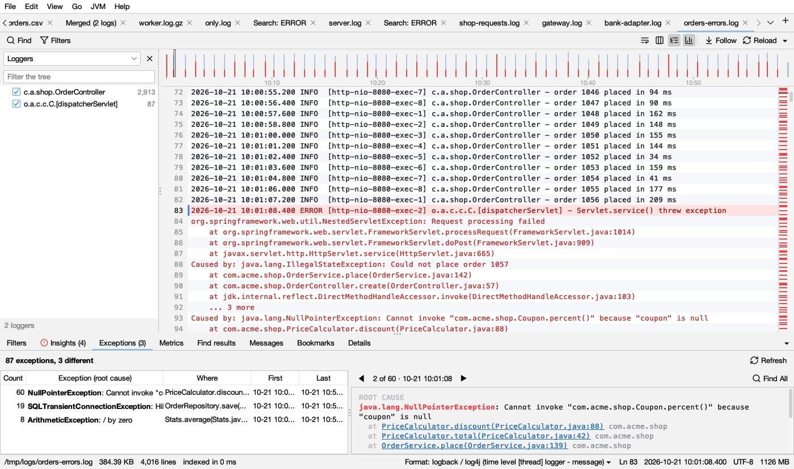

# Exceptions

The **Exceptions** tab (below the log) groups the log's exceptions by their **root cause** and **where they were thrown in your own code**. Its title counts the groups: **Exceptions (12)**.

## How exceptions are grouped

- The **root cause** is the innermost `Caused by:` in Java, or the first exception of a chained Python traceback ("During handling of the above exception…").
- **Where** is the first frames of your own code. Frames of the JDK, Python and well-known frameworks and libraries (Spring, Hibernate, Netty, Apache, connection pools, `site-packages`…) are skipped when deciding where.

So 60 `NullPointerException`s thrown in `PriceCalculator.discount` are one row, however they were wrapped and whatever their messages said. The same exception thrown somewhere else is another row.

## The list

| Column | Shows |
|---|---|
| **Count** | How many times |
| **Exception (root cause)** | The type in bold and its message; in gray, what wrapped it (*in NestedServletException, IllegalStateException*) |
| **Where** | Where in your code it was thrown |
| **First**, **Last** | When it first and last happened |

Click a header to sort. **Refresh** looks again after the log grew.

## The stack

The right side shows the selected group:

- **ROOT CAUSE**: the exception in  red, with its message.
- Its frames. **Your own frames are links**; runs of framework frames are folded into a gray line (*… 14 framework frames*).
- **CAUGHT AND WRAPPED IN**: what caught it and wrapped it, with where.
- At the bottom: how many times, first and last time, and how many different messages it had.

**◀ ▶** step through every time it happened, and the log goes there. **Find All** finds every line with this exception.

## Opening your source

Click one of your frames (or right-click a stack line in the log → **Open … in Editor**) and the file opens at that line.

- Logsift finds the file in your **source folders** (**Settings → Source Code**). The first time, it asks for one (**Add a Source Folder…**).
- Java and Kotlin files are found by package (`com/acme/shop/PriceCalculator.java`, inner classes too). Python files by the most folders in common with the path on the server (`/app/orders/payment.py` → `orders/payment.py`). Build output, dependencies and virtual environments are skipped.
- **Open with** in the same settings: *Automatic* (IntelliJ IDEA or PyCharm when installed, else Visual Studio Code), one of those, the system's app for the file (without the line), or **My own command** with `{file}` and `{line}` filled in, for example `myeditor --goto {file}:{line}`.

## Notes

- Java (`at …`, `Caused by:`, `... 5 more`, `Suppressed:`) and Python tracebacks are read.
- [Insights](insights.md) names the two most frequent root causes, with **Show in Exceptions**.
