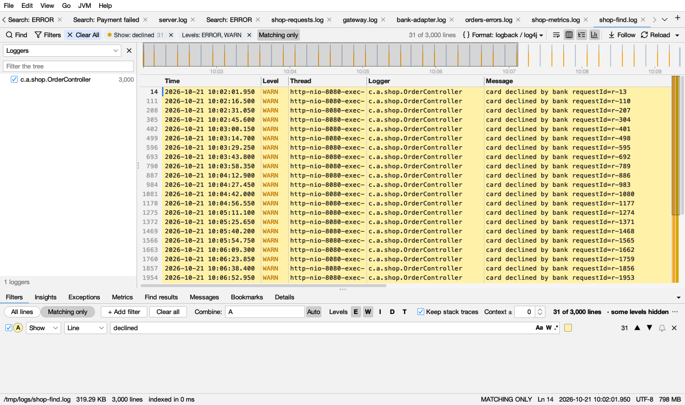
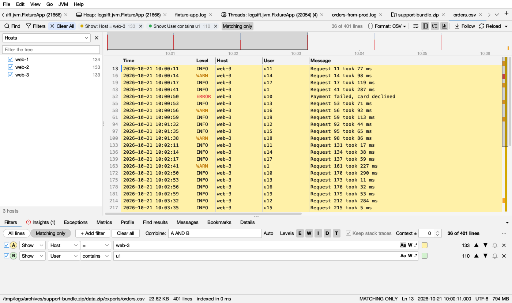
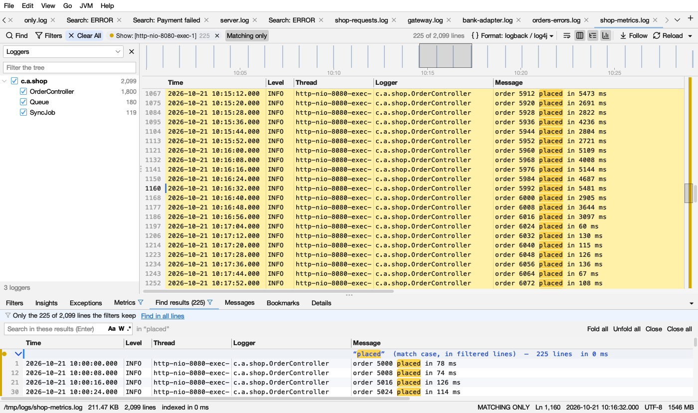

# Filters

Filters show, hide or colour lines. They keep working while the file grows.

## Adding a filter

- Select text in the log, right-click → **Show / Hide / Mark lines with "…"**.
- In the Columns view, right-click a value → **Show Only Rows Where Host = web-1** or **Hide Rows Where Host = web-1**, or right-click a column title → **Filter by …** (see [Filters on a column](#filters-on-a-column)).
- In the find bar, **Filter ▾** → **Show Only Matching Lines**, **Hide Matching Lines** or **Color Matching Lines**.
- In the **Filters** tab below the log, **+ Add filter**.

## The Filters tab

Each filter is a row:

| Part | What it does |
|---|---|
| Checkbox | Turns the filter on or off |
| **A**, **B**, **C** … | Its letter, for the formula. The circle has the filter's colour |
| **Show** / **Hide** / **Mark** | **Show** keeps matching lines, **Hide** removes them, **Mark** only colours them |
| **Line** / a column | Where to look: the whole line, or one column of the log's format. Shown when the log's format has columns |
| **contains** / **=** / **>** / **<** / **between** | For a column: how its value is compared (below) |
| Text, with **Aa** **W** **.\*** | What to match: match case, whole word, regular expression. A wrong regular expression gets a red outline |
| Colour | The colour of its lines (below), or *No color* |
| Count | How many lines match |
| ▲ ▼ | Previous or next matching line |
| Bell | Alerts for new matching lines (below) |
| ✕ | Removes the filter |

Up to 26 filters (A to Z). A new filter takes the colour used least; a Hide filter starts with none.

### Filter colours

| Name | Line colour (light) | Line colour (dark) | Mark (chip dot, highlight bar) |
|---|---|---|---|
| Yellow |  |  |  |
| Green |  |  |  |
| Blue |  |  |  |
| Purple |  |  |  |
| Orange |  |  |  |
| Pink |  |  |  |
| Teal |  |  |  |
| Red |  |  |  |

A filter's colour replaces the [level colour](log-view.md#level-colours) on the lines it matches.

## Filters on a column

A filter can look in one column instead of the whole line: pick the column in the list after **Show** / **Hide** / **Mark** (it says **Line** for the whole line). It works for every log Logsift shows as columns: CSV files, JSON logs, the built-in layouts and your own formats.

| Compare | Matches rows whose value |
|---|---|
| **contains** | contains the text. **Aa**, **W** and **.\*** work as usual |
| **=** | is the text, all of it: *web-1* is not *web-10* |
| **>** / **<** | is a number above or below the one you type. Units count: *1.5 s* is more than *800 ms*, and *2 KB* more than *900* |
| **between** | is a number from the first to the second: *10..20* includes both, *10..<20* leaves 20 out. A click on a [Profile](profile.md) histogram bar adds one that keeps exactly that bar's rows |

The quick ways:

- Right-click a value in the Columns view → **Show Only Rows Where Host = web-1** or **Hide Rows Where Host = web-1**. This adds a **=** filter and switches to Matching only.
- Right-click a column title → **Filter by …** adds an empty filter on that column in the Filters tab, ready for the text.
- **Count Values in …** (right-click a column title): **Show Only** and **Hide** add a **=** filter on that column too.

A column filter shows as a chip like *Show: Host = web-1*. Lines that aren't rows (stack traces, a CSV's header row) don't match it themselves; with **Keep stack traces** they go with their entry.

## Combining filters

**Combine** says how filters work together, using their letters.

- **Auto** (on by default) writes it for you: any Show filter, and no Hide filter. For example `(A OR B) AND NOT C`.
- Type your own to get anything else: `A AND B`, `(A OR B) AND NOT (C OR D)`, `NOT C`. `AND OR NOT ( )` work, and so do `& | ! -`. Typing turns Auto off. A formula that can't be read gets a red outline, and the last good one stays in use.
- Mark filters only colour; they don't change which lines show.

## All lines or Matching only

**All lines** shows every line, with the lines your filters leave out grayed. **Matching only** (Ctrl+Shift+H, ⇧⌘H on macOS) shows only the lines that pass. Your place in the file is kept when you switch: filter down, click a line, switch back and see everything around it.

The count on the right says *65,361 of 1,832,469 lines* (with context lines: *… matching, … shown*). It adds *in the selected time range* or *some levels hidden* when those apply.

## Which tabs follow the filters

Some tabs below the log count only the lines the filters keep; the others always look at the whole log.

| Tab | Follows the filters |
|---|---|
| **Metrics** | With **Matching only** on and filters (or a time range) set |
| **Profile** | With **Matching only** on and filters (or a time range) set |
| **Messages** | When its list says **Filtered lines** instead of **Whole file** |
| **Find results** | A search run while Matching only was on finds in the filtered lines, and keeps to them (its header says *in filtered lines*) |
| **Insights**, **Exceptions**, **Bookmarks** | Never: always the whole log (hover the tab) |
| **Details**, **Request** | Show one entry or one request, as they are in the file |

How to tell: while a tab counts only the filtered lines, a  blue filter icon follows its name (hover it: *Counts only the lines the filters keep*), and a strip in a pale blue (dark blue in dark mode) at the top of the tab says *Only the 225 of 2,099 lines the filters keep*. Its link goes back to every line: **Show all lines** (Metrics, Profile) turns Matching only off, **Count all lines** (Messages) counts the whole file, **Find in all lines** (Find results) runs the selected search again over every line.

## Levels: E W I D T

The **E W I D T** buttons show only some levels, together with your other filters: errors (ERROR, FATAL, SEVERE, CRITICAL), warnings (WARN, WARNING), info (INFO, NOTICE), debug (DEBUG), trace (TRACE). All on means no level filtering. Turn off I, D and T to see just errors and warnings, stack traces included. With your own log format, its level column is used instead.

## Keep stack traces and Context

- **Keep stack traces** (on by default) treats a log line and the lines under it (stack traces, wrapped messages) as one entry: if any line of the entry matches, the whole entry shows, and Hide filters hide whole entries. Hover it to see how Logsift found that entries start (a date, a time, a level word, `{` for JSON). It is grayed out when every line stands alone.
- **Context ±N** adds N grayed lines before and after each match (up to 50), with a dashed line where lines were skipped, like `grep -C`.

## Chips

Filters that are on show as **chips** in the log's bar: *Show: ERROR 65,529*, *Hide: …*, *Color: …* (a Mark filter), *Show: Host = web-1* (a [filter on a column](#filters-on-a-column)), with a dot in the filter's colour and the number of lines.

- **Click** a chip to turn its filter off or on. An off chip is gray, with a dashed outline.
- **✕** removes it.
- **Right-click** to change what it does (On, Show, Hide, Color), **Edit in Filters…** or **Remove**.
- Other chips: **Levels: ERROR, WARN** (the levels shown), **Time: …** (a time range from the [timeline](timeline.md)), **Tree: N hidden** (branches hidden in the tree of loggers). Their ✕ clears them.
- Chips that don't fit fold into **+N more**, which opens the Filters tab.

## Alerts

Click the bell on a filter to be told when new lines matching it are written (while the file grows). The bell turns  amber. Logsift shows a desktop notification and a popup you can click to jump to the line, beeps, and puts a count on the tab. Bursts are combined: at most one alert per filter every 3 seconds. Lines that were already in the file don't alert.

## Clearing

- **Clear All** in the log's bar (lit in blue while anything is set) goes back to the whole log: it removes every filter, turns all levels back on, clears the time range and what the tree hides, and closes the find bar and the Find results.
- **Clear all** in the Filters tab clears only the filters.

## Saving filters

The **⋯** menu in the Filters tab: **Save Filters…**, **Load Filters…** (`.lmfilters` files), **Remove All Filters**. Each log also remembers its own filters, formula, level buttons and Matching only for next time.
