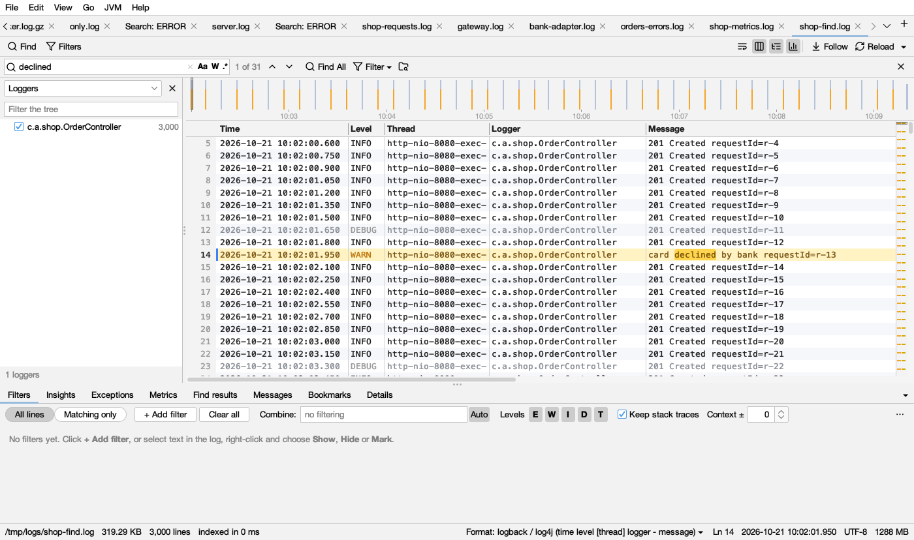

# Find

## The find bar

**Ctrl+F** (⌘F on macOS), or **Find** in the log's bar, opens a find bar at the top of the log, with the selected text filled in.

- Matches light up in  **yellow** as you type ( dark yellow in dark mode), and the log goes to the first match at or after the current line.
- Inside the box: **Aa** (match case), **W** (whole word), **.\*** (regular expression).
- The count: *3 of 1,240* when you are on a match, else *1,240 matches*. *…* means it is still counting; *+* means there are more than it counts. *no matches* outlines the box in amber; *invalid regex* outlines it in red (hover for why).
- **Enter** / **Shift+Enter** (or ▼ ▲) go to the next and previous match. **F3** / **Shift+F3** do the same from anywhere (also ⌘G / ⇧⌘G on macOS).
- **Find All** (Ctrl+Enter) lists every match in **Find results** below the log.
- **Filter ▾** turns the search into a filter: **Show Only Matching Lines**, **Hide Matching Lines** or **Color Matching Lines** (see [Filters](filters.md)).
- The folder button searches for it in a whole folder, zips included (see [Folder search](folder-search.md)).
- **Esc** closes the bar. The text is kept for next time.

## Find All and the results

Each **Find All** is added to the top of the **Find results** tab and opens there. Earlier searches fold to a header line (*"ERROR" — 1,234 lines*) and stay available.

Every search gets its own colour, in the log, on the highlight bar, and as a dot on its header and a stripe on its lines. The colours, in order, then again:

| # | In the log (light) | In the log (dark) | Mark |
|---|---|---|---|
| 1 |  yellow |  |  |
| 2 |  green |  |  |
| 3 |  blue |  |  |
| 4 |  pink |  |  |
| 5 |  orange |  |  |
| 6 |  purple |  |  |
| 7 |  teal |  |  |

- Click a line to go there in the log (or move with the arrow keys; Enter or a double-click goes there too).
- Click a header (or press Enter, ← or →) to fold or open it. **Fold all** / **Unfold all** do every search.
- **F3** / **Shift+F3** step through the selected search's hits.
- Running a search you already have moves it back to the top.
- **Close** removes the selected search (Shift+Esc), **Close all** every one. A middle click on a search's header closes it too.
- The header says how the search ran: *(regex, match case, whole word)*, how long it took, and *(limit reached)* when there were too many hits to list.

**Search within results:** select a search (or any of its lines), type in **Search in these results** and press Enter. A nested search like *"ERROR › timeout"* appears under it, showing only the lines that match both. You can keep narrowing. Closing a search also closes the searches nested in it.

**With filters on:** while the log shows only the lines its filters keep (**Matching only**), Find All finds in those lines (*in filtered lines*), and follows the filters as they change.

**Growing files:** Find All keeps running. New matching lines show up in the results as they are written, in nested searches too.

## Go to a line or time

- **Go → Go to Line…** (Ctrl+L).
- **Go → Go to Time…** (Ctrl+Shift+L) takes `10:05`, `10:05:30.250` or `2026-10-21 10:05`.
- **F8** / **Shift+F8**: next or previous error.
