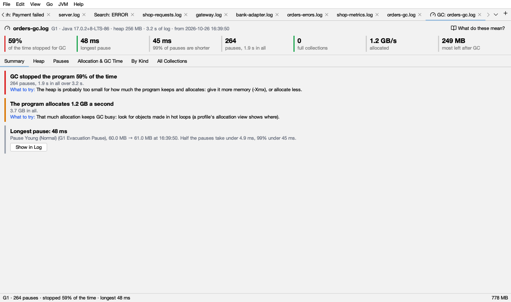
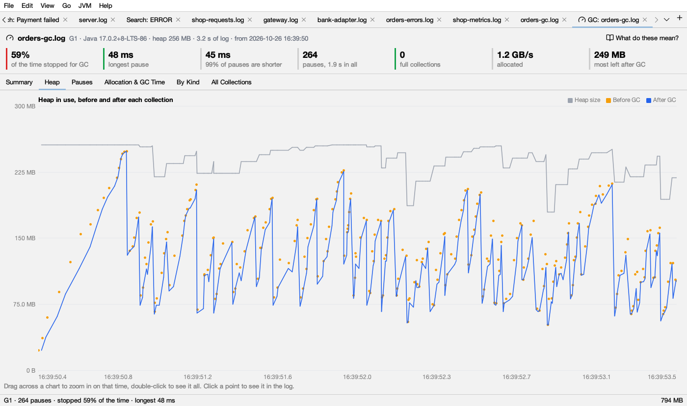
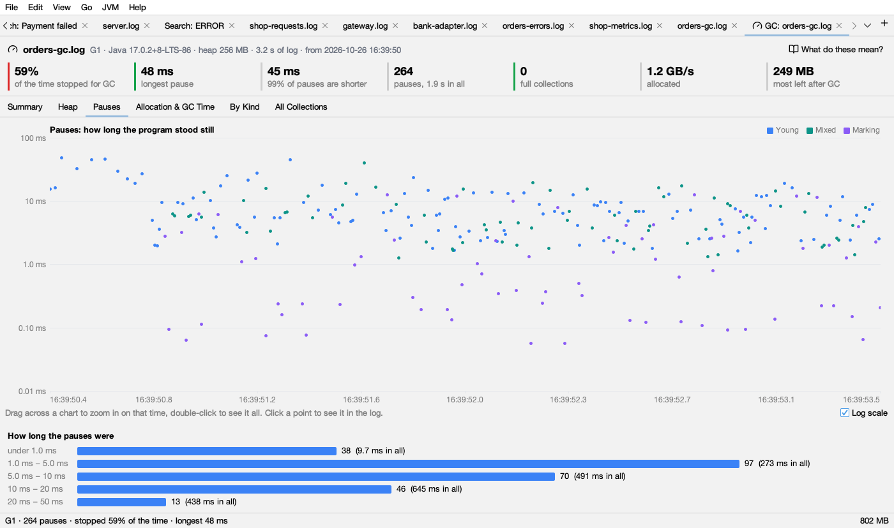
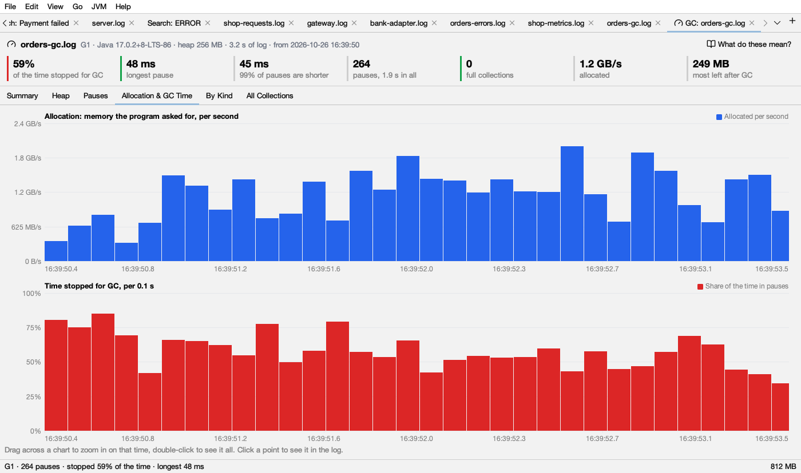

# GC logs

Logsift reads a Java GC log and tells you how long the program stood still, what the longest pauses were and why, and whether the memory left after each collection keeps growing. Each problem it finds comes with what to try.



## Opening a GC log

- **Open the log as usual.** When Logsift sees GC lines in the first part of a file, a bar above the log says *"This is a Java GC log. See how long the program stood still, what the pauses were, whether memory keeps growing, and what to tune."* Click **Analyze GC**, or **×** to hide the bar. It needs at least 3 GC lines in the first 5,000 lines.
- **JVM → Open GC Log…** opens a file and analyzes it in one go.
- **JVM → Analyze GC in This Log** works on the log you have open. GC lines inside other output (a console log with `-Xlog:gc`) count too.

The result opens as a tab named **GC: *log name***, right after the log's tab. While it is selected, the status bar sums it up: *G1 · 4,102 pauses · stopped 12% of the time · longest 840 ms*.

If Logsift finds nothing it can read, it says *"There are no garbage collections in … that Logsift can read."*

### What it reads

- Java 9 and later: unified logging (`-Xlog:gc*`), with any decorations (uptime, time, level, tags), also mixed into other output.
- Java 8: `-XX:+PrintGCDetails`, with or without `-XX:+PrintGCDateStamps`.
- Collectors: G1, Parallel, Serial, CMS, ZGC (also generational), Shenandoah. When the log doesn't name the collector, Logsift works it out from the names of the pauses.

For the most to go on, log with:

```
-Xlog:gc*,safepoint:file=gc.log:time,uptime,level,tags          (Java 9 and later)
-XX:+PrintGCDetails -XX:+PrintGCDateStamps -XX:+PrintGCApplicationStoppedTime -Xloggc:gc.log   (Java 8)
```

Without `safepoint` (or `PrintGCApplicationStoppedTime`) Logsift can't tell how long threads took to stop. Without `gc+cpu` times (included in `gc*`) it can't tell whether a pause waited for the machine.

## The header

The first line names the log, then in gray: the collector, the Java version, the heap size, how much time the log covers, and when it starts (when the log has dates). The heap size is the larger of the maximum the log reports and the largest heap seen at any collection.

Click **What do these mean?** at the right to open this page.

## The tiles

A row of numbers sits under the header. The colored bar on the left of a tile says whether the number is good or bad:

- <span class="sw" style="background:#16A34A"></span> **green**: fine.
- <span class="sw" style="background:#D97706"></span> **amber**: worth a look.
- <span class="sw" style="background:#DC2626"></span> **red**: a problem.
- A gray bar: the number is for information only and has no good or bad.

These colours are the same in light and dark mode.

| Tile | What it means | Green | Amber | Red |
|---|---|---|---|---|
| **of the time stopped for GC** | The share of the time the program stood still in GC pauses (stop-the-world pauses only, from the first collection to the last) | under 5% | 5% to under 10% | 10% or more |
| **longest pause** | The longest single stop | under 200 ms | 200 ms to under 1 s | 1 s or more |
| **99% of pauses are shorter** | 99 pauses in 100 were shorter than this | – | – | – |
| **pauses, … in all** | How many pauses, and their total time | – | – | – |
| **full collections** | Collections of the whole heap | none | one or more | – |
| **allocation stalls** | Threads that had to wait for memory (ZGC, Shenandoah). Only shown when there were some | – | – | always red |
| **allocated** | Memory the program asked for, per second, on average | – | – | – |
| **most left after GC** | The most heap still in use right after a collection | – | – | – |

A full collections tile is amber even when every full collection was a `System.gc()` call. The findings below tell those apart.

## The findings (Summary tab)

The **Summary** tab lists what Logsift found, worst first: red, then amber, then green, then gray. Each card has:

- a colored bar on its left: <span class="sw" style="background:#DC2626"></span> red (bad), <span class="sw" style="background:#D97706"></span> amber (warning), <span class="sw" style="background:#16A34A"></span> green (healthy) or <span class="sw" style="background:#9CA3AF"></span> gray (information);
- a title in bold, details in gray, and in blue, **What to try:**;
- **Show in Log**, when the finding is about one line, to see that line in the log.

When nothing is red or amber, the list has a green **GC looks healthy**: *"Short pauses, little time stopped, and no collection had trouble."*

Below, each finding with the rule behind it.

### GC stopped the program X of the time

The share of time stopped for GC pauses, then *"N pauses, T in all over D."*

| Colour | When |
|---|---|
| <span class="sw" style="background:#DC2626"></span> red | 10% or more |
| <span class="sw" style="background:#D97706"></span> amber | 5% to under 10% |
| <span class="sw" style="background:#9CA3AF"></span> gray | under 5% |

**At its worst:** Logsift cuts the log into blocks of time (1 minute when the log covers 10 minutes or more, 10 seconds when it covers 1 minute or more, else a tenth of the log, at least 1 second). If the worst block was stopped at least 1.5 times the overall share and at least 10% of the time, it adds *"At its worst, 1 min from 10:32, it was 35% of the time."*

**What to try** (amber and red): the heap is probably too small for how much the program keeps and allocates. Give it more memory (`-Xmx`), or allocate less.

### Longest pause: X

What the pause was, why, the heap before and after, and when. It adds how many pauses took 200 ms or more (when more than one did), and that half the pauses took under the median and 99% under the 99th percentile.

| Colour | When |
|---|---|
| <span class="sw" style="background:#DC2626"></span> red | 1 s or more |
| <span class="sw" style="background:#D97706"></span> amber | 200 ms to under 1 s |
| <span class="sw" style="background:#9CA3AF"></span> gray | under 200 ms |

**What to try** (amber and red), the first that fits:

1. It was a full collection: full collections stop everything for the whole heap. Give the heap more room, or find what fills it.
2. It took more than 0.1 s and more than 1.2 times the CPU time of the GC threads: the pause waited for the machine. Check CPU limits and swapping.
3. G1: lower `-XX:MaxGCPauseMillis` (G1 then collects less each time), or use a collector made for short pauses (ZGC, Shenandoah).
4. Parallel or Serial: these stop the program for all their work. For shorter pauses use G1 (or ZGC).

### Full collections: N, T in all

A full collection stops the program while the whole heap is collected. A Shenandoah *degenerated* GC and a young collection that failed count as full. With degenerated GCs, the title is *"Shenandoah fell back to stopping the program"*. The details list the most common causes and the longest one.

| Colour | When |
|---|---|
| <span class="sw" style="background:#9CA3AF"></span> gray | Every one was a `System.gc()` call |
| <span class="sw" style="background:#DC2626"></span> red | The collector is G1, CMS, ZGC or Shenandoah. These work alongside the program, so a full collection means it couldn't keep up. Also red with more than one full collection per minute on average, whatever the collector |
| <span class="sw" style="background:#D97706"></span> amber | Any other case (Parallel or Serial, now and then) |

**What to try:** give the heap more room (`-Xmx`), or find what fills it. If the memory left after GC keeps growing, take a heap dump.

### The memory left after GC keeps growing

<span class="sw" style="background:#DC2626"></span> Always red. This is the classic sign of a leak, or of a cache with no limit.

How Logsift decides: it cuts the log into 12 equal stretches of time and takes, for each, the least heap left after a collection (the floor). It reports growth only when all of these hold:

- at least 6 stretches have a collection;
- the floors rise steadily (a correlation of 0.7 or more with time);
- the floors of the last third are at least 1.4 times those of the first third;
- and the rise is more than 10% of the heap (when the heap size is known).

It says *"From about E to L over D (the heap is H)."*

**What to try:** take two heap dumps some time apart and compare them (**Compare with Another Dump…**, see [Heap](heap.md)) to see what grows.

### After GC the heap is still X full

<span class="sw" style="background:#D97706"></span> Amber. Checked only when the memory isn't growing as above. It shows when the floors of the last third are above 80% of the heap: collections free little and come often.

**What to try:** give the heap more room (`-Xmx`), or look at a heap dump for what holds the memory.

### Collections that had trouble

All <span class="sw" style="background:#DC2626"></span> red, each with **Show in Log** for the first one:

| Finding | What happened | What to try |
|---|---|---|
| **G1 ran out of room to copy objects** | *To-space exhausted* or *evacuation failure*. These collections are slow and often end in a full collection | Give the heap more room, start marking earlier (lower `-XX:InitiatingHeapOccupancyPercent`), or keep more free (`-XX:G1ReservePercent`) |
| **Promotion failed** | The old generation had no room for objects moving up from the young one, so a full collection ran instead | Give the heap more room, or start old collections earlier (`-XX:CMSInitiatingOccupancyFraction`) |
| **CMS couldn't keep up (concurrent mode failure)** | The old generation filled before CMS finished, so it stopped the program for a full collection | Start CMS earlier (`-XX:CMSInitiatingOccupancyFraction=60 -XX:+UseCMSInitiatingOccupancyOnly`), give the heap more room, or move to G1 |

Other trouble the log reports is listed by its own name, in <span class="sw" style="background:#D97706"></span> amber.

### Threads waited for memory

<span class="sw" style="background:#DC2626"></span> Red. *Allocation stalls* (ZGC, Shenandoah): a thread that allocates is stopped until GC frees memory, because the collector couldn't free it fast enough. It names the longest wait.

**What to try:** give the heap more room (`-Xmx`), or GC more threads (`-XX:ConcGCThreads`).

### Causes worth knowing

| Finding | Colour | What it means | What to try |
|---|---|---|---|
| **Something called System.gc()** | <span class="sw" style="background:#D97706"></span> amber | Each call runs a full collection (unless the JVM makes it concurrent). Libraries do it too, such as RMI every hour | Find the caller, or let the JVM ignore it (`-XX:+DisableExplicitGC`) or run it alongside the program (`-XX:+ExplicitGCInvokesConcurrent`) |
| **Metaspace filled** | <span class="sw" style="background:#D97706"></span> amber | Loading classes filled the metaspace, which starts a collection | Start with a bigger metaspace (`-XX:MetaspaceSize=256m`). If it keeps happening, classes are loaded again and again (a class loader leak) |
| **A large array started a collection** | <span class="sw" style="background:#9CA3AF"></span> gray | G1 *humongous* objects (half a region or more) go straight to the old generation and can start collections early | Bigger regions (`-XX:G1HeapRegionSize=16m` or `32m`), or fewer large arrays |
| **JNI critical sections delayed GC** | <span class="sw" style="background:#9CA3AF"></span> gray | A collection waited for native code holding a JNI critical section | – |

### The machine, not GC

Both <span class="sw" style="background:#D97706"></span> amber. They need the CPU times of each pause in the log (`[Times: …]` in Java 8, `gc+cpu` in Java 9 and later).

- **Pauses waited for the machine, not for GC work:** a pause of 0.1 s or more took more than 1.2 times longer on the clock than the GC threads worked. The machine was busy with something else, swapping, or the container's CPU was throttled. Check the CPU limit, other processes and swap. **Show in Log** goes to the worst one.
- **Pauses spent most of their time in the kernel:** more than 2 pauses of 0.05 s or more spent more time in the system than in GC work (and over 0.03 s of it). Usually swapping or transparent huge pages: check swap, and try `echo madvise > /sys/kernel/mm/transparent_hugepage/enabled`.

### Safepoints

They need safepoint lines in the log (`-Xlog:safepoint`, or `-XX:+PrintGCApplicationStoppedTime` in Java 8).

- **Threads took up to X to stop for a safepoint:** every thread must stop before GC can start, and one that doesn't stop soon holds up all the others. <span class="sw" style="background:#D97706"></span> Amber from 100 ms, <span class="sw" style="background:#DC2626"></span> red from 1 s. Usually a long loop without a safepoint check, or a large array copy. Log `-Xlog:safepoint` and look for the thread with `-XX:+SafepointTimeout`.
- **The JVM stopped the program for more than GC:** <span class="sw" style="background:#9CA3AF"></span> gray. All stops took more than 1.5 times the GC pauses, and over 1 s more in all. Other safepoints: deoptimization, biased locking, thread dumps, class redefinition.

### The program allocates X a second

The average allocation rate (and the peak, when it was over 1.5 times the average). <span class="sw" style="background:#D97706"></span> Amber above 1 GB a second (about 954 MB as Logsift shows sizes), else <span class="sw" style="background:#9CA3AF"></span> gray.

**What to try** (amber): that much allocation keeps GC busy. Look for objects made in hot loops: the allocation view of a [profile](profiling.md) shows where.

## The charts

Every chart works the same way:

- **Drag** across a chart to zoom in on that time. All the charts follow.
- **Double-click** to see the whole log again.
- **Hover** a point to see its value and time.
- **Click** a point to see its line in the log (on the Heap and Pauses charts).

The legend at the top right names each series with its colour. The series colours are the same in light and dark mode; only the grid lines change.

### Heap

*Heap in use, before and after each collection.*



| Series | Colour | Drawn as | What it means |
|---|---|---|---|
| **Heap size** | <span class="sw" style="background:#9CA3AF"></span> gray | line | How big the heap was |
| **Before GC** | <span class="sw" style="background:#F59E0B"></span> amber | dots | Heap in use when a collection started |
| **After GC** | <span class="sw" style="background:#2563EB"></span> blue | line | Heap in use when it ended: what the program still keeps |
| **After a full GC** | <span class="sw" style="background:#DC2626"></span> red | dots | Heap in use after a full collection |

**How to read it:** a blue line that falls back to the same level after each collection is healthy. A blue line whose low points climb over time is memory that is never freed. Blue close to the gray line means the heap is nearly full after GC. Red dots are full collections.

If the log doesn't give heap sizes, the chart says *"This log doesn't say how much heap was in use."*

### Pauses

*Pauses: how long the program stood still.* One dot per pause. The **Log scale** box (on by default) spreads short and long pauses over the height.



| Series | Colour | Pauses |
|---|---|---|
| **Young** | <span class="sw" style="background:#3B82F6"></span> blue | Young collections |
| **Mixed** | <span class="sw" style="background:#0D9488"></span> teal | G1 mixed collections (young and some old) |
| **Full** | <span class="sw" style="background:#DC2626"></span> red | Full collections |
| **Marking** | <span class="sw" style="background:#8B5CF6"></span> purple | Remark, cleanup and initial mark pauses |
| **Other** | <span class="sw" style="background:#6B7280"></span> dark gray | Other pauses, for example ZGC's or Shenandoah's short pauses |
| **Allocation stall** | <span class="sw" style="background:#EA580C"></span> orange | Threads waiting for memory |

Work GC does alongside the program (concurrent phases) isn't a pause and isn't drawn.

Below it, **How long the pauses were** counts the pauses in buckets (under 1 ms, 1–5 ms, 5–10 ms, 10–20 ms, 20–50 ms, 50–100 ms, 100–200 ms, 200–500 ms, 500 ms–1 s, 1–2 s, 2 s or more), with their total time. The bars are <span class="sw" style="background:#3B82F6"></span> blue under 200 ms, <span class="sw" style="background:#EA580C"></span> orange from 200 ms, and <span class="sw" style="background:#DC2626"></span> red from 1 s.

### Allocation & GC Time

Two charts with one bar per stretch of time (Logsift picks a stretch so the log has about 60 bars):

- **Allocation: memory the program asked for, per second.** <span class="sw" style="background:#2563EB"></span> Blue bars. Worked out from how much the heap grew between two collections.
- **Time stopped for GC, per *stretch*.** <span class="sw" style="background:#DC2626"></span> Red bars: the share of each stretch spent in pauses. A tall red bar is a bad minute; check what the heap did then.



### By Kind

Pauses grouped by what they were and why, the most time first:

| Column | Meaning |
|---|---|
| **Pause** | The pause's name, for example *Pause Young (Normal)* |
| **Why** | Its cause, for example *G1 Evacuation Pause* or *System.gc()* |
| **How many** | How many such pauses |
| **In all** | Their total time |
| **Share of pause time** | Their share of the time of all pauses |
| **Average**, **Longest** | Their average and longest time |

Double-click a row to see its longest pause in the log. Click a header to sort.

### All Collections

Every collection, pause and stall, one per row: **Time** (the clock time, or seconds since the JVM started), **GC** (its number), **Kind** (Young, Mixed, Full, Remark, Cleanup, Initial mark, Other pause, Concurrent, Allocation stall), **What**, **Why**, **Before**, **After**, **Heap size**, **Took** and **Trouble** (such as *to-space exhausted*). Click a header to sort, for example by **Took** to find the longest; double-click a row to see it in the log.

## Limits

- HotSpot GC logs only (Java 8 and later). OpenJ9's verbose GC (XML) isn't read.
- A rotated GC log (`gc.log.0`, `gc.log.1`…) is read one file at a time. Merge them first (**File → Merge Files by Time…**) to see them together.
