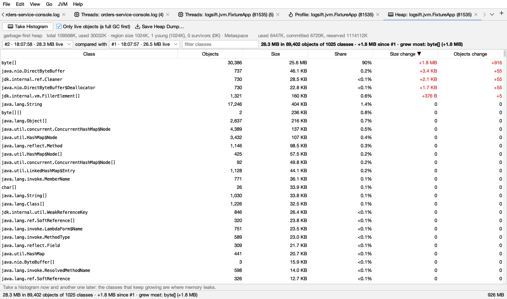
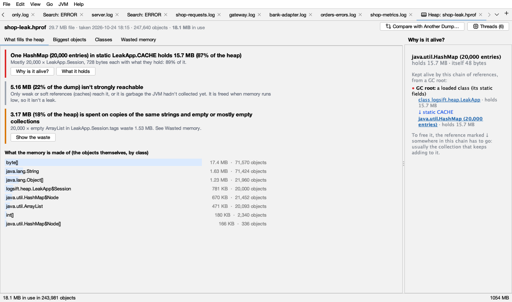
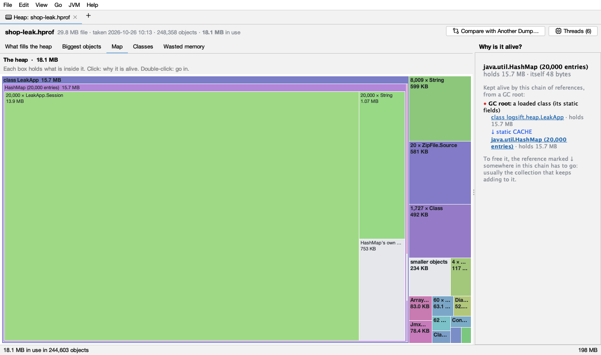
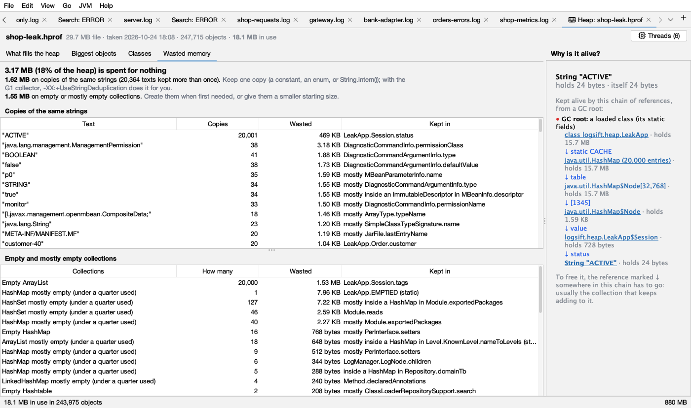
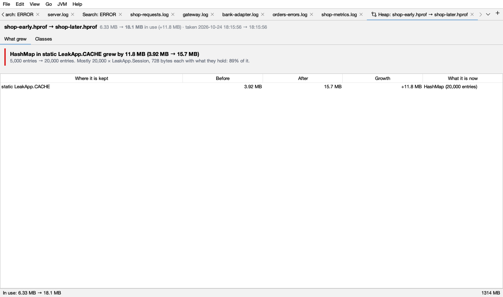
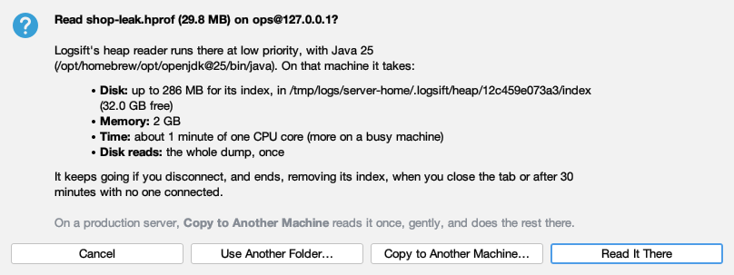

# Heap

Logsift shows what fills a JVM's memory in two ways:

- a **heap histogram** of a running JVM: how many objects of each class, and how big, taken in seconds;
- a **heap dump** (`.hprof`): every object and who holds it, so Logsift can say *what* keeps the memory and *why* it is still alive.

## Heap histogram of a running JVM

Connect to a JVM (see [JVM connections](jvm.md)), then click **Heap…** in its Threads tab, or **Heap** in the bar above its log.

- **Take Histogram** counts the heap by class. Columns: **Class**, **Objects**, **Size**, **Share** (of the heap). Click a header to sort; **filter classes** finds one.
- Take another a little later. With two or more, **compared with** picks the earlier one (the one before, by default), and the **Size change** and **Objects change** columns show what grew:  red `+…` grew,  blue `−…` shrank (the same in dark mode). The line at the top names what grew most. Classes that keep growing from one histogram to the next are where memory leaks.
- **Only live objects** (on by default) runs a **full garbage collection** first, so only objects still in use are counted. That pauses the JVM, longer for a big heap. Turn it off to count without the full GC, garbage included. Compare histograms of the same kind; Logsift says so when they aren't.
- **Save Heap Dump…** writes every object to a `.hprof` file and opens it. The JVM pauses while it is written, and the file is about as big as the heap in use. See [What each action costs](jvm.md#what-each-action-costs-a-running-service).

## Opening a heap dump

- **File → Open**, drag the file onto the window, or **JVM → Open Heap Dump…**. Any file ending in `.hprof` opens as a heap dump.
- **From a log:** when a JVM started with `-XX:+HeapDumpOnOutOfMemoryError` runs out of memory, it prints `Dumping heap to java_pid4242.hprof ...`. Right-click that line or the `OutOfMemoryError` line → **Open the Heap Dump**, or click **Open Heap Dump** on the known problem in [Insights](insights.md). Logsift looks where the log says the dump went, and next to the log. For a log read over SSH it offers **Copy Here** or **Read It There…** (see [On a server](#a-dump-on-a-server)).
- Opening the same file again goes to its tab.

While it reads, the tab shows the stage (*Reading the heap dump*, *Linking objects*, *Finding what holds what*, *Finding why objects are alive*) with a progress bar and **Cancel**. A dump of several GB takes a minute or more.

The header shows the file size, when the dump was taken, how many objects, and how much memory is **in use**. The tab is named **Heap: *file***.

## Two words first

- **Size** (or shallow size): the bytes of the object itself.
- **Holds** (retained size): what would be freed if this object went away, the object and everything only it keeps alive. A `HashMap` itself is small, but it can *hold* gigabytes.

Sizes are the JVM's own: 12-byte headers, 4-byte references with compressed pointers, objects aligned to 8 bytes. When the dump was taken without compressed pointers, the header says *sizes without compressed pointers*.

## What fills the heap

The first tab says in sentences what matters most. Each finding is a card with a coloured bar on its left (the same in light and dark mode):

| Colour | Finding | When |
|---|---|---|
|  red | **One *object* in *where* holds X (P of the heap)** | One object holds 10% of the heap or more |
|  amber | **X is spent on copies of the same strings and empty or mostly empty collections** | Wasted memory is 3% of the heap or more |
|  gray | **X isn't strongly reachable** | More than 5% of the dump is reached only by weak or soft references, or is garbage the JVM hadn't collected yet. It is freed when memory runs low, so it isn't a leak |

A red card reads like *"One HashMap (20,000 entries) in static LeakApp.CACHE holds 13.6 MB (85% of the heap). Mostly 20,000 × LeakApp.Session, 616 bytes each with what they hold."* Logsift follows the chain down while one part holds 80% or more of its parent, so it names the collection that is filling up rather than its internal array. Buttons:

- **Why is it alive?** shows the chain of references on the right.
- **What it holds** opens it in **Biggest objects**.
- **Show the waste** (amber card) opens **Wasted memory**.

With no red card, it says *"No single object holds 10% of the heap or more. The memory is spread out: see the biggest objects and the classes."*

Below the cards, **What the memory is made of** shows the 8 classes that take the most space themselves, as  light blue bars ( dark blue in dark mode), as wide as their share of the heap.

**What to do:** a red card is where to look for a leak. Check that the collection it names has a limit, and that entries are removed when they are no longer needed.

## Why is it alive?

The right side of the tab. Select any object (in any tab) and it shows the shortest chain of references from a **GC root** to it:

- the object, with what it holds and its own size;
-  a red dot and **GC root:** what the chain starts from: a loaded class (its static fields), a local variable in a method of a thread, a running thread, native code (JNI), a lock in use, or the JVM;
- then each step: ↓ field (in blue) and the object it leads to, with what it holds. Click an object to open it in Biggest objects.

To free the object, one link in that chain has to go: usually the collection that keeps adding to it.

*"Nothing keeps it alive through strong references"* means only weak or soft references reach it, or it is garbage: it would be freed.

## Biggest objects

A tree of every object with what it holds, biggest first, from **All objects in use**. Each row shows what it holds (bold), its share of the heap (gray; blank under 0.1%) and what it is (`HashMap (20,000 entries)`, `String "…"`, `byte[1,024]`). Open a row to see what is inside it. Each level shows the 200 biggest, then *… and N smaller*.

## Map

The heap as boxes, each as big as what it holds, with what it holds inside it.

- **Click** a box: why it is alive. The selected box gets a  amber outline ( yellow in dark mode).
- **Double-click** a box to go into it. The path at the top (*The heap › …*) goes back out; click any part of it, or press **Backspace**.
- **Hover** for details: what it is, where it is kept, how much it holds.

What the colours mean:

- Each **class has its own colour**, the same everywhere in the map. The colour says nothing good or bad; it just helps you see that boxes are of one class. Boxes nested inside others are a little lighter. Dark mode uses darker shades of the same colours.
-  **Gray** boxes ( in dark mode) are *smaller objects* taken together, and a collection's *own parts* (its table and entries).

How it is built: it looks through a collection's own parts to what is kept in it, and puts many objects of one class in one box (*20,000 × LeakApp.Session, 13.9 MB*). The 3 biggest objects of a class get their own box when each is 3% or more of their parent. Classes under 0.1% of their parent go into *smaller objects*. It shows three levels at a time.

## Classes

Every class, with **Objects** (how many), **Size** (their own bytes) and **Retained** (what they hold, freed with them). Type in **Filter classes** to find one. Click a header to sort. Select a class to see why its biggest object is alive.

## Wasted memory

Memory spent for nothing, and the field it sits in. Logsift works it out in the background once the dump is open.

The top line sums it up: *"X (P of the heap) is spent for nothing"*, with what to do.

**Copies of the same strings:** each text kept in 2 or more String objects. Columns: **Text**, **Copies**, **Wasted** (the bytes all but one copy take), **Kept in** (the field, such as `Session.status`). Keep one copy: a constant, an enum, or `String.intern()`; with G1, `-XX:+UseStringDeduplication` does it for you.

**Empty and mostly empty collections:** JDK lists, maps, sets and queues with nothing in them, or *mostly empty*: at least 8 unused slots and under a quarter used. Columns: **Collections**, **How many**, **Wasted**, **Kept in**. Create them when first needed, or give them a smaller starting size.

*Kept in* says *mostly …* when not all of them sit in that one place, and *nothing strong* when only weak references reach them.

Only the JDK's own collections are counted (ArrayList, Vector, HashMap, LinkedHashMap, HashSet, Hashtable, WeakHashMap, IdentityHashMap, ConcurrentHashMap, ArrayDeque, CopyOnWriteArrayList, LinkedList, TreeMap, TreeSet), not those of other libraries.

Select a row to see why one of them is alive.

## Threads

**Threads (N)** at the top right opens the dump's threads in the [Threads view](threads.md): names, states and stacks at the moment of the dump. A heap dump doesn't record which locks threads hold, so lock findings are missing.

## Comparing two dumps

**Compare with Another Dump…** (top right), or **JVM → Compare Two Heap Dumps…**, takes an earlier dump of the same program and says what grew, and where. The dumps are put in order by when they were taken.

- **What grew:** cards like *"HashMap in static LeakApp.CACHE grew by 11.8 MB (3.92 MB → 15.7 MB). 5,000 entries → 20,000 entries. Mostly 20,000 × LeakApp.Session."*, or **New:** for a place that wasn't there before. Up to 4 cards, for places with 5% or more of the growth. The table below lists every place that grew: **Where it is kept**, **Before**, **After**, **Growth**, **What it is now**.
- **Classes:** every class that changed, with **Objects before**, **Objects after**, **Growth** and **Size now**, most growth first.

Objects move between dumps, so places are matched by the chain of fields from a GC root that keeps them, not by address. When a place grows mostly because of a place inside it, the inner one is shown. Growth shows as `+X`, and a shrink as `−X`.

If nothing stands out: *"No one place holds the growth: it is spread out."* Then look at **Classes**.

Comparing works with two dumps on this computer, not with dumps read on a server.

## A dump on a server

**JVM → Open Heap Dump on a Server…** reads a dump where it is, over SSH, on a Linux or macOS server, so a 40 GB dump doesn't have to come to your computer. Pick the file and click **Read It There…**.

Logsift first looks at the server and asks before anything starts:

- **Disk:** up to the dump's size for its index, and how much is free there.
- **Memory:** 2 GB, plus the disk cache for its index. *little to spare* means under 3 GB is available.
- **Time:** about a minute of one CPU core for every 4 GB of dump.
- **Disk reads:** the whole dump, once (and the wasted-memory report after).

Buttons: **Read It There**, **Copy to Another Machine…**, **Use Another Folder…** (for the index, on a disk with room), **Cancel**.

It can't go ahead when there is no Java 8 or later on the server, or when the disk has less free space than the index needs plus 1 GB. Choose **Use Another Folder…** on a bigger disk, or copy the dump elsewhere.

How it runs: the reader is copied to `~/.logsift/heap` on the server and runs at low priority (`nice`, `ionice`). It keeps going if you disconnect; opening the same dump again reconnects. It ends when you close the tab, or after 30 minutes with no one connected. Its index is temporary files that go when it ends. Nothing else is removed there.

**Copy to Another Machine…** is for production servers: the dump is read once on the first server at low priority, copied to a folder on another server, and read there. The other server fetches it itself when it can sign in to the first with its own key and already knows its host key; else Logsift offers **Copy Through This Computer**. Logsift never overwrites a file: if the name is taken, choose another folder. A stopped copy leaves `NAME.part` there; Logsift says where, and doesn't remove it.

## Big dumps

When a dump is bigger than a third of Logsift's memory, its index goes to files on disk, in `~/.logsift/heap-index`, removed when the tab closes. The status bar then says *index on disk*. It needs free disk about the dump's size plus 256 MB; when there isn't enough, Logsift says so before it starts. A 12 GB dump with 223 million objects opens in about 2½ minutes with the app's usual 2 GB of memory.

## Limits

- HotSpot `.hprof` files only. Compressed `.hprof.gz` and OpenJ9 `.phd` aren't read: unpack a `.gz` first and open the `.hprof`.
- Weak, soft and phantom references don't keep anything alive here (as in the JVM when memory runs low).

If a dump can't be read, the tab says *"Could not read this heap dump: …"* with the reason, such as *not a heap dump (.hprof)* for another kind of file.
