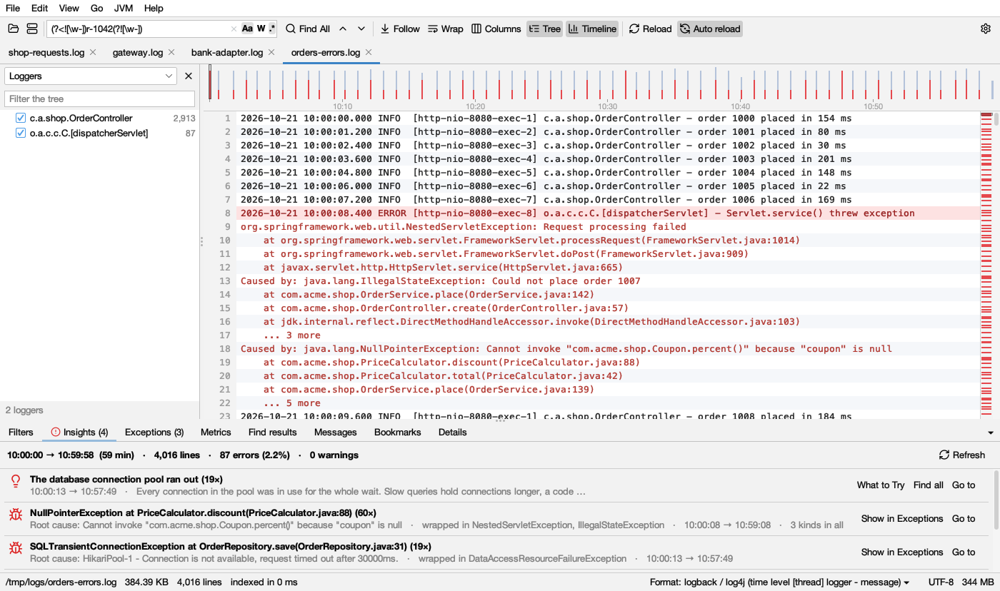

# Insights and messages

## Insights

The **Insights** tab (next to Filters, below the log) tells you at a glance what is going on in the log. It fills in by itself once a file is read, for files up to 2 GB; for bigger files, when you open the tab. Its title counts the red findings: **Insights (6)**, with a red icon, so you see them without clicking.

At the top: the time the log covers, how many lines, errors and warnings. **Refresh** looks again after the log grew (it says how many new lines there are).

### Colours

Each finding has an icon in its colour (the same in light and dark mode):

-  **red**: errors (bursts, new errors, frequent errors, exceptions, serious known problems).
-  **amber**: warnings (silences, restarts, things that never ended, spikes, the most common warning, lighter known problems).
-  **blue**: for information (noise).
-  **green**: *Nothing unusual*.

Findings are sorted red first, then by kind: bursts, new errors and known problems, exceptions, spikes, things that never ended, restarts, silences, errors, warnings, noise.

### The findings and their rules

| Finding | Colour | When | What to do |
|---|---|---|---|
| **Error burst *from – to*: N errors, N× the usual rate** | red | Errors came at least 4 times faster than on average (and at least 5 in a slice of time). Needs 10 errors or more and a log with times. At most 3 bursts | **Show these minutes** shows just that time. Look at what happened just before it started |
| **An error message** with *New: began at …* | red | One of the 4 most frequent error messages first appeared after the first tenth of the log (and at least twice). *stopped at …* when it ended before the last tenth | Something changed at that time: a deploy, a dependency going down |
| **An error message** with *N times · first → last* | red | One of the 4 most frequent error messages, there from the start | *x% of all errors* tells you which one to fix first |
| **Exception at *method* (N×)** | red | The 2 most frequent exceptions by root cause | **Show in Exceptions** (see [Exceptions](exceptions.md)) |
| **A known problem (N×)** | red or amber | One of about 30 problems that look the same in every log (below) | **What to Try** explains it |
| **N *things* started and never ended** | amber | Something that starts and ends (a job, a request) started and has no end. At most 2 | **Show in Metrics** (see [Metrics](metrics.md)). Often what hung |
| **High: *measurement*, *from – to*** | amber | A measurement in the messages was 3 times its usual median or more for a stretch (but not the whole log). Needs 50 values with times | **Show these minutes**, **Show in Metrics** |
| **Started N times** | amber | A start-up message (*Started … in N seconds*, *Tomcat started on port*, *listening on port* …) appears 2 times or more | The program restarted: look just before each start for why it stopped |
| **No lines for *duration*** | amber | A gap with no lines of at least 1 minute and 8 times the usual gap. At most 3 | The program was quiet, stuck or not running |
| **Most common warning** | amber | The most frequent warning message | |
| **One message is x% of the log** | blue | One message is a quarter of the lines or more (logs of 1,000 lines or more) | **Hide** it to see the rest |
| **Nothing unusual** | green | No red or amber finding | |

For files over 512 MB, the never-ended and spike findings are worked out when you open the Metrics tab.

### Buttons on a finding

- **Go to** (or click the row): goes to its line.
- **Show these minutes**: shows only the lines of that time. **Clear All** in the log's bar brings back the rest.
- **Find all** / **Show only** / **Hide**: that message's lines.
- **What to Try** (known problems): *What it usually means* and *What to try*.
- **Show in Exceptions**, **Show in Metrics**.
- **Open Heap Dump** (out of heap memory): opens the dump the JVM wrote, see [Heap](heap.md).

### Known problems

| Problem | Colour | What to try, in short |
|---|---|---|
| The JVM ran out of heap memory | red | Compare heap histograms over time, or profile live objects. Add `-XX:+HeapDumpOnOutOfMemoryError`. If nothing grows, raise `-Xmx` |
| The JVM ran out of Metaspace | red | Look for classes generated over and over. Raise `MaxMetaspaceSize` only if that many classes is expected |
| The JVM could not start more threads | red | Take a thread dump and look for many threads in pools with the same name. Check `ulimit -u` and the container's pids limit |
| The JVM ran out of direct memory | red | Profile native memory |
| Endless recursion (StackOverflowError) | red | The repeating frames in the stack are the cycle |
| The JVM crashed | red | Find the `hs_err_pid` file: its *Problematic frame* names the library. Update it or the JDK |
| Long garbage collection pauses | amber | If the heap after GC keeps growing, look for a leak; else more heap or CPU. See [GC logs](gc.md) |
| The database connection pool ran out | red | Look at what ran just before (slow queries, bursts). Compare the pool size with the threads that use the database |
| A thread pool was full | red | Take a thread dump while it happens: what the pool's threads wait on is the cause |
| Too many open files | red | Count open files over time. If they grow, find what isn't closed; else raise `ulimit -n` |
| The disk is full | red | `df -h`; check log rotation and temp folders |
| The port was already in use | red | Find what uses it, stop it, or use another port |
| The application failed to start | red | Read the *Description* and *Action* lines just after |
| A certificate is not trusted | red | Add it to the JVM's trust store |
| A host name could not be resolved | red | Check the host name; `nslookup` on the server |
| Connections were refused | amber | Was the service up then? Compare the address with its settings |
| Calls to another service timed out | amber | Look at that service's log at the same time ([merge](compare.md) the logs by time) |
| Database deadlocks | red | Touch rows in the same order, keep transactions short, retry |
| Waits for database locks timed out | amber | Find long transactions |
| The database refused more connections | red | Add up the pool sizes of every instance and compare with the database's limit |
| Kafka consumers were thrown out of their group | amber | Process batches faster, fewer records per poll, or a longer poll interval |
| Calls were rate limited | amber | Slow down or batch the calls, retry with backoff |
| The process was killed (out of memory?) | red | Compare the container's memory limit with `-Xmx` plus metaspace, threads and direct memory |
| Web workers were killed for taking too long (gunicorn) | red | Find what those requests waited on |
| Errors in asyncio tasks were never handled | amber | Keep a reference to every task and await it |
| Background tasks were retried (Celery) | amber | Look at a task's first failure; for lost workers, memory limits |
| Python ran out of memory | red | Process data in chunks |
| Endless recursion (RecursionError) | red | The repeating frames are the cycle |
| The database could not be reached (Python) | red | Check the database at that time |

## Messages (top messages)

The **Messages** tab groups the lines into kinds of messages and counts them, most frequent first. Parts that change (numbers, IDs, durations) are shown as ∗, so `Database connection lost after 26579 ms` and `… after 812 ms` count as one. Stack traces count with their line.

- **Analyze** (later **Analyze again**) counts. **Whole file** or **Lines shown by filters** (only the lines your filters and time range show).
- The level list: **All levels**, **Errors**, **Warnings**, **Errors and warnings**. *Errors* answers "what is going wrong?" in seconds.
- **search messages** filters the list.

| Column | Shows |
|---|---|
| **Count** | How many lines, with a bar as long as its share of the top message |
| **%** | Share of the counted lines |
| **Level** |  red for errors,  dark amber for warnings, gray for the rest |
| **Message** | The message, ∗ for the parts that change |
| **First**, **Last** | When it first and last appeared (or line numbers when the log has no times) |

**Double-click** a message to find all its lines. **Right-click**: **Find All**, **Show Only These Lines**, **Hide These Lines** (hide noise), **Mark These Lines**, **Copy Message**. Select several messages to hide them all at once.
