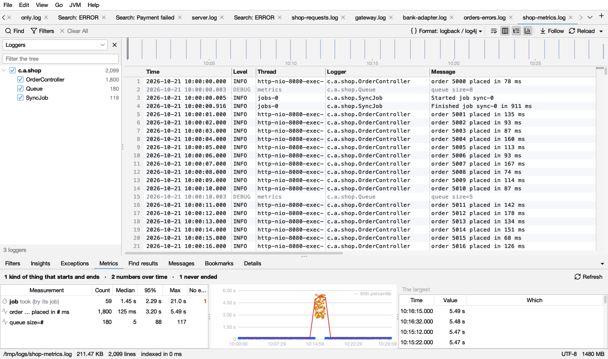
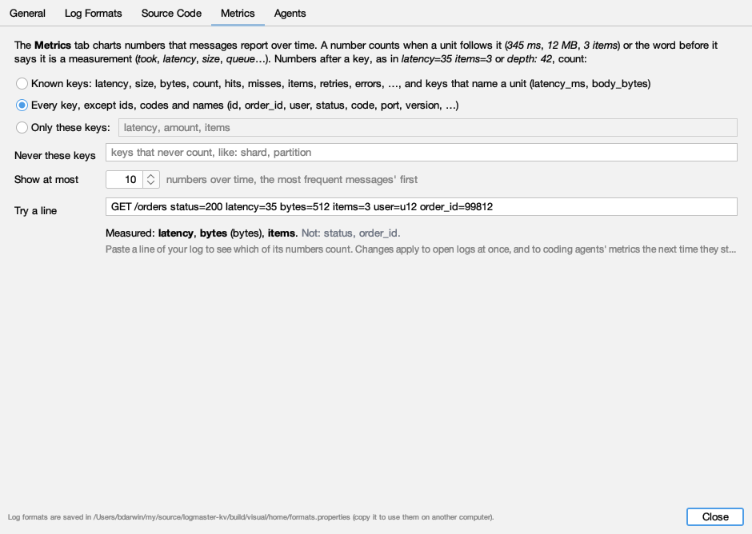
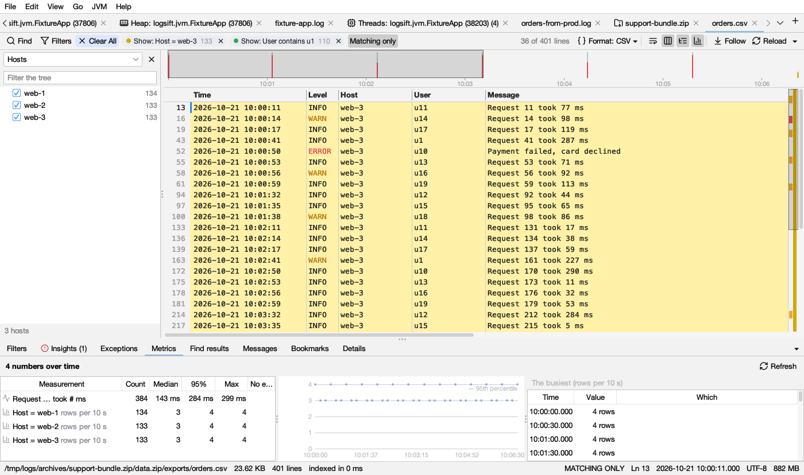
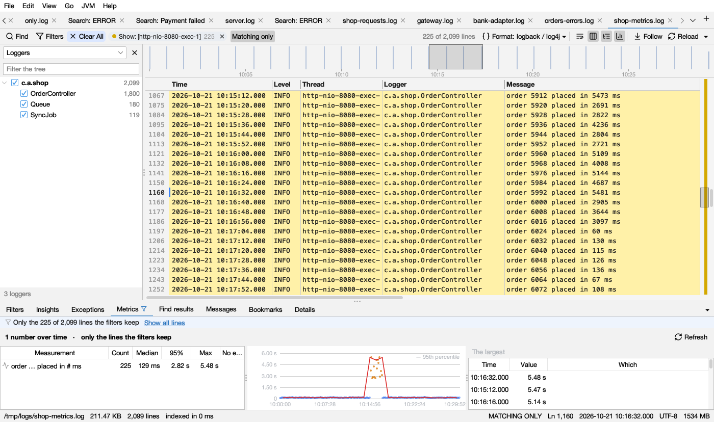
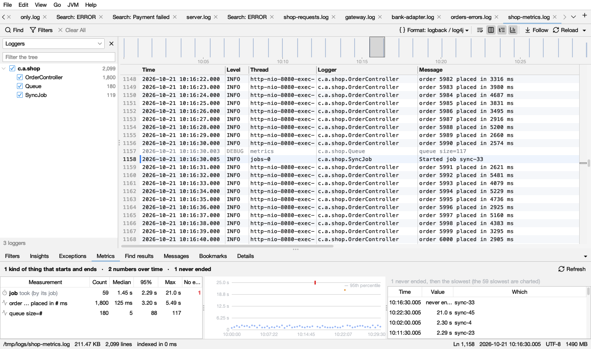

# Metrics

The **Metrics** tab (below the log) shows what the log measures, without any setup. Click **Refresh** to look again after the log grew.

## What it finds

- **Things that start and end:** message kinds that open and close something (*Started job sync-7* … *Finished job sync-7*, *Processing request r-12* … *Completed request r-12*) are found by their words. Lines are paired by the value they share (the job, the request), or else by thread. The list says which: *took (by its job)* or *took (by thread)*. Hover for the two messages.
- **Numbers in messages:** a number with a unit after it (`ms`, `s`, `MB`, `%`, `rows`), or a word like *took*, *size*, *latency* or *queue* before it: *order … placed in **#** ms*, *queue size=**#***. Order numbers and IDs are not measurements. A message kind needs 20 lines or more. Durations are in milliseconds and sizes in bytes, whatever unit each line used. The 10 measurements of the most frequent messages are shown (change it in Settings → Metrics).
- **Numbers after a key:** `latency=35 bytes=512 items=3`, `depth: 42`. Each number belongs to the key right before it, and a key's name can give its unit (`latency_ms`, `body_bytes`, `timeout_s`). Which keys count is set under [Which numbers count](#which-numbers-count).
- **Columns** of a CSV file, a JSON log or a layout with columns (see below).

## Which numbers count

**Which Numbers Count…** (top right of the tab) opens **Settings → Metrics**:

- **Known keys** (at first): *latency*, *size*, *bytes*, *count*, *hits*, *misses*, *items*, *retries*, *errors* and the like, and keys that name a unit (*latency_ms*, *body_bytes*).
- **Every key, except ids, codes and names**: every number after a key, but not *id*, *…_id*, *user*, *status*, *code*, *port*, *version* and the like.
- **Only these keys**: the keys you list.
- **Never these keys**: keys that never count, whatever the choice above.
- **Show at most**: how many measurements of messages the tab shows (10 at first, up to 100).
- **Try a line**: paste a line of your log, and see which of its numbers count.

Changes apply to the open logs at once. Coding agents' `metrics` tool uses them the next time the agent starts Logsift.

## Columns

When a log has columns, its columns are measured too:

- **A column of numbers** (with a unit, or more than 12 different values) is a measurement: *duration_ms*, *bytes*, *latency*, the access log's *size*. The unit comes from the value (*7 ms*, *1.5 s*, *2 KB*) or from the column's name (`_ms`, `_s`, `_bytes`, `_kb`, `_pct`; *duration*, *latency*, *elapsed* and *took* are taken as milliseconds). Columns that number things rather than measure them are left out, whatever their name says: IDs, ports, years, and numbers that only go up (a row number, an offset, a clock).
- **A column with a few values** (2 to 12, such as *status* or *host*) gives, for each of its most frequent values, how many rows have it in each stretch of time: *Host = web-1*, *rows per minute*. The stretch fits the log: per second for a log of a minute, per hour for a day. This needs times in the log. At most two such columns, the ones with the fewest values. [Insights](insights.md) doesn't report these (the [timeline](timeline.md) shows busy times).
- Time, level, thread, logger and message columns are not measured this way; the message is still read for numbers (above). In a CSV file only the message column is read for them, so a measurement is named by the message (*Request … took # ms*), once for all levels.

A column needs 20 rows or more. On big logs every n-th row is read, as for numbers in messages.

## With filters

With **Matching only** on and filters set (or a time range picked on the timeline), Metrics counts only the lines the filters keep. The tab's name then has a filter icon, and a strip at the top says how many lines are counted, with **Show all lines** (see [Which tabs follow the filters](filters.md#which-tabs-follow-the-filters)). It follows the filters as they change. Turn Matching only off to see the whole log again.

- **Things that start and end** are paired over the whole log first, so a filter doesn't split a start from its end. A span counts when its **start** line is kept.
- **Numbers in messages** and **columns of numbers** count the values on the kept lines.
- **Rows per stretch of time** count the kept rows.
- A measurement with nothing left on the kept lines is not listed.
- The list of message kinds always comes from the whole log, and the log isn't read again when only the filters change: switching filters is quick.
- [Insights](insights.md) always look at the whole log.

## The list

| Column | Shows |
|---|---|
| **Measurement** | A timer icon for things that start and end, a line icon for numbers in messages, a columns icon for a column of numbers, a bar icon for rows per stretch of time. The **#** marks the measured part |
| **Count** | How many |
| **Median** | Half are below this |
| **95%** | 95 in 100 are below this |
| **Max** | The largest |
| **No end** | Things that started and never ended, in  red. Often what hung |

## The chart

Select a measurement for a chart over time. Hover a dot for its time and value; click it to go to its line.

| Mark | Light | Dark | Means |
|---|---|---|---|
| blue dots |  |  | Each value |
| orange dots |  |  | A value 3 times the median or more: far above usual |
| red line |  |  | The 95th percentile over time (with 40 values or more) |
| red marks along the top |  |  | Things that started then and never ended |
| small triangles at the top | | | Values too big for the chart's height |

**How to read it:** a red line that climbs means things got slower for most, not just a few. A cloud of orange dots at one time is a slow spell: compare it with the [timeline](timeline.md) and [Insights](insights.md).

## Beside the chart

The lines that never ended, then the slowest (or largest) ones: **Time**, **Value**, **Which**. For rows per stretch of time, the busiest stretches (*12 rows*). Click one to go to its line (for a stretch, its first row with that value).

## In Insights

[Insights](insights.md) reports what never ended (*1 job started and never ended*) and when a measurement (in a message or a column of numbers) was far above usual (*High: order … placed in # ms, 10:15:00 – 10:16:59*: the median of that stretch was 3 times the usual median or more), with **Show these minutes** and **Show in Metrics**. For files over 512 MB this is worked out when the Metrics tab is opened.
