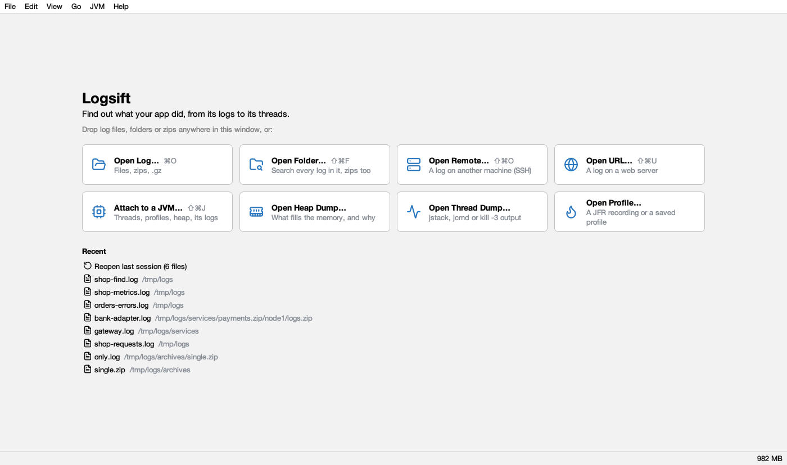

# Opening logs

## The start page

With nothing open, Logsift shows a start page. With logs open, **+** after the tabs shows it again.



| Button | Opens |
|---|---|
| **Open Log…** | Files, zips, `.gz` (Ctrl+O) |
| **Open Folder…** | A [folder search](folder-search.md): every log in it, zips too (Ctrl+Shift+F) |
| **Open Remote…** | A log on another machine over SSH (Ctrl+Shift+O) |
| **Open URL…** | A log on a web server (Ctrl+Shift+U) |
| **Attach to a JVM…** | Threads, profiles, heap of a running Java program (Ctrl+Shift+J); see [JVM connections](jvm.md) |
| **Open Heap Dump…** | A `.hprof` file; see [Heap](heap.md) |
| **Open Thread Dump…** | `jstack`, `jcmd` or `kill -3` output; see [Thread dumps](threads.md) |
| **Open Profile…** | A JFR recording or saved stacks; see [Profiling](profiling.md) |

Below them, **Recent**: **Reopen last session** and your last files. On macOS the shortcuts use ⌘ instead of Ctrl.

## Files

- **File → Open…** (Ctrl+O), or drag files onto the window. A file that is already open is just selected.
- **Windows:** right-click a file or folder → **Open with Logsift** (a folder opens a search in it). Logsift is also in the **Open with** list of `.log`, `.txt` and `.out` files, without taking over what double-click does.
- **macOS:** Open With, or drop files on the Dock icon.
- **One window:** if Logsift is already running, files open in the same window.
- **File → Open Recent** lists the last 15 files. **File → Reopen Last Session** reopens the logs that were open last time; Logsift also does that at start (you can turn it off in [Settings](settings.md)). Each file remembers its filters, formula, level buttons, Matching only and position.

A big file shows its first lines at once and is indexed in the background; the status bar says *indexing…*, then *indexed in N ms*. A file on a slow network or cloud drive shows *Waiting for the file…* with **Cancel**.

## Zips and .gz files

- A `.zip` opens as a tab showing its folders and files as a tree (zips inside it too), with their sizes.

  

  - Double-click a file (or select several and press **Open**) to open it as a log.
  - **Merge by Time** merges the selected logs.
  - **Find in all files** (Ctrl+F in the zip's tab) searches every file in it.
  - **Filter files by name** narrows the tree.
- A zip with one file opens that file right away. A `.gz` file opens directly.
- A file from a zip is named by its place in it (`bundle.zip/logs/app.log`) and behaves like any log. It is unpacked to a temporary copy once, when first opened, so it doesn't follow the original.
- Zips inside zips are followed 5 levels deep.

## Web addresses

**File → Open URL…** (Ctrl+Shift+U) takes one or more `http`/`https` addresses, one per line (lines starting with `#` are skipped).

- **Sign in:** None, **User and password**, or **Token** (sent as `Authorization: Bearer …`). Passwords are not saved.
- One address opens in a tab. Several are downloaded into one temporary folder and searched together. A `.zip` or `.gz` download is unpacked.
- The file is a copy: it doesn't follow the server's file as it grows.
- **Certificates:** they count as trusted when Java or this computer trusts them (Windows' and macOS's own stores, where a company proxy's certificate usually is). When neither does, Logsift asks: **Open Anyway** (this time), **Always for *host***, or **Cancel**. Choose to open only if you trust the network and the server.

## WSL (Windows)

**File → Open from WSL…** opens your Linux home folder. Windows reaches WSL files directly (`\\wsl.localhost\Ubuntu\…`), so they open and follow like any other file, without SSH. The menu item shows only when WSL is installed.

## Command line and piped output

```bash
logsift app.log other.log      # open files
logsift --version              # print the version
kubectl logs -f my-pod | logsift -
docker logs -f my-app 2>&1 | logsift -
journalctl -f | logsift -
```

Piped output is saved to `~/.logsift/stdin/` as it arrives and followed like a growing log. Captures older than a week are removed. Piped input always gets its own window.

On macOS the command is `/Applications/Logsift.app/Contents/MacOS/Logsift`; on Linux `/opt/logsift/bin/Logsift` (`.deb`) or `Logsift/bin/Logsift` (`.tar.gz`). Add an alias for convenience.

## Logs on a server (SSH/SFTP)

**File → Open Remote (SFTP)…** (Ctrl+Shift+O).

1. **Server:** host, port (22) and user, then a **Password** or a **Private key** (`~/.ssh/id_ed25519`, `id_ecdsa` or `id_rsa` is suggested) with its passphrase. Click **Connect**.
2. **Files:** type a folder in the address bar (`/var/log`, `~/logs`, or a name relative to the folder shown) and press Enter, or double-click folders (`..` or Backspace goes up). Double-click a file or press **Open**.
3. **Load:** the **Last 50 MB** (by default) or the **Whole file**. A whole multi-GB file is a big read of the server's disk and network; the last few MB are usually enough.

Logsift keeps a local copy up to date while the remote log grows (new lines are fetched every second). It starts over when the file is truncated or rotated, and reconnects by itself if the connection drops: the status bar then shows *⚡ reconnecting… (reason)*. Every feature works on remote logs.

**Host keys** are checked against `~/.ssh/known_hosts`. For a new server, Logsift shows its key and asks whether to trust it and remember it. If a known server's key changed, the same question says *REMOTE HOST IDENTIFICATION HAS CHANGED*: answer **No** unless you know why it changed (see [Troubleshooting](troubleshooting.md#the-host-key-changed)).

Logsift remembers the server, user, key and the last folder per server, never passwords.

## Encodings

UTF-8, UTF-16 and Windows-1252 are detected by themselves. See [The log view](log-view.md#text-encodings).

## Export

**File → Export** saves lines to a new file: **Lines Shown by Filters…** (Ctrl+Shift+E), **Find Results…**, **Selected Lines…** or **Everything in the View…**. The original bytes are copied (line endings and encoding unchanged), so even large exports take seconds.
