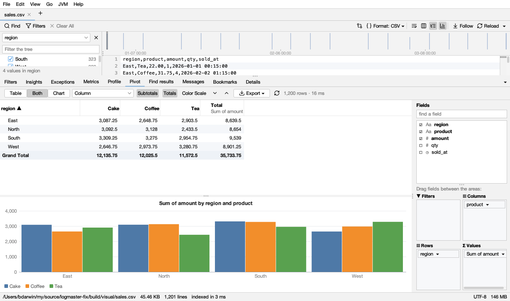
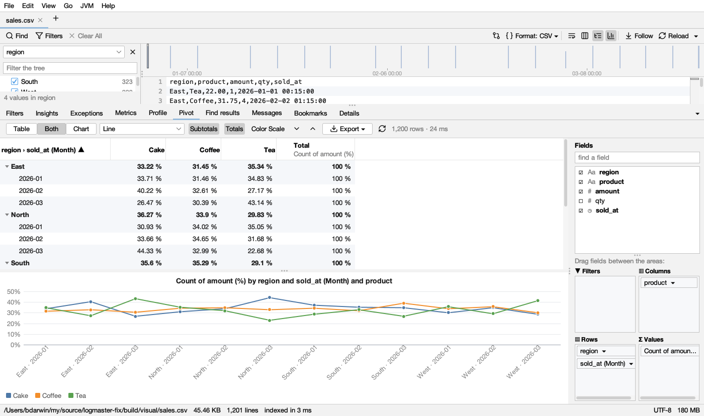

# Pivot

The **Pivot** tab (below the log, next to Profile) makes a pivot table of a table's rows, as in a spreadsheet, and a chart of it. It is there for every CSV or TSV file; for another log with columns, right-click a column title → **Pivot Table and Chart**. Every row is counted: nothing is sampled, and a million rows take about a second.

## Fields and areas

On the right, **Fields** lists the file's columns, each with its kind: **#** numbers, **◷** times, **Aa** text. **find a field** narrows a long list. It takes part of a name, or a pattern: `*` is any text and `?` one character. For example, `cpu_*` is every column starting with *cpu_*, `*_ms` every column ending in *_ms*, and `cpu_1?` is *cpu_10* to *cpu_19*. With more than one field shown, **Add the 10 to: Values · Rows · Columns · Filters** puts them all in that area at once (at most 200 at a time), which helps with tables of hundreds or thousands of columns. Put fields in the four areas below it:

| Area | What it does |
|---|---|
| **Rows** | Groups the rows down the side, one line per value. A second field groups inside the first (*region › month*), with a subtotal on each group's line |
| **Columns** | Splits each value across the top, one column per value of the field, plus a **Total** column |
| **Values** | What the cells hold: **Sum**, **Count**, **Count distinct**, **Average**, **Min**, **Max**, **Median**, **95th percentile** or **99th percentile** of a field (percentiles interpolated, as spreadsheets do; past a million numbers in a cell, from a fair sample of a million). With no values, the cells count the rows |
| **Filters** | Keeps only rows with some values of a field: click it → **Choose Values…** and untick the ones to leave out |

- **Tick** a field (or double-click it): numbers go to **Values** (summed), times and text to **Rows**. Untick it to take it out.
- **Drag** a field from the list to an area, or from one area to another; drag it out of the areas to remove it.
- **Click** a field in an area for its options: **Summarize by** (values), **Show values as** *% of the grand total*, *% of the row's total* or *% of the column's total*, **Group by** (times: *Year*, *Quarter*, *Month*, *Week*, *Day*, *Hour*, *Minute*, *Day of the week*, *Hour of the day*), **Move Up** / **Move Down**, **Move to** another area, **Remove**.
- Before any field is placed, a button offers a quick start, like *Sum of amount by region*.

The layout is remembered for each file (which fields are where, how they sum up and group), and comes back when you open the file again. A filter's chosen values aren't remembered.

## The table

- A group with groups inside has a **▸ / ▾**: click it (or double-click the label) to fold or open it. **⌄** opens every group, **⌃** folds them to the outermost.
- **Subtotals** shows a total on each group's line; **Totals** adds the **Grand Total** row and the **Total** columns.
- Click a **column's title** to sort by it: the labels A to Z (numbers and dates in order), a value largest first; click again for the other way. *(blank)* and *(other)* stay last.
- **Color Scale** colours each cell from its column's lowest value (red) to its highest (green), as in a spreadsheet.
- Select cells as in a spreadsheet; **Ctrl+C** (⌘C) copies them as tab-separated text with their titles. **Double-click a cell** (or right-click → **Show These Rows in the Log**) to see its rows: the log gets a filter for each of the cell's groups (*Show: region = North*). Times grouped by period aren't filtered.
- Numbers that aren't plain (*1,234.50*, *$12*, *50%*, *7 ms*) are read as numbers; cells that aren't numbers don't count in a sum or an average (a count counts them).
- More than 100,000 groups down the side, or 400 across, are put together as *(other)*, and the status says so.

## The chart

**Table | Both | Chart** shows the table, the table with its chart below, or the chart alone. The chart shows the table's rows (the innermost shown, folded groups as one) and a series per column (or per value): **Column**, **Stacked Column**, **100% Stacked Column**, **Bar**, **Stacked Bar**, **Line**, **Area**, **Stacked Area**, **Pie** and **Doughnut**. Hover a bar, a point or a slice for its numbers; click it to select its row in the table.

**Export ▾** saves the table as CSV or the chart as a PNG picture, or copies either (the chart as a picture to paste in a document or a chat).

## With the filters

Like Profile and Metrics, the pivot follows **Matching only**: with it on, it counts only the lines the log's filters keep, and the tab says so in a strip on top (*Only the 225 of 2,099 lines the filters keep*, with a link to count every line).
