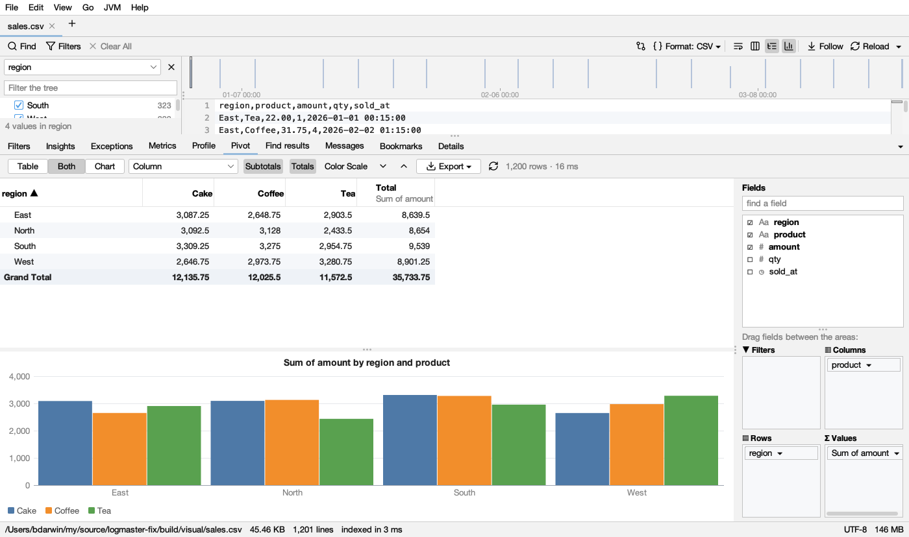
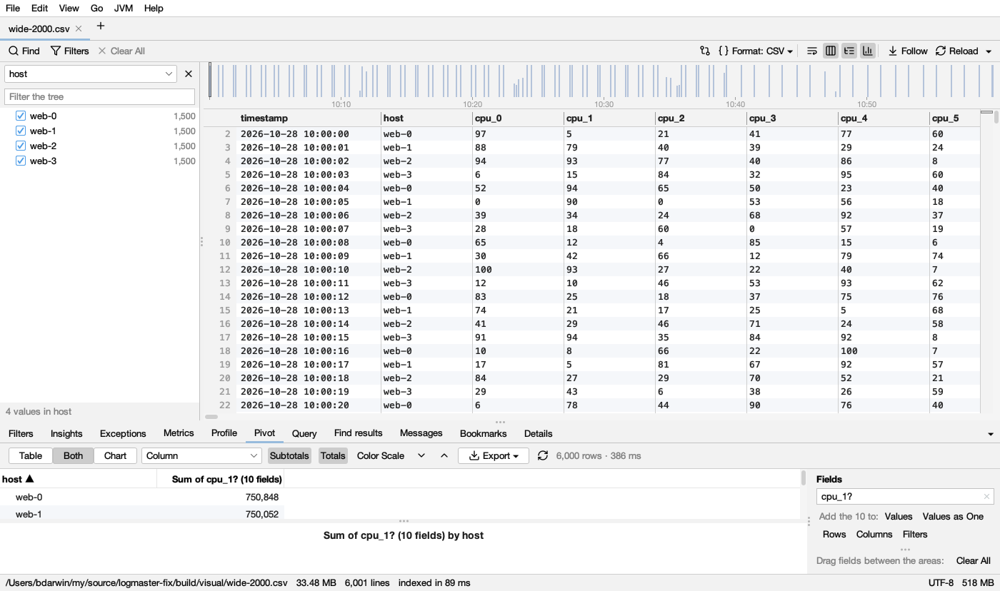
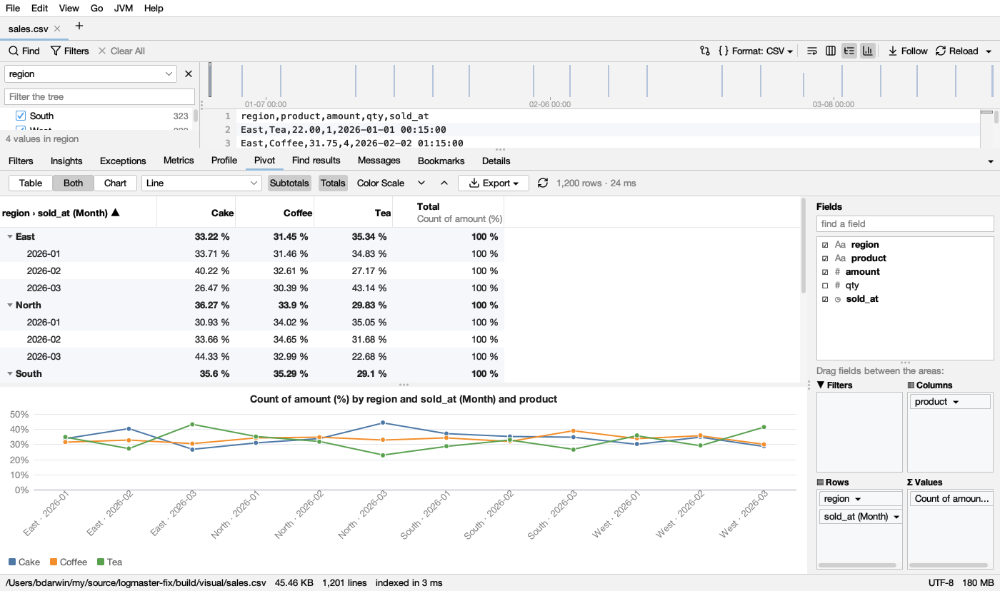
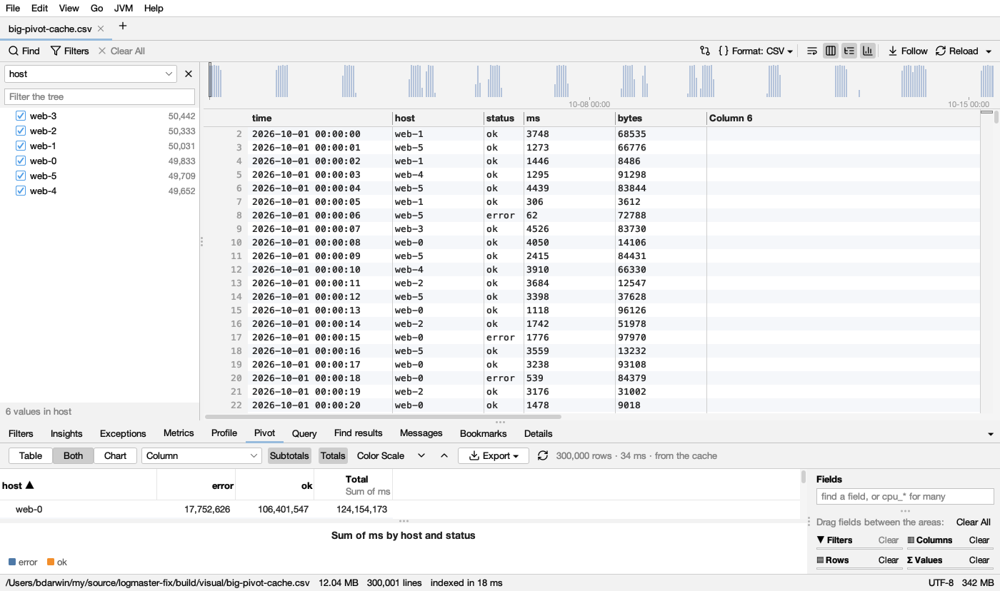

# Pivot

The **Pivot** tab (below the log, next to Profile) makes a pivot table of a table's rows, as in a spreadsheet, and a chart of it. It is there for every CSV or TSV file; for another log with columns, right-click a column title → **Pivot Table and Chart**. Every row is counted: nothing is sampled, and a million rows take about a second.

## Fields and areas

On the right, **Fields** lists the file's columns, each with its kind: **#** numbers, **◷** times, **Aa** text. **find a field** narrows a long list. It takes part of a name, or a pattern: `*` is any text and `?` one character. For example, `cpu_*` is every column starting with *cpu_*, `*_ms` every column ending in *_ms*, and `cpu_1?` is *cpu_10* to *cpu_19*. With more than one field shown, **Add the 10 to: Values · Values as One · Rows · Columns · Filters** puts them all in that area at once (at most 200 at a time), which helps with tables of hundreds or thousands of columns. Put fields in the four areas below it:

| Area | What it does |
|---|---|
| **Rows** | Groups the rows down the side, one line per value. A second field groups inside the first (*region › month*), with a subtotal on each group's line |
| **Columns** | Splits each value across the top, one column per value of the field, plus a **Total** column |
| **Values** | What the cells hold: **Sum**, **Count**, **Count distinct**, **Average**, **Min**, **Max**, **Median**, **95th percentile** or **99th percentile** of a field (percentiles interpolated, as spreadsheets do; past a million numbers in a cell, from a fair sample of a million). With no values, the cells count the rows |
| **Filters** | Keeps only rows with some values of a field: click it → **Choose Values…** and untick the ones to leave out |

- **Tick** a field (or double-click it): numbers go to **Values** (summed), times and text to **Rows**. Untick it to take it out.
- **Drag** a field from the list to an area, or from one area to another; drag it out of the areas to remove it.
- **Click** a field in an area for its options: **Summarize by** (values), **Show values as** *% of the grand total*, *% of the row's total* or *% of the column's total*, **Group by** (times: *Year*, *Quarter*, *Month*, *Week*, *Day*, *Hour*, *Minute*, *Day of the week*, *Hour of the day*, by the times as the file writes them, whatever your computer's time zone), **Move Up** / **Move Down**, **Move to** another area, **Remove**.
- Before any field is placed, a button offers a quick start, like *Sum of amount by region*.
- **Clear** at the top of an area takes every field out of it (in **Filters**: every filter, so all rows count again). **Clear All** empties every area, to start again.

### Many fields as one value

To see all of `abc_1`, `abc_2`, … `abc_40` summed up in one column, type `abc_*` in **find a field** and click **Values as One**. Values gets one field, *Sum of abc_\* (40 fields)*, and each cell holds every value of those fields for its group: put a field in **Rows** (say *host*) and each host's line has the sum of all its `abc_` numbers.

- **Summarize by** works on all their values together: *Count* counts the values that aren't blank, *Average* is the average of every value, *Max* the largest of any of them, and so on.
- Its menu has **Split into 40 Values**, to get each field in its own column again.
- It stays in **Values** (it can't be moved to Rows or Columns). It is remembered by its pattern, so when the file comes back with more `abc_` columns, they are counted too.

The layout is remembered for each file (which fields are where, how they sum up and group), and comes back when you open the file again. A filter's chosen values aren't remembered.

## The table

- A group with groups inside has a **▸ / ▾**: click it (or double-click the label) to fold or open it. **⌄** opens every group, **⌃** folds them to the outermost.
- **Subtotals** shows a total on each group's line; **Totals** adds the **Grand Total** row and the **Total** columns.
- Click a **column's title** to sort by it: the labels A to Z (numbers and dates in order), a value largest first; click again for the other way. *(blank)* and *(other)* stay last.
- **Color Scale** colours each cell from its column's lowest value (red) to its highest (green), as in a spreadsheet.
- Select cells as in a spreadsheet; **Ctrl+C** (⌘C) copies them as tab-separated text with their titles. **Double-click a cell** (or right-click → **Show These Rows in the Log**) to see its rows: the log gets a filter for each of the cell's groups (*Show: region = North*). Times grouped by period aren't filtered.
- Numbers that aren't plain (*1,234.50*, *$12*, *50%*, *7 ms*) are read as numbers; cells that aren't numbers don't count in a sum or an average (a count counts them).
- More than 100,000 groups down the side, or 400 across, are put together as *(other)*, and the status says so.

## The chart

**Table | Both | Chart** shows the table, the table with its chart below, or the chart alone. The chart shows the table's rows (the innermost shown, folded groups as one) and a series per column (or per value): **Column**, **Stacked Column**, **100% Stacked Column**, **Bar**, **Stacked Bar**, **Line**, **Area**, **Stacked Area**, **Pie** and **Doughnut**. Hover a bar, a point or a slice for its numbers; click it to select its row in the table.

**Export ▾** saves the table as CSV or the chart as a PNG picture, or copies either (the chart as a picture to paste in a document or a chat).

## With the filters

Like Profile and Metrics, the pivot follows **Matching only**: with it on, it counts only the lines the log's filters keep, and the tab says so in a strip on top (*Only the 225 of 2,099 lines the filters keep*, with a link to count every line).

## Big tables

A table of millions of rows, or of thousands of columns, is read once for the first pivot, then kept: Pivot stores the columns it used in a cache, and every pivot after that over the same columns takes milliseconds instead of reading the whole file again. The status says *from the cache*.

- The first pivot on a column takes a little longer while it's stored (the status says *Preparing these columns for quick pivots*). Five million rows of a few columns take a few seconds; the file is read once for all of them.
- Only the columns you use are kept, so a table of 6,000 columns doesn't fill the disk. **Values as One** over many fields keeps each row's count, sum, smallest and largest, so it's quick too (its count distinct, median and percentiles read the file).
- The answers are the same as reading the file: the same groups, blanks, numbers and time periods. Medians and percentiles are exact, where reading the file takes a fair sample past a million numbers.
- When the file changes (it grew, or was replaced), **Refresh** reads it again into a new cache. With **Matching only** on, Pivot reads the file, as the log's filters decide which rows count.
- [Column filters](filters.md#filters-on-a-column) use the same cache: a column filtered once is kept, and the next filters on it take milliseconds.
- Tables from 200 MB on are cached. **Settings → General → Pivot cache** sets how much room caches may take (5 GB at first; 0: no cache) and shows how much they use; **Empty** removes them (those of open files stay). They're kept in `.logsift/cache/pivot` in your home folder, and the oldest used go first when there's no room.

## For coding agents

Agents get the same Pivot through the **pivot** tool ([Coding agents](agents.md)): rows by one or more fields (`host`, `timestamp:hour`), columns by another, values such as `count`, `sum(ms)`, `avg(bytes)`, `median(ms)`, `p95(ms)`, `count_distinct(user)`, and a pattern for many fields as one (`sum(cpu_*)`). Filters keep some values (`status=500; host=web-1|web-2`), values can show as a % of the grand total, the row or the column, and groups can be sorted by their total. The answer is the table as text, with the same numbers as the Pivot tab.
