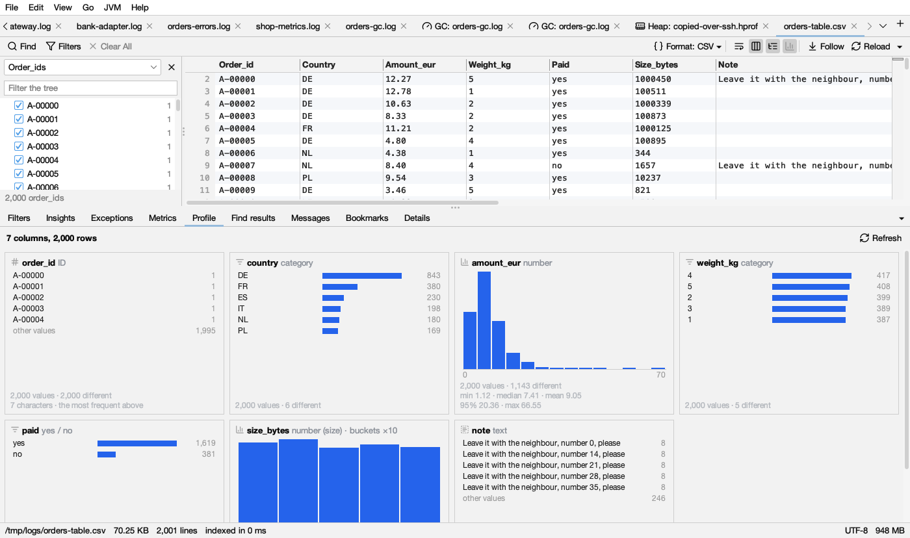

# Profile

A CSV file is often a table, not a log. The **Profile** tab (below the log, next to Metrics) shows what each column holds: one card per column, with its kind, how many values it has, and a small chart. It is there for every CSV or TSV file; for another log with columns, right-click a column title → **Profile of the Columns**. Click **Refresh** to read the columns again after the file grew.

## The kinds

Each column gets one kind, from its values:

| Kind | What the column holds | Its chart |
|---|---|---|
| **number** | Numbers (95% of its values or more), with many different values or a unit: *amount*, *duration_ms*, *size_bytes*. *(time taken)* or *(size)* follows when the values or the name have a unit | A histogram |
| **time** | Dates and times (or epoch numbers in a column named like a time) | Rows over time |
| **category** | Up to 20 different values that repeat: *country*, *status*, *weight 1 to 5* | The 10 most frequent values as bars, then *other values* |
| **yes / no** | Two values like *yes / no*, *true / false*, *1 / 0* | Both values as bars |
| **ID** | Many different short values: *order_id*, a number in a column named *id*, *code*, *key* | The 5 most frequent values, no chart |
| **text** | Many different values with words in them: notes, messages | The 5 most frequent values, no chart |
| **empty** | No values at all | None |

## The numbers on a card

- **values**, **empty** (with its share of the rows) and **different**: how many rows have a value, how many don't (an empty cell, `-` or `null`), and how many different values there are (*over 10,000 different* when there are more).
- Numbers: **min**, **median** (half are below), **mean** (the average), **95%** (95 in 100 are below) and **max**. Durations are shown in ms, s or minutes, sizes in B, KB, MB or GB.
- Times: the first and last time, and how long between them.
- IDs and text: how long the values are, in characters.

## The charts

| Mark | Light | Dark | Means |
|---|---|---|---|
| blue bars |  |  | How many rows have this value, or fall in this range |
| orange bar |  |  | The bar under the mouse |
| gray bar | | | *other values*: all the values not listed |

A histogram's buckets are round numbers (0–5, 5–10, …). When a column's numbers span several orders of magnitude (from 10 to a million, say), each bucket is ten times the one before, and the card says **buckets ×10**. The smallest and largest value are written under the chart. Hover a bar for its range and count.

## Filtering by a click

- Click a value (a category, yes / no, an ID): a filter **Show: Country = DE** is added on that column, and the log shows only those rows.
- Click a histogram bar: a filter **Show: Amount_eur between 5..10** (both ends included).
- Click a bar of rows over time, for the log's own time column: only that time range is shown.

These are [filters on a column](filters.md#filters-on-a-column): they show as chips and can be changed in the Filters tab. With **Matching only** on, the Profile counts only the rows the filters keep (*… · only the rows the filters keep*), and follows the filters as they change.

## Big files

A file with more than 200,000 lines is read in blocks of lines from all over the file, and the Profile says so: *in a sample of 200,000 of 12,400,000 lines*. Counts and *different* are then those of the sample.

## Tables without times

A CSV file without a time column has no [timeline](timeline.md); the Timeline button is grayed and says *No times in this file*. The [Metrics](metrics.md) chart its columns of numbers by row instead of by time (the **Time** column beside the chart then gives the line). A CSV file without a message column has no messages to group: the **Messages** tab says so, and [Insights](insights.md) only looks for errors and the like.
