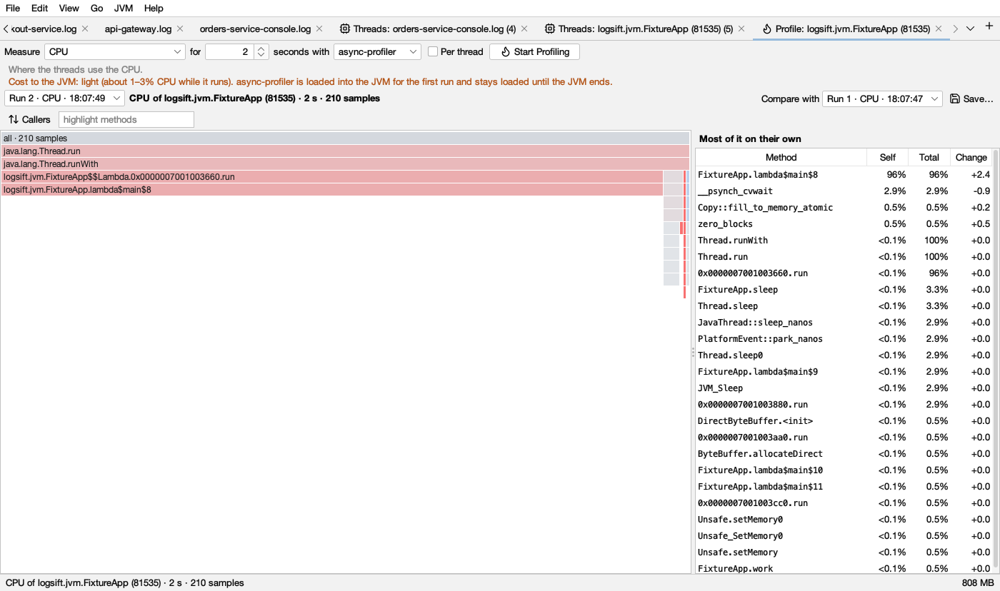

# Profiling and flame graphs

A profile shows where a running JVM spends its time, memory or lock waits, as a flame graph.

## Starting a profile

Connect to a JVM (see [JVM connections](jvm.md)) and click **Profile…** in its Threads tab, or **Profile** in the bar above its log. Then:

1. **Measure:** what to look at (below).
2. **for … seconds** (default 30).
3. **with:** the engine, **async-profiler** or **Flight Recorder**.
4. **Per thread:** one flame graph per thread, each thread's name on top.
5. **Start Profiling.** The JVM keeps running as usual. **Stop** ends a run early.

The gray line under the controls says what the mode shows and, in orange, what it costs the JVM.

| Measure | Shows | Engines |
|---|---|---|
| **CPU** | Where the threads use the CPU | both |
| **Wall clock** | Where the threads spend their time, running or waiting | both |
| **Allocations** | Where memory is allocated, and for what | both |
| **Live objects (memory leaks)** | Objects allocated during the run and still alive at its end: what makes the heap grow. Run it while memory use climbs | async-profiler |
| **Locks** | Where threads wait to get locks | both |
| **Native memory** | Where native memory (malloc, direct buffers) is allocated | async-profiler |
| **Native memory leaks** | Native memory allocated during the run and never freed (the last tenth of the run is left out: it may simply not be freed yet) | async-profiler |
| **Native locks** | Where threads wait for native (pthread) locks | async-profiler |
| **Calls of a method** | Every call of a method you name (`com.acme.Api.handle`, `java.io.FileInputStream.read*`), and where it comes from | async-profiler |
| **Slow calls of a method** | Calls slower than a time you give (default 50 ms), with their total time | async-profiler |
| **Hardware event** | Cache misses, page faults, context switches and the like (Linux) | async-profiler |
| **Everything at once** | CPU, wall clock, allocations, live objects, locks and native memory from one run | both (Flight Recorder: its own kinds) |

For a method, name one class: a `*` is allowed only in the method name (`com.acme.orders.Api.*`), since tracing the methods of many classes can make the JVM stop answering.

### The two engines

- **async-profiler** is built in, for JVMs on Linux and macOS. It offers every mode and also sees native code and the kernel. On Linux, CPU profiling uses perf events when the kernel allows them, and a timer otherwise; Logsift says so (*sysctl kernel.perf_event_paranoid=1* allows them).
- **Flight Recorder** is built into the JVM and works on any JVM with JFR, Windows included, and over a JMX port. It measures CPU, wall clock, allocations and locks.

### What it costs

- **Flight Recorder:** about 2–3% CPU while it records. The first recording in a JVM starts Flight Recorder there.
- **async-profiler:** CPU, allocations and hardware events are light (about 1–3% CPU). Wall clock: light, more with many threads. Locks: light to moderate where threads fight over locks. **Native memory** and **Everything at once** record every `malloc`: noticeable on busy native code; better not on a busy production JVM without need. Method modes instrument the method: every call costs a little, and the JVM recompiles some code. async-profiler is loaded into the JVM for the first run and **stays loaded until the JVM ends**.

See also [What each action costs a running service](jvm.md#what-each-action-costs-a-running-service).

## Reading a flame graph

- The **outermost calls are on top**, what they call below. The top bar, *all*, is everything recorded.
- Each frame is **as wide as its share**: of the CPU time, the time, the bytes allocated, the lock waits, and so on.
- A wide frame at the bottom of a column is where the cost is spent itself. A wide frame with many frames under it passes the cost on to what it calls.
- Under each frame, what it calls is put in order of size, the biggest on the left. Left to right is not time, and the height only shows how deep the calls go.

Hover a frame for its name, its share **with what it calls**, its share **on its own**, and what kind of code it is.

### Frame colours

The colour says what kind of code a frame is. Neighbouring frames vary a little in shade so they are easy to tell apart.

| Colour | Light | Dark | Kind |
|---|---|---|---|
| green |  |  | Java code (your code and libraries) |
| pale green |  |  | The JDK's own Java code (`java.`, `javax.`, `jdk.`, `sun.`, `com.sun.`) |
| teal |  |  | Inlined Java code, and the class an allocation or lock was for |
| yellow |  |  | Native code (C, C++, the JVM itself) |
| orange |  |  | The operating system's kernel |
| gray |  |  | *all*, and thread names with **Per thread** |
| pink |  |  | Frames that match **highlight methods** |

Frames above the one you zoomed into are faded.

### Looking closer

- **Click** a frame to zoom into it; click it again to go back up. **Show All** (or a double-click on empty space) shows everything.
- **Right-click** a frame: **Zoom In**, **Callers of** it (who calls it, all the way up), **Only Stacks Through** it, **Hide Stacks Through** it, **Highlight** it, **Copy Name**. A chip shows the focus; click its ✕ to see all stacks again.
- **Callers** turns the whole graph upside down: where the time is first, then who called it.
- **highlight methods**: type part of a name. Matching frames turn pink, and the share of what is shown is given next to it.
- **Most of it on their own** (right) lists methods with **Self** (on its own) and **Total** (with what it calls). Click one to highlight it; right-click for callers and filters.

### Which view

A run that measured several things (*Everything at once*, or a `.jfr` file) has a view list to pick CPU, Wall clock, Allocations, Locks and so on. Each run stays in the tab: pick an earlier one in the run list (*Run 2 · CPU · 18:07:49*).

## Comparing runs

**Compare with** picks an earlier run of the same kind. Each frame is then coloured by how its share (with what it calls) changed:

| Colour | Light | Dark | Means |
|---|---|---|---|
| red |  |  | Grew. Full red at 5 percentage points or more, or new since the other run |
| blue |  |  | Shrank. Full blue at 5 points or more |
| gray |  |  | Changed less than 0.2 points |

Between 0.2 and 5 points the colour is in between: the stronger the colour, the bigger the change. The method list gets a **Change** column: how the method's own share changed, in points.

**What to do:** after a change that made things slower, profile before and after under the same load, and look for the reddest wide frames.

## Saving and opening profiles

- **Save…** writes what is shown as collapsed stacks (`.collapsed.txt`). They open again here and in other flame graph tools.
- **JVM → Open Profile…** (or **A JFR recording, or saved stacks** on the start page) opens collapsed stacks and `.jfr` recordings. Each kind of event in a recording becomes a view.

## Messages you may see

- *async-profiler doesn't run on this computer; use Flight Recorder*: async-profiler runs only on Linux (x64, ARM64) and macOS JVMs.
- *Over a JMX port only Flight Recorder can profile*: connect over SSH or on that computer for the other modes.
- *Nothing was recorded in that time*: the JVM did none of that during the run (for example no lock waits). Try longer, or under load.
- *The recording stays at …*: a recording fetched from a server stays there. Logsift doesn't remove files on a server.
