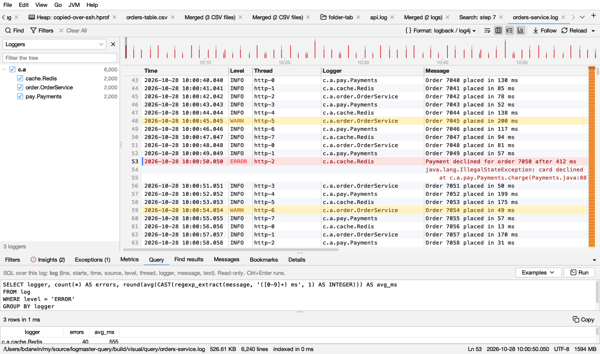
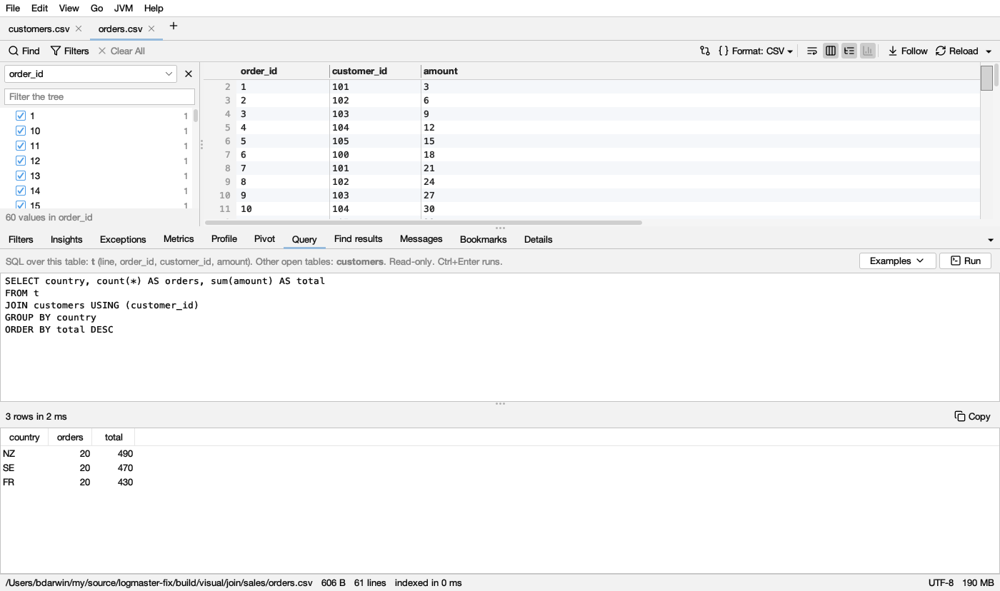
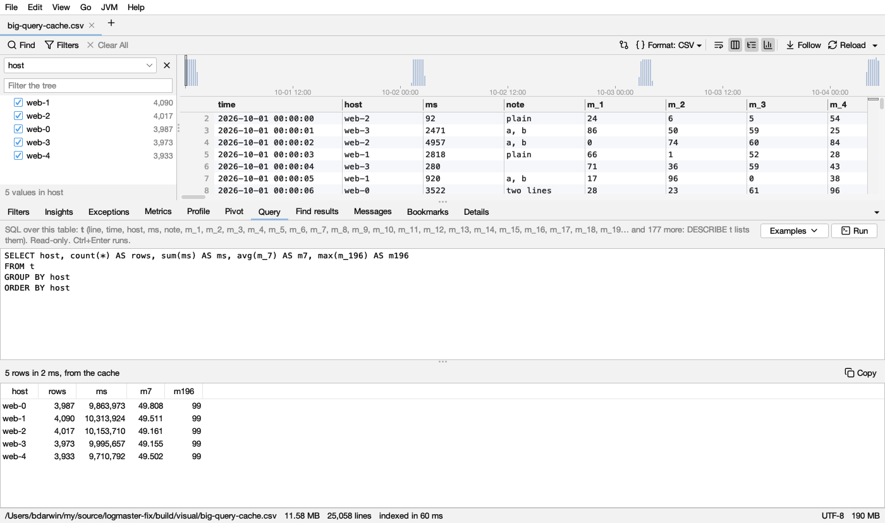
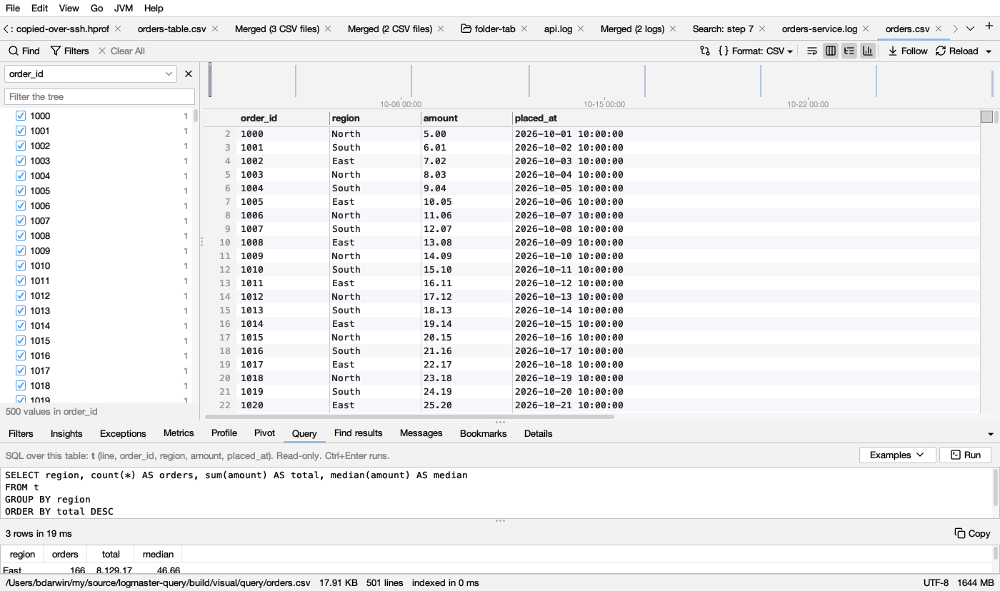

# Query

The **Query** tab (below the log) asks a log or a table anything you can write in SQL: counts, groups, time buckets, percentiles, the slowest requests, errors by logger per minute. It uses DuckDB, which answers in milliseconds over millions of lines.



## The tables

- **A log is the table `log`.** One row per line:

  | Column | Holds |
  |---|---|
  | `line` | The line number, as Logsift shows it |
  | `starts` | Whether the line starts an entry (*false* for the lines of a stack trace under it) |
  | `time` | The line's time, as Logsift reads it (empty when the line has none) |
  | `level`, `thread`, `logger`, `message`… | The log format's columns, whatever its format: your own formats too |
  | `text` | The whole line |

  The first query on a big log gets it ready: Logsift reads it into a table, on several processor cores, about 5 seconds for 300 MB. It does this once. When the log grows, only the new lines are added. A log that was replaced (rotated, truncated) is read again.
- **A table (CSV, TSV) is the table `t`.** It has `line` and then its columns, named as in its header. DuckDB reads the file itself, so even big files answer at once; the biggest ones are kept in a cache (see [Big tables](#big-tables)).

Use `"double quotes"` for a column name with spaces or capitals: `SELECT "Order Id" FROM t`.

### Other open tables

Every other table open in Logsift can be named in a query too, by its file's name: `orders.csv` is `orders`, `Sales 2026-Q4.tsv` is `sales_2026_q4`. The hint above the box lists them. Join one with this table or log:

```sql
SELECT country, count(*) AS orders, sum(amount) AS total
FROM t
JOIN customers USING (customer_id)
GROUP BY country
ORDER BY total DESC
```

**Examples** offers the join when the two tables share a column's name (here `customer_id`). A table closed since is no longer there.



## Big tables

A table of 200 MB or more is queried from the [Pivot cache](pivot.md#big-tables). The first query over some columns reads the file once and keeps those columns. After that, queries over them take milliseconds, however wide the table is: on 6,000 columns, a query that reads three of them reads only those three. DuckDB's plan of the query tells which columns it reads, before anything runs. The bar says *from the cache*.



- There, `t` is the table as Pivot reads it: numbers are numbers, times are times, values have their spaces trimmed, and a line break inside a quoted value is one line break (`\n`). `line` is the line each row starts at.
- Every column can still be named and described (`DESCRIBE t`); only the ones a query reads are kept.
- Some queries read the file in place, as for a smaller table: one that reads more than 64 columns not kept yet (`SELECT *` on a very wide table), a `PIVOT`, or one that reads another file.
- **Settings → General → Pivot cache** sets how much room the cache may take, or turns it off.

The hint above the box names the first 24 columns of a wide table; its tooltip has them all.

## Writing a query

Type SQL in the box and press **Run** (Ctrl+Enter, ⌘Enter on a Mac). **Examples** has queries to start from, made for the file:

- Lines per level, errors per minute, lines per hour.
- The most frequent errors, with numbers blanked so they group.
- Errors and warnings by logger, as a pivot.
- Durations in messages (*… 345 ms*), slowest first.
- Lines with a text.
- For a table, chosen by what its columns hold (numbers, times, text):
  - the first rows, and every column summarized (`SUMMARIZE t`);
  - rows per value;
  - count, average and highest of a number by a text column such as `host`;
  - the rows with the highest values, with the median and 95th and 99th percentiles;
  - rows per hour.
- For a wide table with many columns alike (`cpu_0001` … `cpu_1500`), all of them at once with a pattern, `COLUMNS('^cpu_[0-9]+$')`:
  - the average of each by host, and per minute;
  - their total in each row;
  - the rows with the highest value;
  - the columns turned into rows (`UNPIVOT`), highest average first;
  - finding a column by name in `DESCRIBE t`.

A column counts as numbers or times only when every value in its first rows is one, as DuckDB reading the file sees it. So each example runs as written, on a small table read in place and on a big one from the cache.

DuckDB's SQL has what you'd expect and more:
- `date_trunc('minute', time)`;
- `median(x)` and `quantile_cont(x, 0.95)`;
- `regexp_extract(message, '([0-9]+) ms', 1)`;
- `PIVOT … ON level USING count(*)`;
- `GROUP BY ALL`, and `count(*) FILTER (WHERE …)`.

See [DuckDB's SQL](https://duckdb.org/docs/stable/sql/introduction).

A query runs until it's done or you press **Stop**. A mistake is shown in DuckDB's own words. For a column that isn't there (`regoin`), that includes the columns that are (*Candidate bindings: "region"…*). It also names the line of the query where the mistake is, numbered as you wrote it.

## The results

At most 10,000 rows are shown. The bar says how many there were and how long the query took. Click a column's title to sort by it. **Double-click a row** that has a `line` column to see that line in the log. **Copy** copies the rows as tab-separated text, with the column names, for a spreadsheet.



## Read-only

Only queries run: `SELECT`, `WITH`, `FROM`, `PIVOT`, `SUMMARIZE`, `DESCRIBE`. Anything else (`COPY`, `ATTACH`, `INSTALL`, `SET`, `CREATE`…) is refused, so a query never writes a file or changes a setting. DuckDB's own parser checks each query before it runs, so a change hidden inside a query (a `WITH` that deletes or inserts, a second statement after a `;`) is refused too.

A query can read other files, for example to join this log with a CSV of orders: `read_csv('…/orders.csv')`. It can only read them in the log's folder and your home folder, and nothing on the network. DuckDB never downloads anything. Its settings are locked from the start, so a query can't change them, not even the folders.

## For coding agents

Agents have the same with the **query** tool: they give a log (or a CSV file) and a query over `log` or `t`. The **query_examples** tool gives them the examples above for the file. To join tables, they list the other files in `tables` (`tables=customers.csv`), and each is a table named after its file, as in the app. For them, SQL reads no file at all. Logsift reads the log, after checking the [folders agents may read](agents.md#what-it-cant-do), and secrets in the answer are masked.

A big table comes from the same cache as in the app, so what one has kept, the other uses. A table of more than 64 columns is too big for agents to load whole, so their queries there name the columns they need: `SELECT *` or a `PIVOT` is refused with a hint to name columns (`COLUMNS('cpu_.*')` for many alike) or use the **pivot** tool. A mistake, such as a column that isn't there, is told at once, with DuckDB's list of the columns that are.

## Where it doesn't work

DuckDB has a native library for each system Logsift is built for: Windows, macOS and Linux, on x64 and ARM. The zip for any Java has only Linux x64's. Elsewhere the tab says Query isn't available, and the rest of Logsift works as always.
