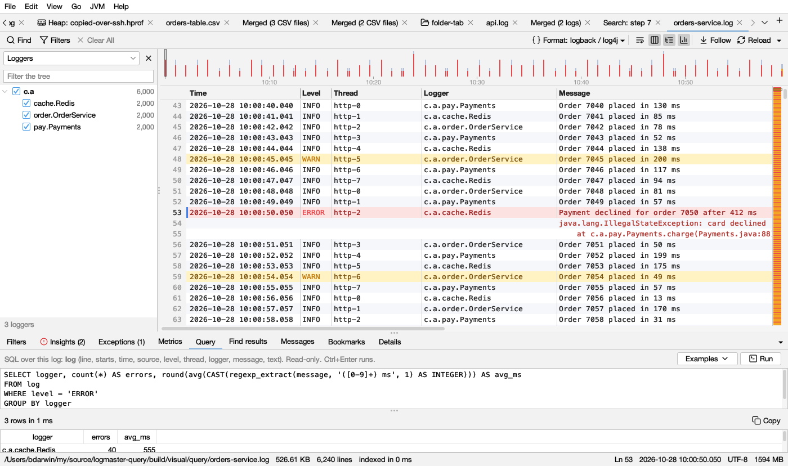
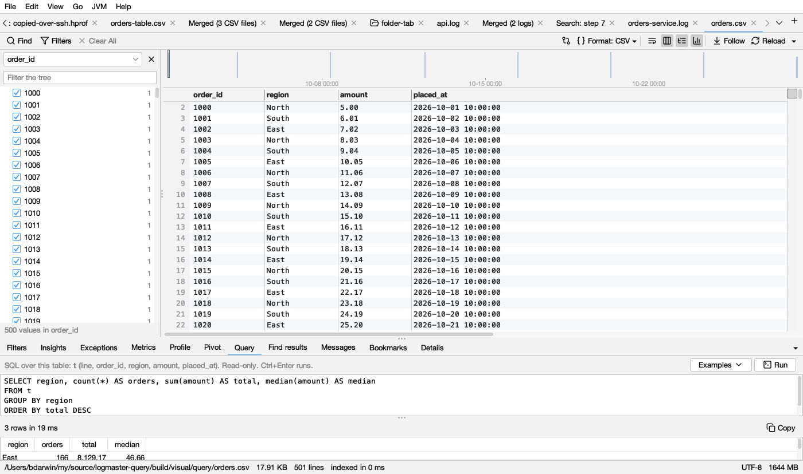

# Query

The **Query** tab (below the log) asks a log or a table anything you can write in SQL: counts, groups, time buckets, percentiles, the slowest requests, errors by logger per minute. It uses DuckDB, which answers in milliseconds over millions of lines.

## The tables

- **A log is the table `log`.** One row per line:

  | Column | Holds |
  |---|---|
  | `line` | The line number, as Logsift shows it |
  | `starts` | Whether the line starts an entry (*false* for the lines of a stack trace under it) |
  | `time` | The line's time, as Logsift reads it (empty when the line has none) |
  | `level`, `thread`, `logger`, `message`… | The log format's columns, whatever its format: your own formats too |
  | `text` | The whole line |

  The first query on a big log gets it ready: Logsift reads it into a table, on several processor cores, about 5 seconds for 300 MB. It does this once. When the log grows, only the new lines are added. A log that was replaced (rotated, truncated) is read again.
- **A table (CSV, TSV) is the table `t`.** It has `line` and then its columns, named as in its header. DuckDB reads the file itself, so even big files answer at once.

Use `"double quotes"` for a column name with spaces or capitals: `SELECT "Order Id" FROM t`.

## Writing a query

Type SQL in the box and press **Run** (Ctrl+Enter, ⌘Enter on a Mac). **Examples** has queries to start from, made for the file:

- Lines per level, errors per minute, lines per hour.
- The most frequent errors, with numbers blanked so they group.
- Errors and warnings by logger, as a pivot.
- Durations in messages (*… 345 ms*), slowest first.
- Lines with a text.
- For a table: the first rows, every column summarized (`SUMMARIZE t`), and rows per value.

DuckDB's SQL has what you'd expect and more:
- `date_trunc('minute', time)`;
- `median(x)` and `quantile_cont(x, 0.95)`;
- `regexp_extract(message, '([0-9]+) ms', 1)`;
- `PIVOT … ON level USING count(*)`;
- `GROUP BY ALL`, and `count(*) FILTER (WHERE …)`.

See [DuckDB's SQL](https://duckdb.org/docs/stable/sql/introduction).

## The results

At most 10,000 rows are shown. The bar says how many there were and how long the query took. Click a column's title to sort by it. **Double-click a row** that has a `line` column to see that line in the log. **Copy** copies the rows as tab-separated text, with the column names, for a spreadsheet.

## Read-only

Only queries run: `SELECT`, `WITH`, `FROM`, `PIVOT`, `SUMMARIZE`, `DESCRIBE`. Anything else (`COPY`, `ATTACH`, `INSTALL`, `SET`, `CREATE`…) is refused, so a query never writes a file or changes a setting.

A query can read other files, for example to join this log with a CSV of orders: `read_csv('…/orders.csv')`. It can only read them in the log's folder and your home folder, and nothing on the network. DuckDB never downloads anything.

## For coding agents

Agents have the same with the **query** tool: they give a log (or a CSV file) and a query over `log` or `t`. For them, SQL reads no file at all. Logsift reads the log, after checking the [folders agents may read](agents.md#what-it-cant-do), and secrets in the answer are masked.

## Where it doesn't work

DuckDB has a native library for each system Logsift is built for: Windows, macOS and Linux, on x64 and ARM. The zip for any Java has only Linux x64's. Elsewhere the tab says Query isn't available, and the rest of Logsift works as always.
