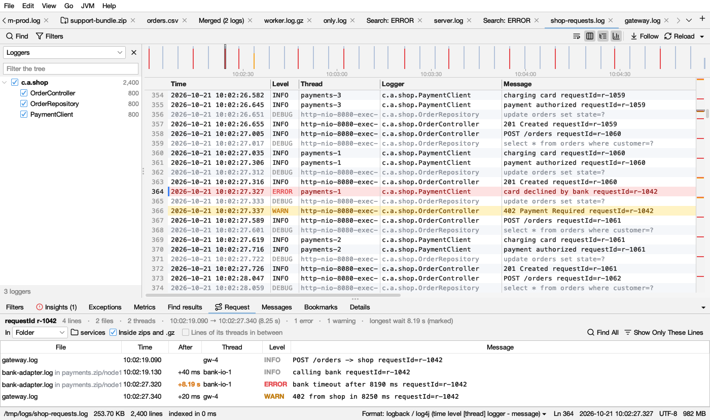

# Following a request

The **Request** tab shows every line of one request in order, across threads and files, with the time between them.

## Starting

- Right-click a line with a trace or request ID → **Follow traceId 4bf92f…**, or press **Ctrl+Shift+R** (⇧⌘R on macOS, **Go → Follow This Line's Request**).
- To follow anything else (an order number, a user), select it first, then right-click → **Follow "…" Through the Log**.

If the line has no ID, Logsift says so: select the text to follow and try again.

**IDs it recognizes:** `traceId=…`, `request_id: …`, `X-Request-Id`, `"correlationId":"…"` and any other key ending in *id*, the `[app,traceId,spanId]` and `[traceId-spanId]` that tracing libraries add, a W3C `traceparent`, and UUIDs. Process, thread and span ids are left out. With several IDs on a line, traces come first, then requests.

## What it shows

The top line sums it up: *6 lines · 2 threads · 10:02:19.097 → 10:02:27.337 (8.24 s) · 1 error · longest wait 8.20 s (marked)*.

| Column | Shows |
|---|---|
| **File** | Which file the line is in (only when the request spans several files) |
| **Time** | When it happened |
| **After** | Time since the line before |
| **Thread**, **Level**, **Message** | As in the log. Levels:  red errors,  dark amber warnings |

**The longest wait** is in bold  amber in the **After** column, and the table scrolls to it. That is usually where the time went. It is marked when it is at least a third of the whole request and 100 ms or more.

Click a line to go there in the log. Double-click a line of another file to open that file there.

## Options

- **In: This log / All open logs / Folder** picks where to look. With **Folder** (the log's own, or any folder or `.zip` you choose), every file in it is searched; **Inside zips and .gz** (on by default) looks inside archives too. Lines from all files are put in one order by time.
- **Lines of its threads in between:** logs often name the ID on only some lines of a request. This adds the lines its threads wrote between its first and last line, until a thread names another request's ID. These lines are  grayed ( in dark mode). Not available for a folder.
- **Find All** and **Show Only These Lines** run the same search in the log.

Up to 5,000 lines of one request are shown.
