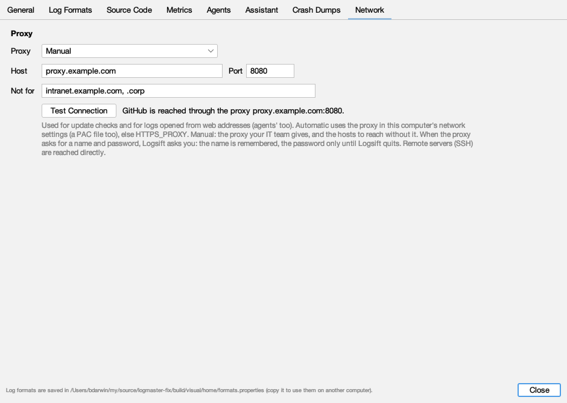

# Settings

**Edit → Settings…** (Ctrl+,), or **Logsift → Settings** on macOS (⌘,). Changes apply at once. Seven tabs: **General**, **Log Formats**, **Source Code**, **Metrics**, **Agents**, **Assistant**, **Crash Dumps**.

## General

| Setting | Default | What it does |
|---|---|---|
| **Font** and size | Automatic (the first installed of JetBrains Mono, Cascadia Mono, Consolas, Menlo, SF Mono, DejaVu Sans Mono, Liberation Mono, Ubuntu Mono), 13 | The font of logs. Ctrl+= / Ctrl+- also change the size |
| **Tab width** | 4 | How wide a tab character is |
| **Stripe every other line** | on | A faint stripe on every other line (also View → Line Stripes) |
| **Show the timeline** | on | The [timeline](timeline.md) above logs |
| **Dark mode** | off | Also View → Dark Mode |
| **Text that isn't UTF-8** | Windows-1252 | How to read files that aren't UTF-8 or UTF-16 (Latin-1, Cyrillic, Shift_JIS, EUC-JP, GB18030, Big5, EUC-KR, KOI8-R…). View → Encoding changes it for one file |
| **Check files for changes** | Twice a second | Less often uses less power with many open files, or files on network drives |
| **Two files dropped** | Ask each time | Two files dropped on the window: ask, compare them, or open each in its own tab |
| **At start: Reopen the files that were open last time** | on | Reopens the last session when Logsift starts without a file |
| **Check for new versions automatically** | on | At start and every 6 hours while Logsift stays open. Asks GitHub for the latest version number only (or the latest snapshot's commit); nothing about you or your logs is sent. When a new version is out, a blue **Logsift 1.4.1 is available** button appears at the left of the status bar, **Help** gets a dot (**Help •**), and its item becomes **Update to Logsift 1.4.1…** |
| **Update to** | what this Logsift is | *Releases*, or *Snapshot builds*: the latest of main, built from each change, to try fixes before they're released. A snapshot build follows snapshots until you choose releases |

### Updating

Click the status bar's button (or **Help → Check for Updates…**), then **Update and Restart**:

1. Logsift downloads the file for your computer, from GitHub only, with GitHub's certificate checked.
2. It checks the file against the release's SHA-256 checksums (`SHA256SUMS.txt`). A file that doesn't match isn't used.
3. It makes the new version ready beside the app; the running one isn't touched.
4. It restarts with the new version, and the files you had open open again. **When I Quit** puts the new version in place the next time you quit, instead.

How the new version goes in depends on how Logsift was installed:

| Installed from | What happens |
|---|---|
| macOS `.dmg` | The new Logsift.app replaces the old one |
| Windows `.msi` | The new installer runs, without questions |
| Windows `.zip`, Linux `.tar.gz`, the zip for any Java 21 | The new folder replaces the old one |
| Linux `.deb`, or a folder you can't change | Logsift downloads and checks the file, and shows it to you to install (`sudo apt install ./Logsift-….deb`) |

Self-update starts with 1.4.1: versions before it have no checksums to check against, so install 1.4.1 (or a snapshot build) by hand once. A Logsift you built yourself, or a beta, doesn't update itself. What the update did is written to `update.log` in Logsift's folder (`~/.logsift/updates`).

## Log formats

When Logsift doesn't know a log's layout, the Columns view says so and offers **Define Its Format…**. Formats are also under **View → Log Format → New Format from This Log…**. There are three ways to make one:

1. **Drop a log file here** (or **Open a Log File…**). Logsift guesses the layout from its lines (time, level, `[thread]`, logger, separators) and how its times are written.
2. **Or paste how your program logs**, then **Create Format**: a log4j, Log4j 2 or logback pattern such as `%d{HH:mm:ss.SSS} [%thread] %-5level %logger{36} - %msg%n`, a whole `logback.xml`, `log4j2.xml` or `log4j.properties`, Spring Boot's layout, a java.util.logging `SimpleFormatter.format`, or a Python logging format, `logging.conf` or `basicConfig(…)`. When a config has several layouts, each becomes a format.
3. **Write a Pattern Yourself…:** `{time} {level} [{thread}] {logger} - {message}`. Columns go in braces; everything else is matched as written. `{*}` skips a part. A regex with named groups like `(?<level>…)` works too.

Each format has a **Name**, a **Line pattern**, a **Time format** (empty for any common timestamp), and **Always use for** (file names like `app*.log; *.trace`). A preview shows sample lines split into columns.

A format is used when most of a log's lines fit it, or always for the file names you give. The log's bar shows the format each log is read with (**Format: …▾**, on the right); click it to choose another for that file, or **Plain text**. Levels in your format's level column drive the colours, the error marks and the E W I D T buttons.

Formats are saved in `~/.logsift/formats.properties`; copy it to use them on another computer.

## Source code

For opening a stack frame in your editor (see [Exceptions](exceptions.md#opening-your-source)):

- **Source folders:** your projects' source code. **Add Folder…**, **Remove**.
- **Open with:** *Automatic* (IntelliJ IDEA or PyCharm when installed, else Visual Studio Code), IntelliJ IDEA, PyCharm, Visual Studio Code, *The system's app for the file (without the line)*, or *My own command*.
- **Command** (for *My own command*): for example `myeditor --goto {file}:{line}`. `{file}` and `{line}` are filled in; put quotes around a path with spaces.

## Other settings in the menus

- **Help → Check for Updates Automatically**: the same as the update setting above.
- **View → Encoding**: reopens one log in another encoding.
- **View → Log Format**: the format for one log.
- Each log's view buttons (Wrap, Columns, Tree, Timeline, Follow, Reload Automatically) are remembered as the default for the next log you open.

## Where Logsift keeps its files

In `~/.logsift` (your home folder):

| File or folder | Holds |
|---|---|
| `formats.properties` | Your log formats |
| `metrics.properties` | Settings → Metrics: which numbers in messages count |
| `files/` | What each log remembers: filters, position, view |
| `bookmarks/` | Bookmarks and their notes |
| `errors.log` | Unexpected errors, every session (Help → Open Error Log; this session's in Help → Show Errors…) |
| `stdin/` | Piped output, kept a week |
| `heap-index/` | Indexes of big heap dumps, removed when their tab closes |
| `agent.properties` | Settings → Agents: what is masked, which folders agents may read |
| `agent.log` | Each call coding agents and the assistant made (never the answers) |
| `chat/` | The [assistant](assistant.md)'s chats (`chats.duckdb`), its settings (who answers, model, the copilot and claude programs: `settings.properties`; where it opens and what it's told: `assistant.properties`), and your own instructions for it (`instructions.md`). Copilot keeps its own sessions in `~/.copilot`, Claude Code in `~/.claude`; `chat/claude-work` is the folder Claude Code works in |
| `logs.json` | Log Locations for Agents: your services, their log folders and what each file holds |
| `crash.properties` | Settings → Crash Dumps: PDB folders, and whether Windows' names may be downloaded |
| `symbols/` | PDBs of Windows' own files, when you let Logsift download them |

Other preferences (window size, recent files, last folders, servers and users, never passwords) are kept in Java's preferences store for your user.

Logsift never sends your logs anywhere. Its only network connections are the update check (if on) and the servers you choose: SSH servers, JMX ports, and web addresses you open. With a Windows dump, it can also download the names of Windows' own files from Microsoft's symbol server, only when you click **Download Windows' Names** or turn that on under Crash Dumps. When you set up a [coding agent](agents.md), what Logsift answers it goes to the agent's AI provider.

## Network

The proxy Logsift uses for update checks and for logs opened from web addresses (coding agents' too). SSH servers and JMX ports are reached directly.

| Setting | Default | What it does |
|---|---|---|
| **Proxy** | Automatic | **Automatic:** the proxy in this computer's network settings (Windows' and macOS's, an automatic configuration script too), else the `HTTPS_PROXY` and `NO_PROXY` environment variables. **Manual:** the proxy your IT team gives. **None:** always connect directly |
| **Host**, **Port** | | A manual proxy, like `proxy.example.com` and `8080`. Until both are given, Logsift says what's missing and keeps to Automatic |
| **Not for** | | Hosts reached without the manual proxy, separated by commas: `intranet.example.com` (and its subdomains), `.corp`, `10.1.2.3`, `*` for all. This computer itself never goes through a proxy |

The line beside **Test Connection** says how GitHub is reached now (*directly*, or *through the proxy proxy.example.com:8080*). **Test Connection** reaches GitHub as an update check does and says what happened: *Reached github.com through the proxy …*, or what's wrong (a proxy that can't be found, doesn't answer, wants a sign-in, refuses GitHub, or shows secure connections with a certificate this computer doesn't trust).

When the proxy asks for a name and password, Logsift asks you (**Proxy Sign-In**): the name is remembered, the password only until Logsift quits. A proxy that signs you in as Windows does (NTLM, Kerberos) needs nothing.

## Crash Dumps

Where [Windows dumps](crash-dumps.md) find function names and source lines:

- **PDB folders:** folders with your program's `.pdb` files (and its `.exe` and `.dll` files, for minidumps). **Add Folder…**, **Remove**. Logsift also looks next to the dump, where the build put the PDB, and in the symbol caches named by `_NT_SYMBOL_PATH`.
- **Download the names of Windows' own files from Microsoft's symbol server:** off unless you turn it on. Only files under `\Windows` are asked for, by name and build id, never your program's. Downloads are kept in `~/.logsift/symbols`.

Coding agents use the same settings.

## Metrics

Which numbers in messages the [Metrics tab](metrics.md#which-numbers-count) charts: numbers after **known keys**, **every key except ids, codes and names**, or **only these keys**; keys that **never** count; and how many measurements to **show at most**. **Try a line** shows which numbers of a line of your log count. Saved in `~/.logsift/metrics.properties`.

## Agents

How to let a coding agent such as GitHub Copilot ask Logsift about your logs, what is masked in its answers, and which folders it may read. See [Coding agents](agents.md).

## Assistant

Who answers (GitHub Copilot or Claude Code, each your own program and sign-in), where the [assistant](assistant.md) opens (in a tab of its own, at the side of the window, or in a window of its own), whether it opens when Logsift starts, its text size (apart from the logs' font; ⌘+ and ⌘- in the assistant change it too), and what it's told before the first question: Logsift's instructions, where your logs are, the step-by-step plans, the date and time, and your own instructions. Each part shows about how many tokens it costs with each question, and its words. See [What it's told](assistant.md#what-its-told). **Audit** sets whether the [assistant's audit](assistant.md#the-audit-what-goes-wrong-and-whats-wasted) keeps what went with each question and the instructions, and when it flags a question: a tool's answer bigger than a size, more tokens, more time or more tool calls than set.
