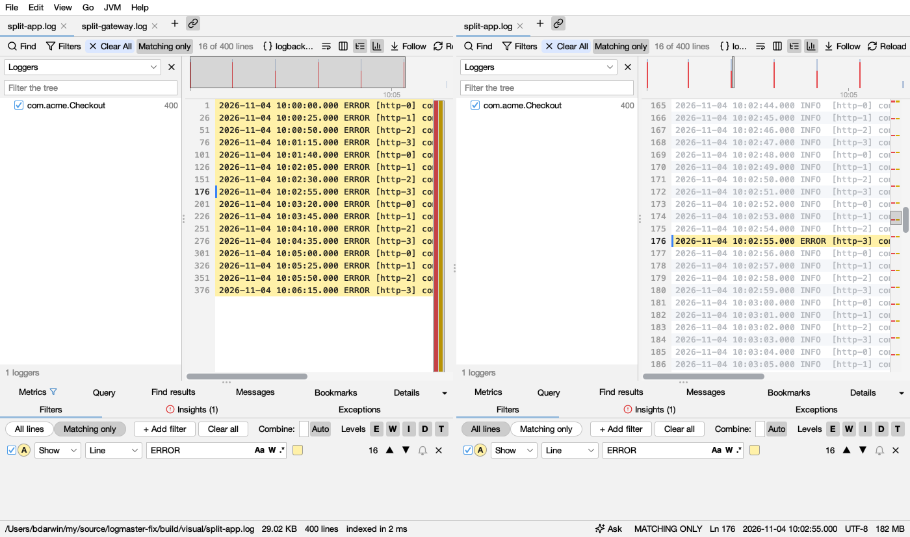
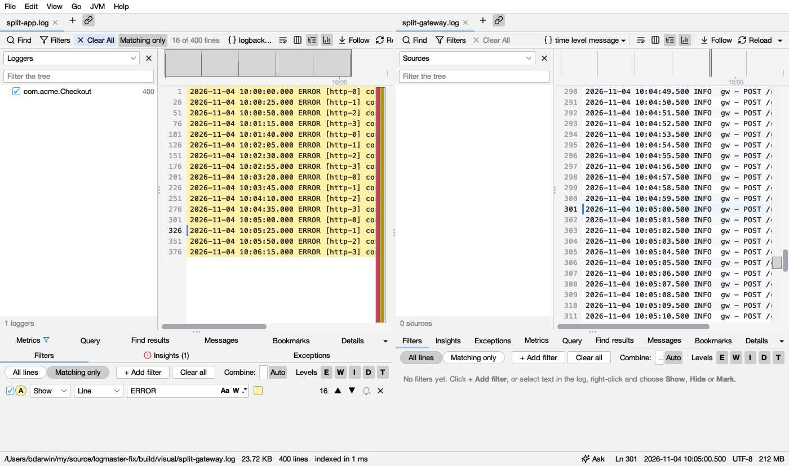
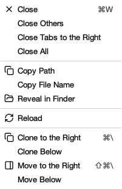

# Split view and tabs

The window can show two tabs at once: side by side, or one above the other. Put the same log on both sides (errors only on the left, the whole log on the right), or two logs of the same moments (the app's and the gateway's in front of it).

## Splitting

- **Clone to the Right** (right-click a tab, or **View → Split**, ⌘\ or Ctrl+\\): the log opens a second time on the other side, with the same filters, search, view and line. From then on each side changes on its own: clear the filters on the right to see the whole log, or add others. **Clone Below** puts it underneath.
- **Move to the Right** (⇧⌘\ or Ctrl+Shift+\\) and **Move Below**: the tab itself goes to the other side. The window needs a second tab to split this way.
- **Drag a tab** to the right edge of the window, or to its bottom, to split it there. When the window is split, drag a tab onto the other side's tabs to move it across.

Only a log read from a file can be cloned. Other tabs (a merged log, a remote log, a comparison, a heap dump) move instead.

The side you last clicked or typed in is the one in use: its tab is underlined in the accent colour, the other side's in grey. New tabs open there, and the menus act on its tab.

Closing a tab closes only that tab. When a side has no tabs left, the window is one again. **Join the Sides** puts all the tabs back in one row, in the same order.

## Scroll Together

With the window split, the link button after each side's tabs is **Scroll Together** (also in the tab menu and **View → Split**). It's on at first.

- **The same log on both sides:** the line you choose on one side is shown on the other. A side with filters keeps them and goes to the nearest line it shows.
- **Two logs:** the other side goes to the first line logged at the same time or after it, so you see what the other service was doing.

Choosing a line on either side moves the other one. Turn it off to move the sides on their own.

## A tab's menu

Right-click a tab:

| Item | What it does |
|---|---|
| Close, Close Others, Close Tabs to the Right, Close All | Closes tabs (on that side) |
| Copy Path | The file's full path; a remote log's `user@host:path` |
| Copy File Name | Only its name |
| Reveal in Finder / Show in Explorer / Show in File Manager | Opens its folder with the file selected; a log from a zip shows the zip |
| Reload | Reads the log again |
| Clone / Move to the Right or Below, to Other Side | See above |
| Join the Sides, Scroll Together | When the window is split |

Coding agents can do the same as Scroll Together with `read_lines` and a time (`at`): what another log was doing when a line was written. See [Coding agents](agents.md).
