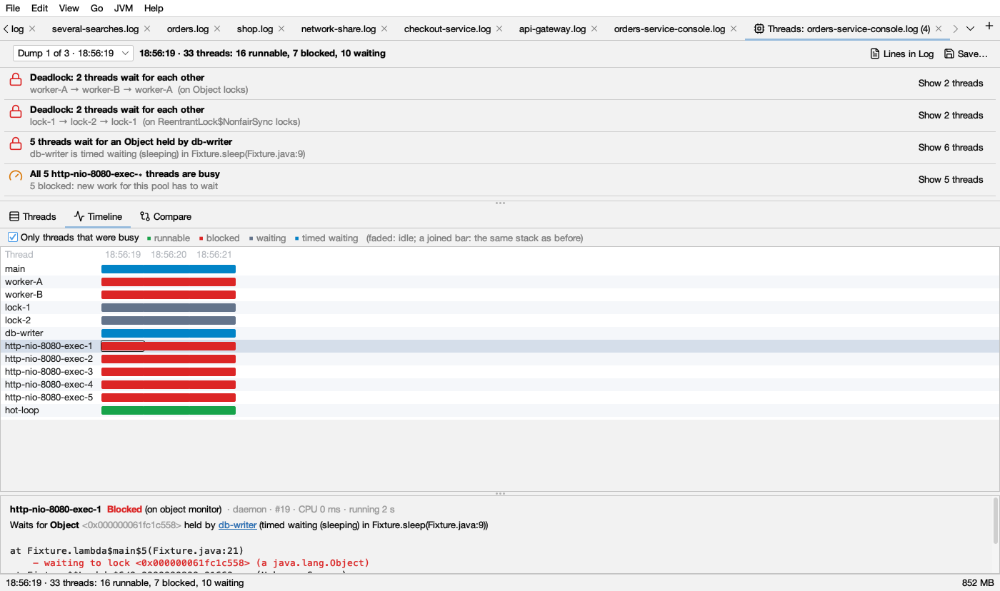

# Thread dumps

The **Threads** tab reads Java (and Python) thread dumps and starts with what stands out: deadlocks, threads queueing for a lock, stuck or busy threads, full pools.

## Getting thread dumps

- **JVM → Open Thread Dump…** reads `jstack` and `jcmd Thread.print` output, the plain and JSON files of `jcmd Thread.dump_to_file` (with virtual threads), and dumps saved by Logsift.
- **Dumps inside a log:** a log with `kill -3` dumps in it (a console log, `catalina.out`, `docker logs` output) shows a bar offering **Analyze Threads**. **JVM → Analyze Thread Dumps in This Log** does the same for any open log.
- **Python:** `py-spy dump` output and `faulthandler` dumps open the same way.
- **A running JVM:** **JVM → Attach to a Running JVM…**, then **Take Dump** (see [JVM connections](jvm.md)).

Several dumps in one file, or taken some seconds apart, are read as a series. With a series you also get stuck threads, CPU use, the timeline and compare.

The tab is named **Threads: *source***. When it found problems, their number follows: *Threads: app.log (4)*.

## The top bar

- **Dump i of n · time** picks the dump to look at (shown when there are several). Next to it: *33 threads: 16 runnable, 7 blocked, 10 waiting* (waiting includes timed waiting).
- **Take Dump** (a running JVM only): takes a dump now. The JVM stops for a moment: milliseconds, more with many threads.
- **Record…**: takes several dumps some seconds apart (default 6 dumps, 5 seconds apart). **Stop** ends it early.
- **Profile…** and **Heap…** (a running JVM only): see [Profiling](profiling.md) and [Heap](heap.md).
- **Lines in Log** (when the dumps belong to a log): shows only the lines the selected thread wrote.
- **Save…** writes all the dumps as a text file that opens again here, or in any other tool.

## Findings

The top of the tab lists what Logsift found, worst first. Each row has an icon coloured by how serious it is (the same in light and dark mode):

-  **red**: a problem now (deadlocks, long lock queues).
-  **amber**: worth a look.
-  **blue**: for information.
-  **green**: nothing unusual.

Click a row, or **Show N threads**, to list just those threads. A chip *Showing N threads of: …* appears; click its ✕ to see all threads again. A thread named by one finding isn't repeated in later ones.

| Finding | Colour | When | What to do |
|---|---|---|---|
| **Deadlock: N threads wait for each other** | red | Threads wait in a circle, each for a lock (monitor or `ReentrantLock`) the next one holds. They will never go on | The detail shows the circle (*worker-A → worker-B → worker-A*). Change the code so they take locks in the same order. Only a restart frees them |
| **N threads wait for a *Lock* held by *thread*** | red with 5 or more waiting, or when the same thread held it across more than one dump; else amber | 2 or more threads wait for one lock | The detail says what the holder is doing. Speed that up, or hold the lock for less time |
| ***Thread* uses NN% of a CPU core** | amber from 80%, else blue | With several dumps: 25% of a core or more between the first and last dump. With one dump: 50% or more on average since the thread started (threads running 10 s or more). At most 5 are listed | Look at its stack, or [profile](profiling.md) the JVM to see where the CPU goes |
| ***Thread* stuck in *method*** | amber | Same state and the same stack in every dump (needs 2 dumps or more). Idle and sleeping threads don't count | It is doing the same thing for the whole time: a slow call, a lock, or an endless loop |
| ***Thread* waiting in *method* for *time*** | blue | Like stuck, but waiting or timed waiting in your own code | Usually fine; check what it waits for |
| **All N *pool* threads are busy** | amber | Every thread of a pool of 4 or more (`http-nio-8080-exec-∗`) is doing something | New work for the pool has to wait. Find what the threads wait on; a bigger pool only helps if they wait on something that has room |
| **Threads grew from A to B** | amber | The count grew by 10 or more, and by 20% or more, across the dumps | The detail names the pool that grew. Threads that are never ended leak memory too |
| **Nothing unusual** | green | None of the above | Take a few dumps some seconds apart to see stuck threads and CPU use |

**Idle threads** (waiting for work) are left out of most findings. A thread counts as idle when it waits in a pool for a task, in a queue's `take`/`poll`, in `accept` or a selector, and the like. A thread waiting on a database, connection pool or HTTP call is **not** idle: that is work.

## Thread states and their colours

The same colours are used in the State column, the stack header and the timeline:

| State | Light | Dark | Means |
|---|---|---|---|
| **Runnable** |  green |  | Running, or ready to run (also in native code, such as reading a socket) |
| **Blocked** |  red |  | Waiting to enter a `synchronized` block another thread holds |
| **Waiting** |  slate gray |  | Waiting with no time limit (`wait()`, `park()`, `join()`) |
| **Timed waiting** |  sky blue |  | Waiting with a time limit, or sleeping |
| New, Terminated, Unknown |  gray |  | Not started, ended, or the dump doesn't say |

For Python dumps, an active thread shows as runnable and an idle one as waiting.

## Threads

The threads of the selected dump.

- **Group:** *No groups*, *Group by pool* (the default: `pool-3-thread-∗`), or *Group by same stack* (threads doing exactly the same thing). Click a group's header to open or close it.
- **State filter:** All states, Runnable, Blocked, Waiting (waiting and timed waiting), Busy (not idle).
- **search names and stacks** filters by text in thread names and methods.
- **JVM threads** (off by default) also shows the JVM's own threads (GC, compiler, VM threads).

| Column | Shows |
|---|---|
| **Thread** | The name. Idle threads are grayed |
| **State** | The state in its colour (see above). Hover for more, such as *sleeping* or *parking* |
| **CPU** | CPU time the thread used |
| **Where** | The first frame that isn't the JDK's: where in your code it is |
| **Lock** | *waits for … (held by X)* or *holds … · N waiting* |

Click a header to sort. Right-click a thread → **Show Lines of "…" in *log***, when the dumps belong to a log.

### The stack

Click a thread to see its stack on the right:

- The header: its name, its state in the state colour, then daemon, id, CPU and how long it has run.
- **Waits for *Lock* held by *thread*** and **Holds *Lock* — N threads wait for it**, each thread a link. Click one to go to that thread.
- Frames: your own code in full colour, the JDK's (`java.`, `javax.`, `jdk.`, `sun.`, `com.sun.`) grayed.
- Lock lines under a frame: *waiting to lock* in  red, *parking to wait for* and *waiting on* in  amber, *locked* in  blue ( lighter in dark mode).

## Timeline

One row per thread and one cell per dump, coloured by state (see the colours above). It needs two dumps or more.

- A **faded** cell: the thread was idle in that dump.
- **Joined** cells (no gap between them): the same stack as in the dump before. A long solid bar is a thread that didn't move, for example a long red bar is a thread blocked the whole time.
- An empty cell: the thread didn't exist then.
- **Only threads that were busy** (on by default) leaves out threads that were idle in every dump.

Click a cell to see that thread's stack in that dump.

## Compare

What changed between two dumps: choose **From** and **to**. **Only changes** (on by default) leaves out threads doing the same thing in both.

| Change | Colour | Means |
|---|---|---|
| **New** |  green | Not in the earlier dump |
| **Changed** |  amber | A different state or stack |
| **Gone**, **Same** |  gray | Ended, or doing the same thing |

Columns: **Change**, **Thread**, **Before**, **After** (state and place).

## Threads and their log

A log and its JVM are linked (see [JVM connections](jvm.md)):

- In a log, right-click a line → **Show Thread "…" in Threads** shows that thread's stack in a dump of the JVM, taking one if needed. A name the log cut short (`nio-8080-exec-1`) still finds `http-nio-8080-exec-1`.
- In the Threads tab, **Lines in Log** shows only the lines that thread wrote.

## Limits

HotSpot dumps are read (OpenJDK and its builds). OpenJ9 `javacore` files are not. A heap dump's threads (see [Heap](heap.md)) have no lock information.
